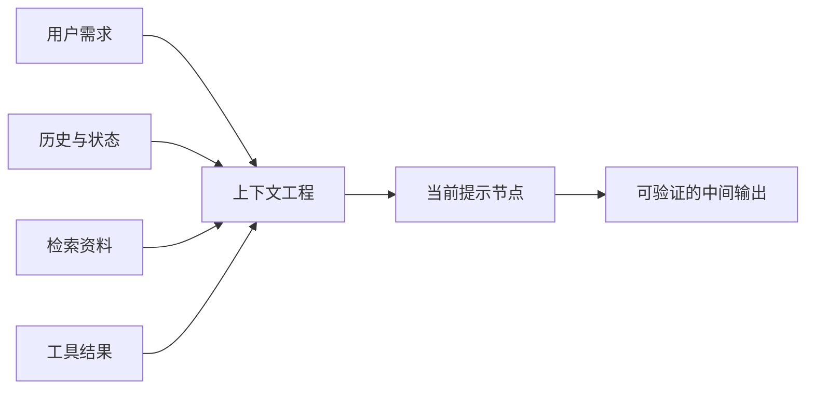
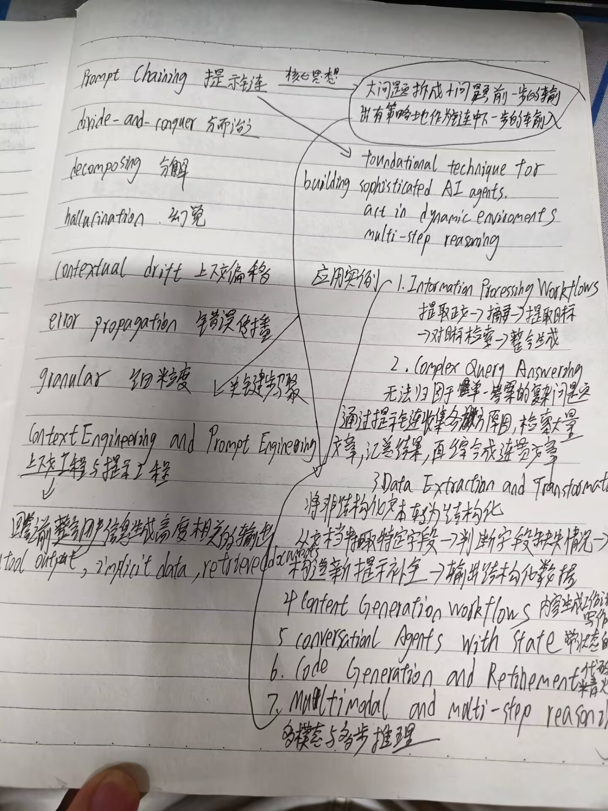
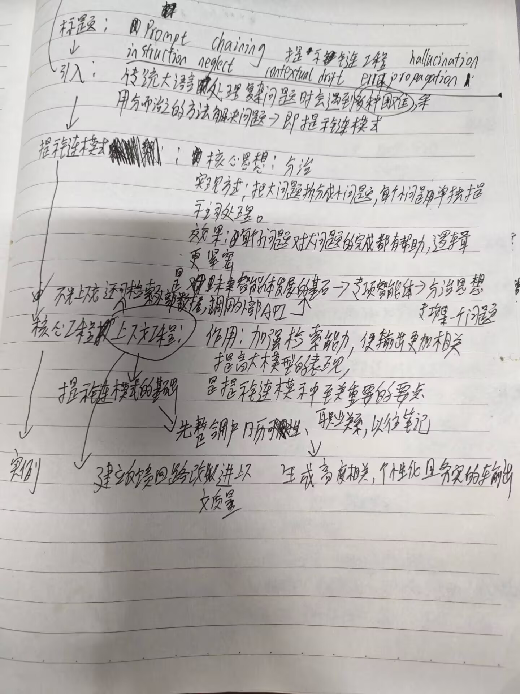

# 提示链：手写笔记整理

> 本文根据两张课堂手写笔记照片整理。保留原图便于核对；个别笔迹不清的地方按上下文归纳为概念性表述，而不是逐字转录。

## 一、提示链的核心定义

**Prompt Chaining（提示链）**是一种“分而治之”的工作方式：把一个大问题拆成多个小问题，每个提示词只处理一个子任务；前一步的输出经过组织后，作为链中下一步的输入。


它是构建复杂 AI 智能体的一项基础技术，尤其适用于动态环境中的多步推理任务。

## 二、要解决的问题

手写笔记指出，单次长提示词容易同时承受太多目标、约束和信息，从而出现以下风险：

- **Instruction neglect（指令忽视）**：模型漏掉部分要求。
- **Contextual drift（上下文偏移）**：推理或生成逐步偏离原始目标。
- **Hallucination（幻觉）**：缺乏依据时生成不可靠内容。
- **Error propagation（错误传播）**：早期错误传到后续步骤，并被逐渐放大。

提示链通过拆分任务、明确交接和分段验证，让问题停留在较小的范围内，避免整个工作流因一个模糊环节而失控。

## 三、关键原则

### 1. 分解，但保留依赖关系

任务拆分不等于把步骤彼此隔离。各子任务之间应有清晰的输入输出关系：前一步提供下一步所需的事实、约束或中间结论。

例如，复杂报告可以拆为：

```text
明确目标 → 提取资料 → 分主题总结 → 交叉检索 → 整合生成
```

### 2. 细粒度设计

将任务分到足够细的粒度，使每个节点只解决一个具体问题。这样做有三个好处：

- 提示词更容易写清楚；
- 中间结果可以单独检查；
- 出错时只修正一个节点，不必重做整条链。

### 3. 用结构化输出完成“握手”

节点之间最好传递结构化数据，而不是含义模糊的一段自然语言。常见输入包括：

- 工具输出（tool output）；
- 隐式数据，例如用户偏好、当前状态或历史上下文；
- 检索到的文档（retrieved documents）；
- 已验证的中间结论。

结构化的字段、格式和校验规则可以减少误解，使下游节点明确知道哪些信息可信、哪些字段需要继续处理。

## 四、上下文工程与提示工程

手写笔记将**上下文工程（Context Engineering）**与**提示工程（Prompt Engineering）**放在提示链的核心位置。

- 提示工程关注如何写好当前节点的指令；
- 上下文工程关注如何为当前节点提供完整、相关、及时的信息环境。

当需要处理多轮任务时，应先整合用户需求、背景资料、历史信息和工具结果，再把与当前步骤有关的部分交给模型。这样可以提高输出的相关性，帮助生成更高质量、更有针对性且更深入的内容。



## 五、应用场景

手写笔记列出了提示链适合的任务类型：

1. **信息处理工作流**：提取主题 → 摘要 → 提取实体 → 针对实体检索 → 整合生成。
2. **复杂问答**：将无法由单个步骤可靠回答的查询拆分、求解并汇总。
3. **数据提取与转换**：从非结构化文本抽取特定字段，校验与转换后形成结构化结果。
4. **内容生成工作流**：按提纲、段落、审核与修订等阶段生成内容。
5. **带状态的对话智能体**：在连续对话中维护用户需求、历史和当前任务状态。
6. **代码生成与优化**：先规划，再生成、审查、修正和完善代码。
7. **多模态与多步推理**：分别处理图像、文本等不同信息源，并在后续步骤整合。

## 六、复习要点

| 问题 | 记忆答案 |
| --- | --- |
| 提示链的核心思想是什么？ | 分而治之：大问题拆成小问题，前一步输出服务于下一步输入。 |
| 为什么不用一个超长提示词？ | 它容易引起指令忽视、上下文偏移、幻觉和错误传播，且难调试。 |
| 节点之间怎么交接？ | 优先用 JSON、XML 或固定字段等结构化方式，让信息可读、可校验。 |
| 上下文工程的作用是什么？ | 在生成前准备当前节点需要的相关信息，包括提示、检索、状态、历史和记忆。 |
| 最典型的应用是什么？ | 信息处理、复杂问答、数据转换、内容生成、对话智能体、代码生成和多模态推理。 |

## 原始笔记





