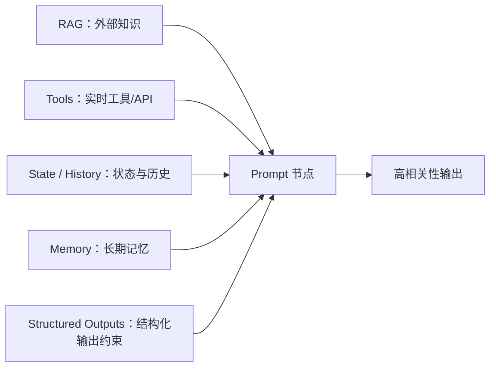
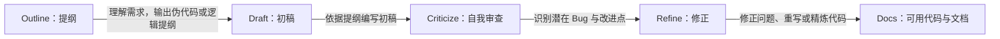

# 提示链工程：构建可靠的智能体工作流

> 提示链（Prompt Chaining）将复杂任务拆解为一组相互衔接的子任务：上一步的输出经过约束和整理后，成为下一步的输入。它是一种用“分而治之”构建可靠智能体工作流的基础模式。

## 为什么单一提示词容易失效

试图用一条很长的提示词解决所有问题，会把大量目标、约束和中间步骤同时交给模型处理，常见后果包括：

- **指令忽视**：模型遗漏或弱化较早、较不显眼的约束。
- **上下文漂移**：生成过程逐渐偏离任务目标或事实依据。
- **幻觉风险上升**：当信息不足或约束过多时，模型可能补造看似合理的内容。
- **错误传播**：一个小偏差在后续推理中被放大，最终导致整个任务失败。
- **难以调试**：整体式提示像“黑盒”，很难定位到底是哪一步造成了错误。

提示链不是让模型做得更多，而是让每个节点只做清晰、有限且可检查的一件事。

## 核心思想：分而治之

将庞大问题拆为可管理的子问题，并为每个子问题设计专用提示词、输入和输出格式。


这一模式把“用一个提示解所有问题”的思路，转变为可设计、可观察、可逐步验证的工程流程。

### 三个直接收益

1. **降低认知负荷**：每个节点只处理特定侧面，避免模型在同一轮承担过多约束。
2. **提高聚焦度**：每个提示词有单一职责，可针对提取、总结、判断或生成分别优化。
3. **稳健构建**：前一步的成功结果构成后一步的基础；出现问题时可在单个节点修复或重试。

## 运行机制：构建数字流水线

在提示链中，步骤 `N` 接收经过整理的上下文，并完成特定的逻辑变换；其输出直接成为步骤 `N + 1` 的输入。因此，节点之间形成严格的数据依赖关系。

```text
输入 → 提取 → 清洗/总结 → 实体识别 → 检索或判断 → 综合生成 → 最终结果
```

### 结构化握手：让节点明确交接

节点间不应只靠自然语言“猜测”彼此的输出。应尽量用 JSON、XML 或固定字段交接信息，使下游节点明确知道可读取什么、应该如何处理。

```json
{
  "task": "entity_extraction",
  "source_summary": "……",
  "entities": [
    {"type": "person", "name": "……"}
  ],
  "next_step": "database_lookup"
}
```

结构化输出减少歧义，也让失败更容易定位：问题可能出在提取、字段校验、下一步提示词，或最终整合，而不是模糊地归因于“模型回答不好”。

## 效果：从整体式提示到链式流程

| 评估维度 | 传统整体式提示 | 提示链模式 |
| --- | --- | --- |
| 认知负荷 | 很高，模型容易顾此失彼 | 较低，每一步遵循单一职责 |
| 错误隔离 | 一步出错，后续可能整体受影响 | 错误可限制在单一节点，并进行重试或替换 |
| 可调试性 | 黑盒，难定位失败原因 | 可观察每个中间输出，便于检查与修复 |
| 输出可靠性 | 波动较大，容易依赖概率性生成 | 通过确定的流程约束提升稳定性 |

提示链不只是解题技巧，更是提升系统可控性的标准化工程做法。

## 核心工程：上下文工程

**上下文工程（Context Engineering）**是在生成 Token 之前，为模型设计、构建并交付完整信息环境的系统方法。它不只优化一句提示词，而是组织模型在当前节点真正需要的全部信息。



上下文工程包含并协调：

- **Prompt Engineering**：明确当前节点的角色、目标、限制与成功标准；
- **Structured Outputs**：用明确字段规定输出，便于下游消费；
- **RAG**：从知识库提供与当前问题相关、较新的外部信息；
- **State / History**：保留任务进度、对话历史和用户身份等即时状态；
- **Memory**：保存跨任务的稳定偏好、经验或长期信息。

模型输出的质量不只取决于模型本身，也取决于此刻获得的上下文是否丰富、准确且相关。对链中的每一个节点，都应只提供完成该节点所需的信息，避免无关上下文重新造成干扰。

## 两个典型工作流

### 复杂信息处理与报告生成

适用于长文档分析、网页内容处理和综合业务报告。


这种切片式流程避免模型在阅读长文档时遗漏关键实体。每个节点都可以独立检查：提取是否完整、摘要是否忠实、实体是否准确、综合是否有据可查。

### 代码生成与自我修正

适用于 AI 辅助开发中从需求到可用代码的连续过程。



代码生成者与审查者在链中承担不同角色。通过把“生成”和“检查”拆开，可降低直接交付未经审查代码的风险。

## 适用场景

提示链特别适合以下需要多步处理、每一步都有明确中间结果的任务：

1. **信息处理工作流**：提取、摘要、实体识别、检索与整合生成。
2. **复杂问答**：把复杂查询拆成可验证的子问题，逐步求解后再整合答案。
3. **数据提取与转换**：从非结构化文本中抽取字段、校验格式、转换为结构化数据，并建立字段间关系。
4. **内容生成工作流**：先明确受众、目标与提纲，再逐段生成、审核和修改。
5. **带状态的对话智能体**：把用户需求、对话历史、工具结果与当前状态按步骤组织。
6. **代码生成与迭代**：提纲、初稿、审查、修正与文档化。
7. **多模态、多步推理**：将图像、文本或其他模态信息分别处理，再在后续节点汇合。

## 设计检查清单

- 每个节点是否只有一个明确职责？
- 节点输入是否包含完成当前任务所需、但不过量的信息？
- 是否为关键节点定义了结构化输出与字段校验？
- 是否能查看中间输出，并在失败时定位到具体节点？
- 是否对不确定、缺失或错误的结果设计了重试、澄清或人工复核？
- 是否避免让无关的历史信息持续进入后续上下文？

## 总结

提示链是构建复杂智能体的基础设施：它以线性的确定流程组织模型调用，用任务拆分降低复杂度，用结构化交接降低歧义，并以上下文工程为每个节点提供恰当的信息环境。在此基础上，规划、工具调用与自主多智能体协作才能更稳定地扩展。

