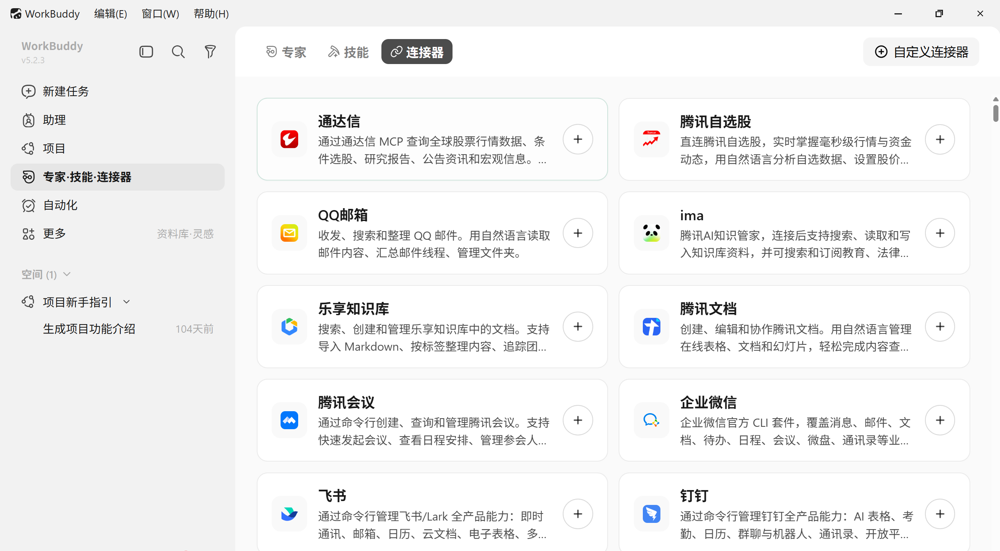
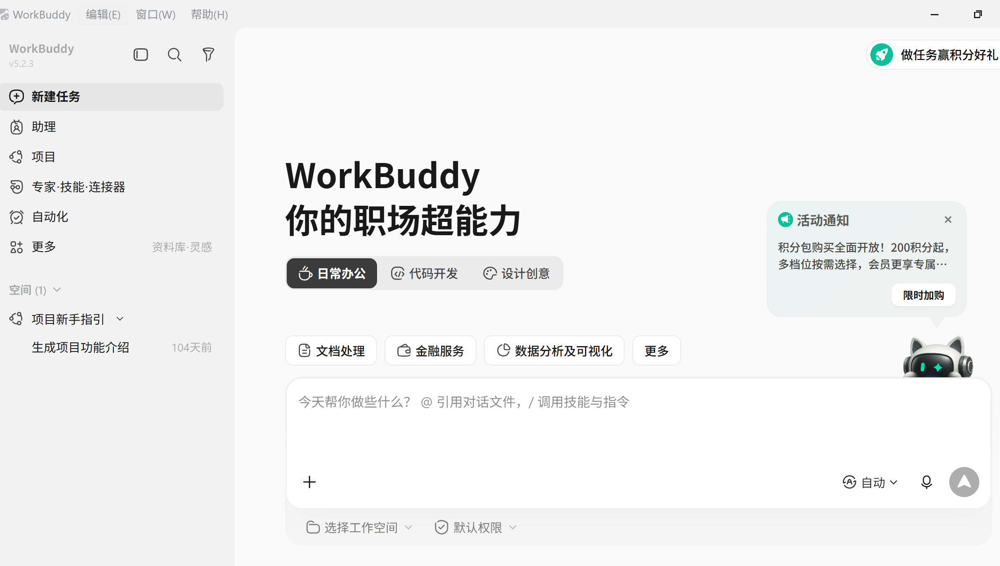
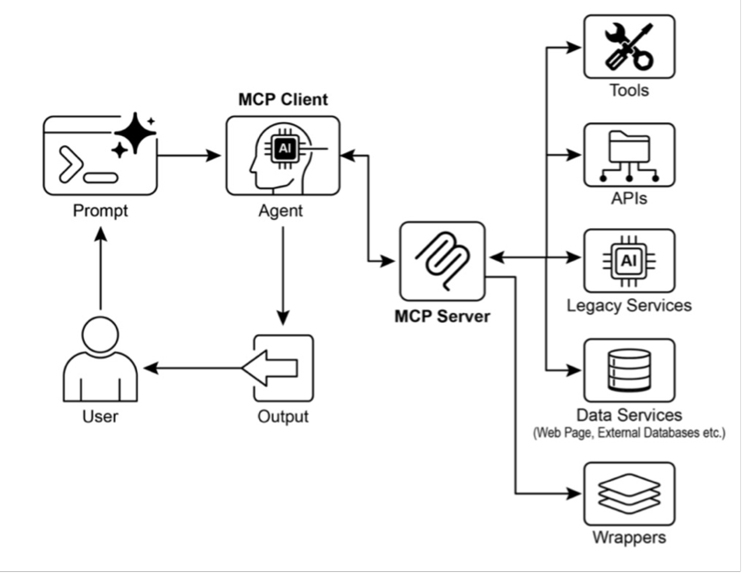
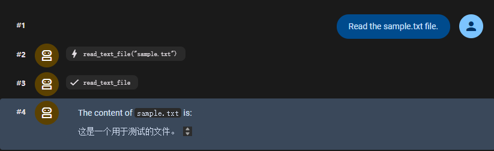
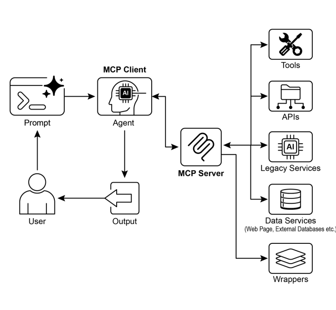

# Model Context Protocol (MCP) 模型上下文协议

> 来源：本目录《MCP.pptx》。本文按主题整理课件中的概念、案例、图表与代码；代码为课件示例的节选与归纳，未在本次整理中执行。

## 1. 什么是模型上下文协议

**模型上下文协议（Model Context Protocol，MCP）**为 AI 应用连接外部数据源、工具和服务提供统一的接口规范。课件以 USB-C 作类比：不同设备采用通用接口后可以减少专用适配，MCP 也试图降低不同 AI 应用接入外部能力的重复工作。

模型自身的知识和行动能力存在边界：训练中未包含的新信息需要从外部获取，读写文件、查询数据库和发送消息也需要应用提供工具。MCP 关注这些外部能力如何被发现、描述与调用。

### 1.1 为什么需要统一接入方式

当多个 AI 应用分别对接多个外部服务时，逐对定制会形成大量重复集成。课件用 **M×N 到 M+N** 的简化模型说明标准化价值：应用接入协议，服务按协议封装，双方通过共同接口协作。

| 集成问题 | 具体表现 | MCP 提供的方式 |
| --- | --- | --- |
| 模型接口不同 | 同一工具在不同模型接口中使用不同字段，例如 `parameters` 与 `input_schema` | 通过统一服务接口提供工具能力，由应用完成模型侧适配 |
| 工具描述不一致 | 同名天气工具可能分别接受城市名、经纬度，返回字段也不同 | 使用标准化的能力描述与参数 Schema，使差异可被显式发现 |
| 跨项目重复实现 | 多个应用各自复制查询、认证和错误处理逻辑 | 将能力封装为独立 Server，供兼容的应用复用 |

标准化描述不意味着所有天气工具的业务参数会自动变成相同结构。工具作者仍需清晰定义参数、结果和使用约束。

### 1.2 MCP 客户端与工具生态

课件以 Work Buddy 及云平台的 MCP 工具广场说明接入过程：在客户端选择服务、配置连接，再由应用向模型提供可用能力。实际可用范围取决于服务配置、认证和用户权限。





## 2. Host、Client 与 Server

MCP 采用客户端—服务器架构。用户提出任务，AI 应用组织模型推理，再通过 MCP 访问外部能力，最后把结果返回给用户。

| 角色 | 定位 | 核心职责 |
| --- | --- | --- |
| Host（宿主应用） | 用户直接使用的 AI 应用，如课件中的桌面助手或编程工具 | 承载对话界面和模型，管理连接，筛选可用能力与权限 |
| Client（客户端） | Host 内部的协议组件 | 与 Server 建立连接、协商能力、发现工具、发送调用并接收结果 |
| Server（服务器） | 外部能力的提供方 | 封装工具、数据或模板，完成请求处理及对外部系统的访问 |
| 外部系统 | 被 Server 接入的真实服务 | 提供数据库、文件、业务 API 或设备能力 |

一个 Host 可以管理多个 Client；在课件的架构中，每个 Client 与一个 Server 建立连接。模型选择调用什么工具，应用及其 Client 负责把调用意图转成协议请求。



### 三类核心原语

| 原语 | 提供什么 | 示例 |
| --- | --- | --- |
| Tools | 可以执行的操作 | 查询订单、发送邮件、读取文件 |
| Resources | 可作为上下文的数据 | 产品文档、订单记录、外部数据 |
| Prompts | 可复用的提示模板 | 退款引导、固定任务的交互模板 |

这三类能力分别对应操作、数据和任务指引。是否需要 MCP，可以先从业务是否需要共享这些能力判断。

## 3. 从连接建立到结果回传

课件用天气查询说明调用过程：

1. **初始化**：Client 与 Server 协商协议版本、交换能力声明。
2. **发现能力**：Client 查询工具清单及参数 Schema。
3. **提出调用**：模型依据用户需求选择工具，应用将工具名和参数交给 Client。
4. **执行请求**：Client 发送 `tools/call`，Server 调用外部服务。
5. **回填结果**：Server 返回数据或错误，应用将结果加入模型上下文，由模型生成回答。

以下是课件调用意图的简化表示，省略完整 JSON-RPC 信封：

```json
{
  "method": "tools/call",
  "params": {
    "name": "get_weather",
    "arguments": {
      "city": "北京"
    }
  }
}
```

| 交互 | 课件中的方法或内容 |
| --- | --- |
| 初始化 | `initialize`，包含协议版本和能力声明 |
| 工具发现 | `tools/list`，返回名称、描述和 `inputSchema` |
| 工具调用 | `tools/call`，包含工具名称及 `arguments` |
| 结果返回 | 内容数据，例如“晴，25℃”，或明确的错误信息 |

课件介绍两类传输方式：本地子进程通过 **STDIO** 通信；网络服务通过 **HTTP** 等方式连接。具体传输与参数写法应与所用协议和 SDK 版本对应。

## 4. MCP 与 Function Calling 如何配合

**Function Calling**用于让模型结构化地表达“调用哪个工具、传入哪些参数”；**MCP**用于标准化应用访问外部能力的方式。两者可以在同一条执行链中接力。

以“北京明天会下雨吗，要带伞吗”为例：

1. 应用向模型提供天气工具定义。
2. 模型选择 `get_weather`，提取 `city="北京"`、`day_offset=1`。
3. 应用找到对应 MCP Client，发送工具调用请求。
4. Server 查询真实天气服务并返回结果。
5. 模型结合降水信息给出出行建议。

**模型输出调用意图，并不等于工具已经执行。执行、参数校验和权限控制仍由应用及服务实现。**

| 维度 | Function Calling | MCP |
| --- | --- | --- |
| 关注点 | 模型表达结构化工具调用 | 外部能力的发现与通信 |
| 接口形式 | 依模型提供商的接口约定 | 开放的客户端—服务器协议 |
| 工具发现 | 应用在请求中提供可用工具 | Client 查询 Server 的能力清单 |
| 执行连接 | 应用实现工具处理逻辑 | Client 与 Server 通过协议交互 |
| 复用方式 | 通常需要应用自行封装 | 同一 Server 可供多个兼容应用使用 |

一个应用只有少量稳定工具时，直接集成 Function Calling 可以较简单；多个应用需要复用工具，或能力来源较多、变化频繁时，MCP 的独立服务和发现机制更有价值。

## 5. 采用 MCP 前的工程评估

课件将选型问题分成业务需求、技术可行性、架构适配性和实现成本四类。

| 维度 | 需要判断的问题 |
| --- | --- |
| 能力类型 | 需要 Tools、Resources、Prompts 中的哪些能力？ |
| 可发现性 | 能力是否经常变化，动态查询清单能否降低维护成本？ |
| 安全性 | 认证、授权、敏感数据保护和高风险操作控制是否到位？ |
| 错误处理 | 参数错误、权限拒绝、超时和业务失败如何识别与反馈？ |
| 部署位置 | 本地服务还是共享的网络服务更适合业务？ |
| 执行模式 | 需要实时按需处理，还是批量任务？ |
| 通信机制 | 本地进程与网络服务各自采用什么传输方式？ |
| 实现成本 | 开发、测试、部署和维护成本能否被长期复用收益覆盖？ |

本地部署适合直接接入本机能力，网络部署便于组织共享。采用协议本身不会自动解决权限、可靠性或成本问题，这些仍是整体方案的一部分。

## 6. 典型应用场景

| 场景 | 课件中的用法 |
| --- | --- |
| 数据库集成 | 查询结构化数据、生成报表、更新记录 |
| 生成式媒体编排 | 组合图像、视频、语音与音乐工具 |
| 外部 API 交互 | 查询天气或行情，访问邮件、CRM 等服务 |
| 信息抽取 | 获取回答问题所需的条款、图表或陈述 |
| 自定义工具 | 将内部函数与专有系统封装为可调用能力 |
| 应用通信 | 用一致接口降低不同模型与应用的集成成本 |
| 复杂工作流 | 串联客户查询、内容生成和邮件处理等步骤 |
| 物联网控制 | 对接设备、传感器或机器人 |
| 金融服务 | 接入行情分析、业务处理与监管报送能力 |

## 7. Google ADK：接入文件系统 Server

课件通过 `MCPToolset` 将现成文件系统 Server 接入 ADK Agent。Client 启动本地子进程，通过 STDIO 调用其工具。

### 7.1 接入结构

以下保留课件代码的主要结构。其中导入路径使用了省略写法，`TARGET_FOLDER_PATH` 也需由实际环境提供，不能直接作为完整脚本运行。

```python
from google.adk.agents import LlmAgent
from ...mcp_toolset import (
        MCPToolset, StdioServerParameters)

root_agent = LlmAgent(
    model="gemini-2.0-flash",
    name="filesystem_assistant_agent",
    instruction=f"...{TARGET_FOLDER_PATH}",
    tools=[
      MCPToolset(
        connection_params=StdioServerParameters(
          command="npx",
          args=["-y",
            "@modelcontextprotocol/server-filesystem",
            TARGET_FOLDER_PATH]),
    )],
)
```

| 配置 | 作用 |
| --- | --- |
| `MCPToolset` | 将 Server 暴露的工具接入 Agent |
| `StdioServerParameters` | 指定本地服务的启动命令与参数 |
| `npx` | 运行 Node 包形式分发的 Server |
| `TARGET_FOLDER_PATH` | 指定允许访问的目录范围 |
| `tool_filter` | 按需要筛选提供给 Agent 的工具 |

课件还介绍 `uvx`，用于在临时环境中运行 Python 包形式的服务；启动命令也可以是本地 Python 脚本，敏感配置通过环境变量提供。

### 7.2 ADK Web 中的验证方式

课件示例的目录结构：

```text
adk_agent_samples/
└─ mcp_agent/
   ├─ agent.py
   └─ __init__.py
```

`__init__.py` 中导入 Agent 模块：

```python
from . import agent
```

在示例目录运行 `adk web`，选择文件系统助手，再测试列目录、读取 `sample.txt` 等请求。预期链路为：用户提问 → 模型选择文件工具 → Client 调用 Server → 读取文件 → 返回结果 → 模型回答。



本地 STDIO 表示 Client 与 Server 之间的传输发生在本机；读取后的文件内容若进入远程模型请求，仍需按应用的数据流判断其传输范围。

## 8. FastMCP：把自己的函数暴露为工具

FastMCP 是 MCP 之上的 Python 开发框架。课件强调三个作用：用装饰器声明能力、根据函数签名和文档字符串生成 Schema，以及支持服务器组合与代理等封装方式。

### 8.1 服务端

```python
from fastmcp import FastMCP

mcp_server = FastMCP()

@mcp_server.tool
def greet(name: str) -> str:
    """Generates a personalized greeting."""
    return f"Hello, {name}! Nice to meet you."

if __name__ == "__main__":
    mcp_server.run(transport="http",
                   host="127.0.0.1", port=8000)
```

`@mcp_server.tool` 注册工具；`name: str` 提供参数类型；docstring 描述用途；`run()` 启动服务。

工具说明会影响模型如何理解和选择能力，因此应明确参数含义、返回内容和适用条件。示例监听 `127.0.0.1`，用于本机访问；网络部署还需要相应的监听地址、访问控制与网络配置。

### 8.2 ADK 客户端

```python
from google.adk.agents import LlmAgent
from google.adk.tools.mcp_tool.mcp_toolset import (
    MCPToolset, HttpServerParameters)

FASTMCP_SERVER_URL = "http://localhost:8000"

root_agent = LlmAgent(
    model="gemini-2.0-flash",
    name="fastmcp_greeter_agent",
    tools=[
        MCPToolset(
            connection_params=HttpServerParameters(
                url=FASTMCP_SERVER_URL),
            tool_filter=["greet"],
        )
    ],
)
```

客户端需要声明服务地址，并可通过 `tool_filter=["greet"]` 缩小提供给模型的工具集合。课件中的地址和接口名称需与服务端及 SDK 版本对应。

运行顺序为：先启动 FastMCP 服务，再在另一个终端启动 ADK Web，选择 `fastmcp_greeter_agent`，输入“Greet John Doe”。课件展示的工具结果是：

```text
Hello, John Doe! Nice to meet you.
```

## 9. 复习要点

1. MCP 标准化外部能力的接入，降低重复集成与跨应用复用成本。
2. Host 管理应用，Client 负责协议连接，Server 封装外部能力。
3. Tools、Resources、Prompts 分别提供操作、数据与任务模板。
4. Function Calling 与 MCP 可以连续使用，分别处理模型侧意图和服务侧访问。
5. 工具执行、错误处理与权限控制必须落实在应用和服务中。
6. 选型应同时考虑复用价值、动态发现需求、部署方式和维护成本。



原始课件：[[MCP.pptx]]
