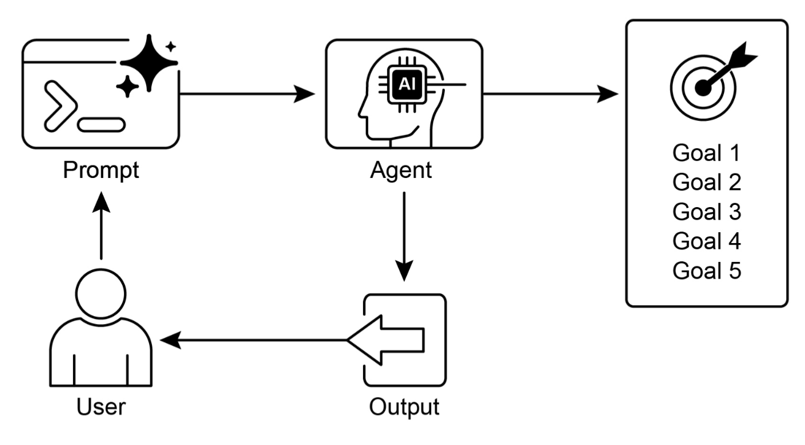
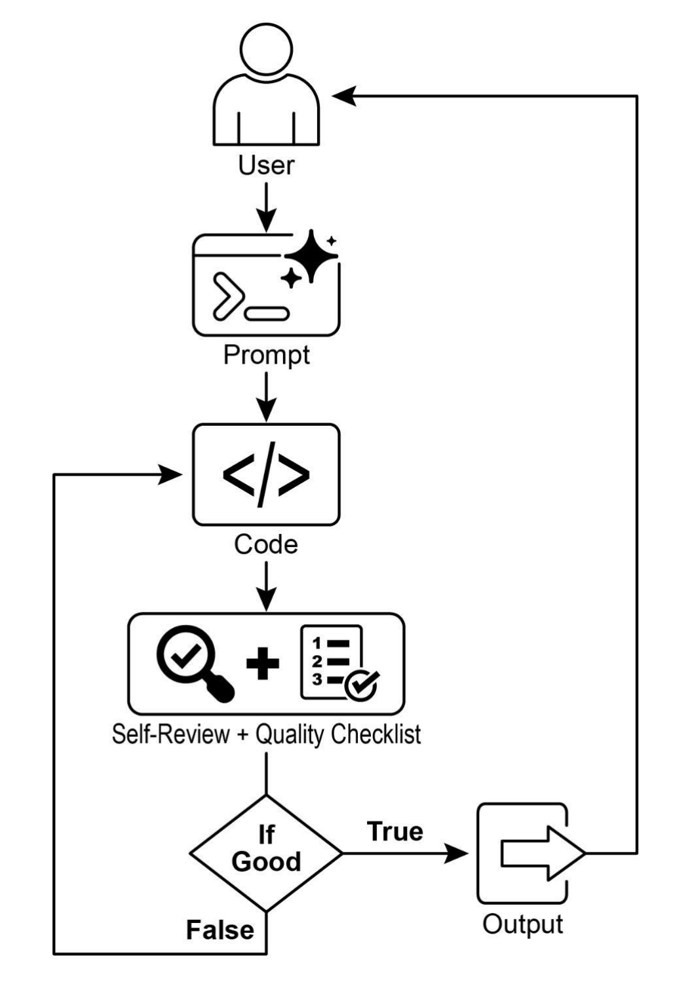

# Goal Setting and Monitoring 目标设定与监控

> 来源：本目录《Ch11_Goal_Setting_and_Monitoring_.pptx》。本文按主题整理课件中的概念、案例、图表与代码；代码为课件示例的节选与归纳，未在本次整理中执行。

## 1. 什么是目标设定与监控

**目标设定（Goal Setting）**将用户意图转化为明确的预期结果与完成标准；**监控（Monitoring）**持续观察执行进展，判断当前行动是否接近目标，并在出现偏差时触发调整。

智能体即使能够理解输入和调用工具，也需要回答三个问题：要达成什么结果、如何判断已经完成、遇到变化时如何修正。

课件以旅行规划作类比：

1. 确定起点，对应当前数据、上下文和环境状态。
2. 明确目的地，对应可检验的目标状态。
3. 权衡路线、交通和预算，对应工具、时间、成本与约束。
4. 拆解订票、出行、入住等行动序列。
5. 持续检查进度，遇到取消或延误时重新规划。

### 与规划、反思的关系

| 模式 | 核心问题 | 在闭环中的作用 |
| --- | --- | --- |
| 规划（Planning） | 接下来怎样做？ | 将意图拆成步骤与依赖 |
| 目标设定 | 怎样才算成功？ | 提供检查与验收标准 |
| 监控 | 当前进展如何？ | 收集行为、状态与工具结果，识别偏差 |
| 反思（Reflection） | 为什么偏离，怎样改进？ | 利用反馈修正方案 |

## 2. 目标驱动的执行闭环

相较于只响应当前输入的系统，目标导向的智能体需要把目标显式保存，并在执行期间不断核对。

| 维度 | 单步或固定脚本 | 目标设定与监控 |
| --- | --- | --- |
| 驱动方式 | 按输入触发既定操作 | 围绕目标推进多个子任务 |
| 过程感知 | 完成一次调用后结束 | 跟踪进度和完成条件 |
| 环境变化 | 容易沿用失效步骤 | 发现偏差后调整或重规划 |
| 交付判断 | 依赖操作是否执行 | 检查结果是否满足目标 |



### 2.1 监控哪些信号

- **智能体行为**：已经采取的行动、调用轨迹与当前步骤。
- **环境状态**：外部条件、资源可用性和任务相关变化。
- **工具输出**：执行结果、错误信息与可验证指标。

### 2.2 偏离目标后怎样处理

| 动作 | 含义 | 示例 |
| --- | --- | --- |
| 适应（Adapt） | 调整当前参数或局部策略 | 调整讲解难度 |
| 修订（Revise） | 重排或改写后续计划 | 资源不足时重新排期 |
| 升级（Escalate） | 将超出能力或风险边界的任务交给人 | 客诉长期未解决时转人工 |

## 3. 六类应用场景

课件用“目标—监控信号—纠偏动作”组织应用案例。

| 场景 | 目标 | 监控信号 | 纠偏或升级 |
| --- | --- | --- | --- |
| 客户支持 | 解决账单咨询 | 对话、账单变更、用户反馈 | 调整账单；持续未解决时转人工 |
| 个性化学习 | 提升代数掌握程度 | 习题进度、准确率、答题时间 | 调整难度和解释策略 |
| 项目管理 | 按期交付里程碑 | 看板状态、团队沟通、资源 | 提醒延误风险并建议重排 |
| 自动交易 | 在风险约束内执行收益目标 | 行情、持仓和风险敞口 | 按预设规则调整或停止操作 |
| 机器人与自动驾驶 | 安全、高效地到达目的地 | 环境、自身状态、路线进度 | 调整动作或重新规划路线 |
| 内容审核 | 识别并处理违规内容 | 分类结果、误报与漏报 | 调整策略，将模糊案例交人工复核 |

这些案例的共同点是：成功标准可被表达，执行状态可被观察，偏差能够触发下一步动作。

## 4. 自主 AI 程序员案例

课件以 LangChain 与 GPT-4o 组成的编程助手说明目标如何进入生成与评审流程。



### 4.1 主流程与函数职责

| 步骤 | 对应函数 | 作用 |
| --- | --- | --- |
| 接收需求 | `run_code_agent()` | 接收用例、目标清单与最大迭代轮数 |
| 生成或修订 | `generate_prompt()` | 组装任务、目标、上一版代码和反馈 |
| 整理代码 | `clean_code_block()` | 去除模型输出中的代码围栏 |
| 审查代码 | `get_code_feedback()` | 按目标检查清晰度、正确性与边界等问题 |
| 判断达标 | `goals_met()` | 将评审文本转化为布尔结果 |
| 保存结果 | `add_comment_header()`、`save_code_to_file()` | 添加说明并保存代码 |

未达标时，将当前代码和反馈用于下一轮修订；达标或达到最大轮数后退出。**达到轮数上限只是停止条件，不等于代码已经满足质量标准。**

### 4.2 生成提示：注入目标与最近反馈

```python
def generate_prompt(use_case, goals,
    previous_code="", feedback=""):
  base_prompt = f"""
You are an AI coding agent.
Use Case: {use_case}
Your goals are:
{chr(10).join(f'- {g}' for g in goals)}"""
  if previous_code:
    base_prompt += f"\nPreviously generated code:\n{previous_code}"
  if feedback:
    base_prompt += f"\nFeedback on previous version:\n{feedback}"
  base_prompt += "\nPlease return only the revised Python code."
  return base_prompt
```

首轮只提供任务与目标；后续加入上一版代码和评审意见，让修改有具体依据。

### 4.3 评审提示：明确检查维度

```python
def get_code_feedback(code, goals):
  feedback_prompt = f"""
You are a Python code reviewer.
Based on the following goals:
{chr(10).join(f'- {g}' for g in goals)}
Please critique this code and identify
if the goals are met. Mention if
improvements are needed for clarity,
simplicity, correctness, edge case
handling, or test coverage.
Code:
{code}"""
  return llm.invoke(feedback_prompt)
```

除了用户目标，提示中还列出清晰、简洁、正确、边界处理和测试覆盖等检查维度。

### 4.4 布尔判断：把评审接入控制流程

```python
def goals_met(feedback_text, goals) -> bool:
  review_prompt = f"""
You are an AI reviewer.
Here are the goals:
{chr(10).join(f'- {g}' for g in goals)}
Here is the feedback on the code:
\"\"\"{feedback_text}\"\"\"
Based on the feedback above,
have the goals been met?
Respond with only one word:
True or False."""
  response = llm.invoke(review_prompt)
  return response.content.strip().lower() == "true"
```

程序通过精确匹配 `true` 决定分支。这样便于控制循环，但判断依据仍来自模型的文本评审，不能替代实际运行与测试。

### 4.5 课件中的三个测试任务

| 任务 | 目标特点 |
| --- | --- |
| 正整数 BinaryGap | 易理解、功能正确、覆盖边界、限定正整数输入 |
| 递归统计目录文件数 | 处理边界，并明确忽略非必要的性能和测试框架建议 |
| 读取 Word 文件统计词数与字符数 | 清晰、正确、处理边界情况 |

第二个任务说明：目标需要限定范围，否则审查者可能持续提出超出当前任务的优化要求，导致反复修订。

## 5. 自写自审的局限

| 问题 | 影响 | 改进方向 |
| --- | --- | --- |
| 生成者与评审者共享盲区 | 漏洞可能在自审中再次被忽略 | 分离角色，必要时引入异构模型或独立验证 |
| 目标理解有偏差 | 代码不合要求却被判为达标 | 将目标转成明确契约、断言与测试 |
| 只审文本，未运行代码 | 语法错误、运行异常或死循环可能漏检 | 使用受控执行环境与自动化测试 |
| 持续挑错与反复修改 | 迭代时间和成本增长 | 设定范围、轮数、时间与预算上限 |

课件中的示例用于展示闭环结构。保存了一份代码、获得模型的 `True`、测试全部通过，分别代表不同程度的验证，不能混为一谈。

## 6. 职责分离的多智能体方案

课件进一步介绍五种专职角色：

| 角色 | 职责 |
| --- | --- |
| 同伴程序员 | 分析问题并生成核心功能代码 |
| 代码审查员 | 查找逻辑漏洞、提出修订建议 |
| 测试编写者 | 编写测试并提供客观验证 |
| 文档撰写者 | 生成函数说明、接口文档与使用示例 |
| 提示优化者 | 优化指令结构，使交互持续对齐目标 |

审查过程可以分成查错纠错、简化重构、解释修改理由、给出修改前后对照四步。角色拆分有助于明确责任，但仍需要测试结果和清晰的验收标准支撑判断。

## 7. 用 SMART 表达可验收目标

| 准则 | 含义 | 智能体中的表达 |
| --- | --- | --- |
| Specific | 具体明确 | 规定输入、输出格式和边界条件 |
| Measurable | 可衡量 | 使用测试通过率、数值阈值或明确的布尔条件 |
| Achievable | 可达成 | 与模型能力、工具和权限范围相匹配 |
| Relevant | 相关 | 子目标服务于整体任务，排除无关扩展 |
| Time-bound | 有时限 | 限定轮数、超时和成本预算 |

“辅导学生直到完全掌握”为模糊目标。课件将其改写为：生成三道概念辨析题，正确回答至少两道且能解释核心闭环时，判为达到本次预习目标；最多追问三轮，仍未达标则生成学情诊断并转交教师。

监控过程保存 `correct_count` 和 `weak_points` 等状态，目标与停止条件便可被程序检查。

## 8. Google ADK 中的目标与状态监控

1. 通过 `instruction` 向 Agent 传递目标与输出要求。
2. 使用 `output_key` 保存文本输出，通过工具上下文记录结构化进度。
3. 将执行者、评审者与条件检查器放入 `LoopAgent`。
4. 达标时结束循环；未达标时继续，但受 `max_iterations` 约束。

以下为课件中的结构节选，省略导入及其他 Agent 定义：

```python
# Google ADK 目标监控闭环核心模式 (P159 结合 P106/P116)
class GoalChecker(BaseAgent):
  async def _run_async_impl(self, ctx: InvocationContext):
    if ctx.session.state.get("goals_met") == True:
      yield Event(author=self.name, actions=EventActions(escalate=True))

monitored_agent = LoopAgent(
  name="GoalMonitoredLoop", max_iterations=5,
  sub_agents=[coder_agent, reviewer_agent, GoalChecker()]
)
```

这里的 `EventActions(escalate=True)` 用作 ADK 循环退出信号，并不意味着已经完成转交人类的业务流程。人工升级还需要独立的任务、通知和接管机制。

## 9. 复习要点

1. 目标提供验收标准，规划提供步骤，监控提供进展证据。
2. 监控需要同时关注行动、环境与工具输出。
3. 发现偏差后，应有调整、重规划或升级路径。
4. 自然语言评审应结合可执行的检查与测试。
5. 循环需要达标条件，也需要轮数、时间和成本上限。
6. 退出循环与完成任务是两个独立判断。

原始课件：[[Ch11_Goal_Setting_and_Monitoring_.pptx]]
