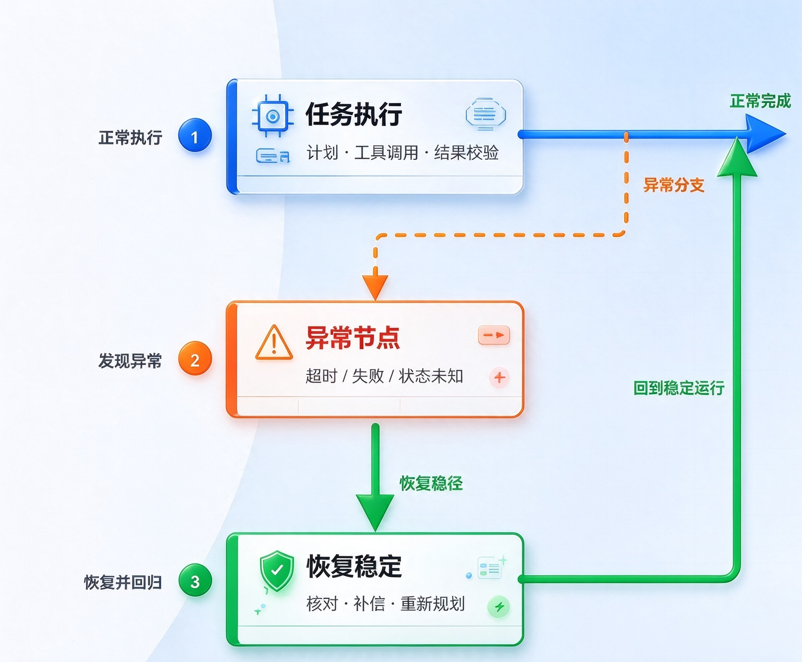

# Exception Handling and Recovery 异常处理与恢复

> 来源：本目录 [第12组.pptx](%E7%AC%AC12%E7%BB%84.pptx)，共 15 页。按原课件页序整理文字、表格与插图；保留代码文本及截图，未执行示例代码。下文为课件内容转录，版本、指标与技术判断沿用课件，未另行核验。

## 内容概览

异常处理与恢复关注任务失败后如何维持可控运行。课件围绕异常检测、处理机制、备用路径和降级策略展开，强调有限重试、适当升级以及在程序与工作流中落实可靠性边界，并通过现实场景说明何时自动恢复、何时交由人类处理。

## 课件逐页内容

> 每节对应一页幻灯片。文字按课件对象顺序保留，同一文本框内保留换行；流程图中的连接关系请结合原 PPTX 阅读。

### 第 1 页：异常处理与恢复

异常处理与恢复

让 AI 智能体从“能够完成任务”

走向“能够可靠运行”

汇报人：[刘志韬] 学号：[2026124862]

课程：[高级数据库技术] 日期：[11.2]

01 · ORIGINAL STYLE REWORK

#### 演讲者备注

大家好，今天我们分享的主题是“异常处理与恢复”。当我们讨论 AI 智能体时，注意力往往集中在它会不会规划、会不会调用工具、回答是否足够聪明。但一旦把智能体放进真实系统，真正决定它能否长期使用的，往往不是最理想情况下能完成什么，而是出现超时、接口错误和状态不确定时会怎样。

### 第 2 页：我们要解决的，不只是“任务失败”

我们要解决的，不只是“任务失败”

五个递进问题，构成智能体可靠运行的完整路径

01 可靠性问题

02 核心机制

03 路径设计

04 工程实践

05 总结协作

KNOWLEDGE ROUTE

从问题识别走向工程落地

01

为什么会失败？

识别执行链中的脆弱点

认识问题

02

如何发现异常？

让错误变成可见信号

检测错误

03

怎样限制影响？

阻止局部故障继续扩大

控制影响

04

如何恢复稳定？

重新建立可信状态

恢复运行

05

怎样落到工程？

把可靠性写进系统边界

工程落地

最终目标

故障可控

过程可解释

运行可恢复

知识地图 / 01

02

#### 演讲者备注

这次分享沿着五个递进问题展开。第一，智能体为什么会失败；第二，系统怎样发现异常；第三，故障发生后怎样阻止影响继续扩大；第四，怎样让系统重新进入稳定状态；第五，这些机制怎样真正写进程序和工作流。这个顺序很重要，因为重试只是其中一个很小的动作。没有检测信号，系统不知道何时触发；没有风险判断，重试还可能制造新的问题；没有状态恢复，表面上的成功也可能是不可信的。下面先把视角从模型本身拉远，看完整执行链。

### 第 3 页：外部依赖区

外部依赖区

模型很聪明，系统仍然可能很脆弱

可靠性不是单点能力，而是整条执行链的共同结果

01 可靠性问题

02 核心机制

03 路径设计

04 工程实践

05 总结协作

用户请求

目标与约束

理解任务

意图与上下文

制定计划

步骤与选择

调用外部能力

工具 / API / 数据库

获得结果

校验与整合

回复用户

完成任务

网络超时

API 限流

返回格式错误

数据损坏

权限不足

工具不可用

智能体的可靠性，由整条执行链中最脆弱的环节决定。

可靠性问题 / 01

03

#### 演讲者备注

一个智能体完成任务，通常要经历理解请求、制定计划、调用工具或数据库、整合结果、回复用户。模型只是这条链上的一环。真正进入外部依赖区以后，网络可能超时，API 可能限流，返回格式可能变化，数据可能损坏，权限也可能不足。即使模型推理完全正确，任何一个依赖失败，都可能让任务中断，甚至把错误状态带到后续步骤。这里的关键结论是：系统可靠性由最脆弱的环节决定。因此，不能只评估“模型回答得好不好”，还要评估从请求到结果的整条路径是否可观察、可控制。接下来我们把可靠运行拆成三种能力。

### 第 4 页：可靠运行需要三种能力

可靠运行需要三种能力

发现异常、限制影响，并重新回到稳定状态

01 可靠性问题

02 核心机制

03 路径设计

04 工程实践

05 总结协作

异常处理与恢复：让系统在故障出现后仍能保持可判断、可约束、可收敛。

可检测

回答：发生了什么？

状态、格式、时间、语义信号

把不可见故障变成可用证据

触发后续策略

可控制

回答：怎样阻止扩大？

有限重试、回退、降级、通知

把故障限制在可管理范围内

保护用户与状态

可恢复

回答：怎样重建稳定？

回滚、诊断、纠正、重新规划

使状态重新变得一致且可信

恢复或安全终止

共同目标

避免直接崩溃 · 保留部分服务 · 降低用户损失 · 保证状态一致 · 必要时安全终止

可靠性能力 / 01

04

#### 演讲者备注

第一种能力是可检测，也就是系统能否准确回答发生了什么。第二种是可控制，故障出现以后先把影响限制住，不让它继续传播。第三种是可恢复，重新建立一致、可信的状态，或者在无法恢复时安全终止。这三者不是同义词。比如支付请求超时后暂停重试，属于控制影响；确认到底有没有扣款，再决定补偿还是继续，才属于恢复。它们共同服务于五个目标：避免直接崩溃、保留部分服务、降低用户损失、保证状态一致，并在必要时安全停止。

### 第 5 页：Detection → Handling → Recovery

Detection → Handling → Recovery

从发现故障，到限制影响，再到重建稳定状态

01 可靠性问题

02 核心机制

03 路径设计

04 工程实践

05 总结协作

异常发生

Detection

发生了什么？

错误码 · 超时 · Schema

输出规则 · 语义复核

建立证据

Handling

怎样阻止扩大？

日志 · 有限重试 · 回退

降级 · 通知与升级

控制影响

Recovery

怎样重建稳定？

回滚 · 诊断 · 自我纠正

重新规划 · 人工介入

恢复可信状态

稳定运行

安全终止

可靠性不是一次动作，而是一条可验证的闭环

检测提供证据 · 处理控制影响 · 恢复重建可信状态

核心机制 / 02

05

#### 演讲者备注

这一页是整场分享的核心框架。异常发生以后，第一阶段是 Detection，也就是检测。它不只是看到一个报错，而是要把错误转化为证据，例如错误码、超时信号、Schema 校验失败，或者输出内容与规则冲突。第二阶段是 Handling，也就是处理。此时目标不是立刻恢复全部能力，而是先控制影响，可以记录日志、做有限重试、切换备用路径、提供降级结果，或者发出通知。第三阶段是 Recovery，也就是恢复。系统需要通过回滚、诊断、自我纠正、重新规划或人工介入，重新建立可信状态。 
这三个阶段分别回答三个不同问题：发生了什么，怎样阻止影响扩大，怎样重新稳定。它们还对应不同的成功标准。检测的成功是信号可靠；处理的成功是故障没有扩大；恢复的成功是状态重新一致。最后系统可能回到稳定运行，也可能安全终止任务。安全终止同样是一种正确结果，因为它比带着未知状态继续执行更可靠。下面我们依次拆开这三个阶段，先看错误如何被发现。

### 第 6 页：第一步：让错误变得可见

第一步：让错误变得可见

把运行中的异常转化为可判断、可触发的检测信号

01 可靠性问题

02 核心机制

03 路径设计

04 工程实践

05 总结协作

状态检测

对象：调用结果与业务状态

信号：API 错误码、业务错误码

例：404 / 500 / 503、权限不足

格式检测

对象：结构与字段完整性

信号：Schema 校验、必填字段

例：JSON 解析失败、字段缺失

时间检测

对象：响应时间与任务期限

信号：超时阈值、心跳、SLA

例：工具超过 5 秒无响应

语义检测

对象：内容是否合理、相关、合规

信号：输出规则、模型复核、监控

例：答非所问、关键结论矛盾

统一异常

事件

没有可靠的检测信号，重试、回退和恢复都无法正确触发。

核心机制 / 02

06

#### 演讲者备注

检测可以分成四类。状态检测关注调用结果和业务状态，例如 500、503 或权限不足；格式检测关注结构是否满足约定，比如 JSON 能否解析、必填字段是否存在；时间检测关注响应是否超过阈值，既包括单次工具调用，也包括整条任务的时间预算；语义检测则判断内容是否合理、相关和合规，例如答非所问或前后结论矛盾。现实系统通常需要组合这些信号。仅看 HTTP 200 并不代表业务成功，仅看格式正确也不代表内容可信。四类信号最终应汇成统一异常事件，才能稳定触发后续策略。

### 第 7 页：第二步：先控制影响，再讨论恢复

第二步：先控制影响，再讨论恢复

策略选择取决于错误性质、成功概率和重复执行的副作用

01 可靠性问题

02 核心机制

03 路径设计

04 工程实践

05 总结协作

策略

主要作用

适用场景

关键边界

日志记录

保留证据与上下文

所有异常

避免泄露敏感数据

有限重试

吸收瞬时波动

超时、503、短暂限流

次数、间隔、幂等

备用路径

绕过不可用依赖

主工具失败、服务切换

备用结果仍需校验

优雅降级

保留基础服务

精度降低但仍有价值

明确能力变化

通知升级

把风险交给责任人

高风险、持续失败

保留人工入口

适合重试

网络波动 · 服务临时不可用 · 短暂超时

前提：再次执行可能成功，且副作用可控

不适合盲目重试

余额不足 · 权限不足 · 永久参数错误 · 安全拒绝

警惕：重复扣款、重复写入、重复通知

核心机制 / 02

07

#### 演讲者备注

检测到异常以后，先选择控制策略。日志记录为诊断保留证据；有限重试吸收短暂波动；备用路径绕过不可用依赖；优雅降级保留基础能力；通知与升级则把持续失败或高风险操作交给责任人。这里最容易犯的错误是把所有异常都当成“再试一次”。网络波动和临时 503 可能适合重试，但余额不足、权限不足、永久参数错误或安全拒绝，重复执行不会改变结果。更重要的是，还要问第二个问题：再次执行会不会产生重复副作用。只要涉及扣款、写数据库或发送通知，就必须先考虑幂等性。

### 第 8 页：第三步：恢复不是“再试一次”

第三步：恢复不是“再试一次”

先重建可信状态，再决定重试、补偿或人工处理

01 可靠性问题

02 核心机制

03 路径设计

04 工程实践

05 总结协作

支付请求超时

结果未知 ≠ 支付失败

暂停直接重试

避免重复扣款副作用

查询可信状态

订单状态 + 支付通道流水

使用幂等键关联同一请求

已成功

明确未执行

部分完成

仍不确定

确认成功

返回既有交易结果

幂等重试

同一键只产生一次扣款

执行补偿

撤销、退款或修复状态

人工审核

冻结动作并保留证据

处理

阻止问题继续扩大，例如暂停重复请求。

恢复

重新建立可信状态，再选择确认、补偿、重试或升级。

核心机制 / 02

08

#### 演讲者备注

支付超时是理解“处理”和“恢复”差异的典型例子。请求没有及时返回时，我们并不知道支付失败了，也可能已经扣款，只是响应丢失。此时最先做的是暂停直接重试，防止重复扣款，这属于控制影响。随后使用订单号、支付流水和幂等键查询可信状态。如果确认已经成功，就返回既有结果；如果明确没有执行，可以使用同一幂等键安全重试；如果出现部分完成，就执行退款或事务补偿；如果仍然无法确定，就冻结动作并进入人工审核。恢复不是把同一请求再发一遍，而是先消除状态的不确定性。

### 第 9 页：把主路径、备用路径和统一响应分开

把主路径、备用路径和统一响应分开

职责分离，让回退逻辑可理解、可测试、可替换

01 可靠性问题

02 核心机制

03 路径设计

04 工程实践

05 总结协作

职责层

主处理器

最优结果

备用处理器

可接受结果

响应处理器

一致体验

用户地址

精确地址查询

追求精确位置结果

状态

失败

城市级查询

以较低精度持续服务

成功时跳过备用路径

统一组织输出

隐藏内部路径差异

共享状态

primary_failed

final_result

关键控制逻辑

if state["primary_failed"]:

result = fallback_lookup(city)

pipeline = [

primary_handler,

fallback_handler,

response_agent

]

执行顺序是控制结构

共享状态是路径之间的契约

路径设计 / 03

09

#### 演讲者备注

这一页展示一个通用的分层回退架构。主处理器负责精确地址查询，它追求最优结果；一旦共享状态中记录主路径失败，备用处理器才接管，提取城市并查询较粗粒度的区域信息；最后由响应处理器统一组织输出。这样做有三个好处。 
第一，主路径和备用路径各自只承担一种职责，可以独立测试和替换。第二，共享状态是清晰的契约，它明确传递是否失败、最终结果是什么，而不是依靠模型猜测上一步发生了什么。第三，统一响应层把内部差异隔离起来，用户不会因为走了不同路径而得到完全不同的交互格式。右侧代码只保留两个关键点：失败状态决定是否执行回退，流水线顺序保证主处理、备用处理和响应组织按预期发生。这里的可靠性来自结构化控制，而不是一句“失败时请换个方法”的提示词。

### 第 10 页：允许精度下降，但不能让服务失控

允许精度下降，但不能让服务失控

正常路径追求最优结果，异常路径保证最低可用结果

01 可靠性问题

02 核心机制

03 路径设计

04 工程实践

05 总结协作

正常路径

异常路径

用户地址

结构化输入

精确查询成功

获得街道级位置

跳过备用路径

保留最优结果

精确位置

统一格式输出

精确查询失败

外部服务不可用

记录失败状态

primary_failed = true

提取城市

保留可用上下文

城市级查询

降低精度

降级

结果

01

主路径与备用路径解耦

各自可独立测试和替换

02

失败状态显式传递

路径切换有明确依据

03

降级结果仍然有用

降低精度但不中断服务

04

最终响应保持一致

用户无需理解内部切换

路径设计 / 03

10

#### 演讲者备注

把架构展开后，可以看到两条清晰路径。正常路径中，精确查询成功，系统跳过备用处理，直接返回街道级位置。异常路径中，精确查询失败后先显式写入失败状态，再保留仍然可用的城市信息，调用城市级查询，最后返回精度较低但仍有价值的结果。 
这张图体现四个设计原则。第一，主路径与备用路径解耦，避免回退逻辑侵入正常逻辑。第二，失败状态显式传递，保证路径切换有可验证的依据。第三，降级不是随便返回一个答案，而是提供满足最低质量要求的结果。第四，不管走哪条路径，最终响应格式保持一致。对用户来说，系统能力可能暂时下降，但服务不能失控。工程上还应给降级结果打上内部质量标记，便于监控其比例和持续时间。理解了路径设计以后，我们再看这些机制如何出现在日常系统中。

### 第 11 页：异常恢复已经存在于我们每天使用的系统中

异常恢复已经存在于我们每天使用的系统中

优秀的恢复机制常常让用户感觉不到内部故障

01 可靠性问题

02 核心机制

03 路径设计

04 工程实践

05 总结协作

场景

异常

恢复方式

地图应用

GPS 信号丢失或漂移

高精度定位不可用

切换基站 / Wi-Fi 定位，或提示手动选点

精度下降，但导航仍可继续

在线支付

提交后响应超时

是否扣款处于未知状态

查询交易流水，结合幂等键决定后续动作

先核对状态，避免重复扣款

云端文档

编辑过程中网络中断

远端写入暂时不可用

本地暂存修改，恢复联网后进行同步

保留用户工作，并处理版本冲突

智能客服

客户数据库不可用

个性化查询无法完成

提供基础回答、记录请求或转人工客服

保留服务入口和任务上下文

好的恢复机制，不是隐藏错误，而是让用户免于承担复杂的内部故障。

工程实践 / 04

11

#### 演讲者备注

地图应用在 GPS 失效时，会切换到基站或 Wi-Fi 定位，必要时让用户手动选点；支付系统在响应超时后先查询交易状态；云文档在断网时把修改暂存在本地，联网后再同步；客服系统在数据库不可用时，仍可提供基础回答、记录请求或转人工。这些案例的共同点是，恢复机制尽量不把内部复杂性转嫁给用户。用户看到的不是堆栈信息，而是能力受限后的可用服务、清楚的状态提示和继续完成任务的入口。

### 第 12 页：可靠性必须写进程序和工作流

可靠性必须写进程序和工作流

提示词表达意图，程序和平台守住边界

01 可靠性问题

02 核心机制

03 路径设计

04 工程实践

05 总结协作

有限重试

限定次数与总时长，防止无限循环

适合瞬时错误

指数退避

逐步拉长间隔，并加入随机抖动

减少拥塞与雪崩

超时控制

为调用和整条任务设置时间预算

避免资源被长期占用

幂等性

同一请求重复执行只产生一次效果

保护支付与写操作

熔断机制

持续失败时暂时停止调用，探测恢复后再放行

隔离故障依赖

可观测性

日志、指标、追踪共同还原一次任务的路径

让诊断有证据

错误分类

区分瞬时、永久、业务、风险和未知错误

决定策略分支

运行时决策

是否为瞬时错误？

重试是否安全？

是否存在备用路径？

是否需要人工介入？

工程实践 / 04

12

#### 演讲者备注

要把可靠性落到工程中，需要几项互相配合的机制。有限重试限制次数和总时长；指数退避让每次等待逐步变长，并加入随机抖动，避免大量实例同时重试；超时控制为单次调用和整条任务设置时间预算；幂等性确保同一请求重复执行不会产生多次效果；熔断在依赖持续失败时暂时停止调用，防止故障扩散；可观测性通过日志、指标和链路追踪还原执行过程；错误分类则决定后续走哪条分支。运行时可以连续问四个问题：是否为瞬时错误，重试是否安全，是否存在备用路径，是否需要人工介入。提示词可以表达策略意图，但这些边界必须由程序和平台强制执行。

### 第 13 页：不是所有问题都应该交给智能体自行处理

不是所有问题都应该交给智能体自行处理

自动化程度应随错误明确度提高，并随操作风险降低

01 可靠性问题

02 核心机制

03 路径设计

04 工程实践

05 总结协作

操作风险更高

错误原因更明确

高风险 · 原因不明确

立即人工介入

冻结高风险动作，保留上下文与证据

不允许自主试错

高风险 · 原因明确

执行受控补偿

按预定义规则回滚、退款或修复

需要审计与授权

低风险 · 原因不明确

降级或重新规划

减少依赖，换一条可接受的路径

限制尝试次数

低风险 · 原因明确

自动重试

使用次数上限、退避与幂等保护

自动化程度最高

高风险场景

支付与资金操作

医疗建议

数据删除

权限变更

法律或合规判断

原则：风险越高，越需要明确授权。

工程实践 / 04

13

#### 演讲者备注

自动恢复和人工介入之间不能只靠直觉，可以用两个维度判断：错误原因是否明确，操作风险是否高。低风险且原因明确，例如一次无副作用的临时查询超时，可以自动重试；低风险但原因不明确时，更适合降级或重新规划，并限制尝试次数；高风险且原因明确时，可以执行预先定义的受控补偿，但要保留审计和授权；高风险且原因不明确时，应立即停止自主动作并交给人类。 
右侧列出的支付、医疗、数据删除、权限变更和法律合规判断，都具有难以逆转或责任重大的特点。这里还需要强调，人工介入不是简单地把错误弹给用户。系统应同时交付任务上下文、已执行步骤、错误证据、可能影响和建议选项，否则人类仍然无法高效判断。边界的本质是风险治理：自动化程度随着错误明确度提高，也随着操作风险降低。

### 第 14 页：可靠的智能体，必须学会正确地失败

可靠的智能体，必须学会正确地失败

从“任务是否完成”转向“失败是否可控”

01 可靠性问题

02 核心机制

03 路径设计

04 工程实践

05 总结协作

01

异常是运行中的必然事件

外部依赖、数据和模型行为都可能引入失败。

02

可靠系统必须完成检测、控制和恢复

三个环节缺一不可，并需要共享状态与明确边界。

03

恢复策略由错误、风险和副作用共同决定

重试、回退、降级、补偿与人工介入各有适用范围。

成熟的智能体不是永远不失败，

而是在失败后仍然

可控 · 可解释 · 可恢复

行动准则

判断顺序：错误类型 → 操作风险 → 重复副作用

安全时有限重试

可降级时保留服务

风险不明时及时转人工

总结协作 / 05

14

#### 演讲者备注

最后总结三点。第一，异常不是偶发事件，而是智能体进入真实环境后的必然组成部分。第二，可靠系统需要同时具备检测、控制和恢复能力，不能把所有希望寄托在重试上。第三，具体策略应由错误类型、操作风险和重复副作用共同决定。成熟的智能体并不是永远不失败，而是在失败后仍然可控、可解释、可恢复。所以，可靠性设计的关键是让每一次尝试都有明确边界：先判断错误类型，再评估操作风险；能安全重试就有限重试，能降级就尽量保留服务，风险不明时及时转交人工。当系统能够识别错误、控制影响，并在高风险情况下停止自主动作，它才真正具备可靠运行的能力。

### 第 15 页：小组成员与分工

小组成员与分工

从内容策划到课堂呈现的协作链

01 可靠性问题

02 核心机制

03 路径设计

04 工程实践

05 总结协作

01 / 策划

[方宇扬]

主题策划

内容统筹

02 / 机制

[艾妮思]

异常检测

处理机制梳理

03 / 路径

[何苗青]

技术案例

流程图设计

04 / 实践

[刘佳昕]

工程实践

现实案例补充

05 / 整合

[刘志韬]

PPT 设计、演讲整合

与最终校对

共同目标：内容准确、结构清晰、表达一致、时间可控

感谢聆听

Questions & Discussion

总结协作 / 05

15

#### 演讲者备注

最后是小组分工。五名成员分别负责主题策划与内容统筹、异常检测和处理机制梳理、技术案例与流程图设计、工程实践和现实案例补充，以及最终的 PPT 设计、演讲整合与校对。各项工作沿着同一内容主线衔接，确保技术表述、视觉呈现和课堂时间保持一致。我们的分享就到这里，感谢聆听，欢迎提问和讨论。

## 小组成员与分工

> 依据课件中的目录、署名与分工页整理；按课件分工顺序列出。

- 方宇扬：主题策划，内容统筹

- 艾妮思：异常检测，处理机制梳理

- 何苗青：技术案例，流程图设计

- 刘佳昕：工程实践，现实案例补充

- 刘志韬：PPT 设计、演讲整合与最终校对，课堂汇报
