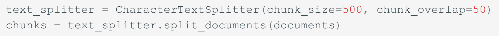
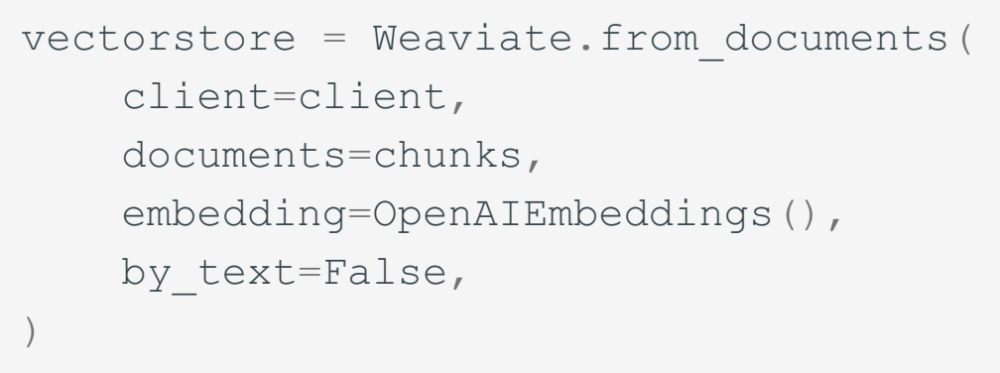
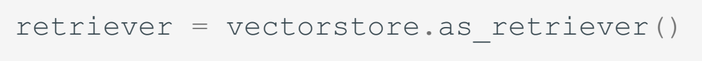
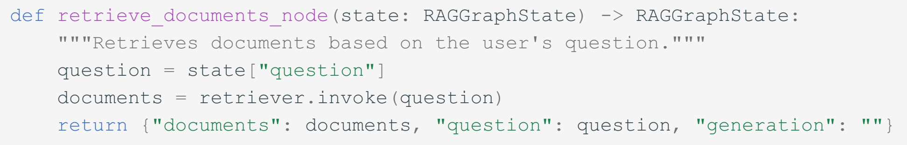
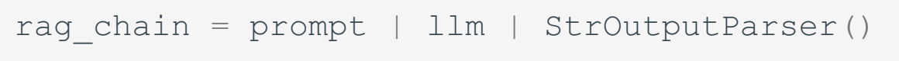
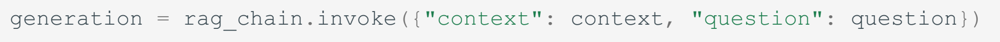
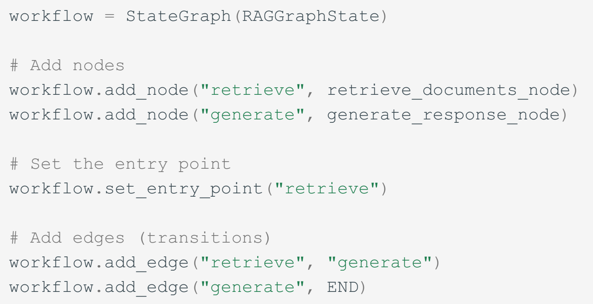
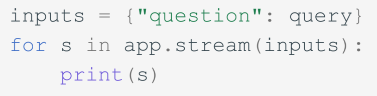

# Knowledge Retrieval (RAG) 知识检索

> 来源：本目录 [第14章_RAG.pptx](%E7%AC%AC14%E7%AB%A0_RAG.pptx)，共 24 页。按原课件页序整理文字、表格与插图；保留代码文本及截图，未执行示例代码。下文为课件内容转录，版本、指标与技术判断沿用课件，未另行核验。

## 内容概览

RAG 先检索资料，再把证据加入上下文生成回答。课件用校园活动场地选择串起分块、嵌入、向量索引与在线检索，比较关键词、向量和混合检索，并介绍 GraphRAG 与 Agentic RAG。代码部分保留原文截图；课件中的检索—生成工作流尚未包含证据评估与补查分支。

## 课件逐页内容

> 每节对应一页幻灯片。文字按课件对象顺序保留，同一文本框内保留换行；流程图中的连接关系请结合原 PPTX 阅读。

### 第 1 页：知识检索：Retrieval-Augmented Generation

第14章 · Agentic Design Patterns

知识检索

Retrieval-Augmented Generation

RAG

检索  →  增强  →  生成

汇报人：胡一鸣 李晨 许书浩 王骏申

#### 演讲者备注

老师、同学们，大家好。今天我们讲第十四章，知识检索，也就是 RAG。 
先想一个场景：我们要办一场一百人的校园活动，定在周五晚上，需要投影，场地预算三百元。大家会想问，选哪里合适，怎么申请？ 
答案可能藏在好几份资料里。我们就用这个活动筹备助手，看看基础 RAG、GraphRAG 和 Agentic RAG 分别能帮什么忙。场地、费用和查询结果都是教学设定。 
教材来源：用户提供的 Agentic-Design-Patterns-CN.pdf 第14章；原文代码在 PDF 第179—181页。校园活动场地、规则、价格和档期均为课堂教学设定，非真实学校规定；代码为原文阅读节选，未进行外部服务运行验证。

### 第 2 页：RAG 基础机制

PART

01

RAG FOUNDATIONS

RAG 基础机制

模型如何依据资料回答问题？

02

#### 演讲者备注

先看第一部分。模型要回答这次活动的问题，得先找到哪些资料？找到以后，又怎么用？ 
教材来源：用户提供的 Agentic-Design-Patterns-CN.pdf 第14章；原文代码在 PDF 第179—181页。校园活动场地、规则、价格和档期均为课堂教学设定，非真实学校规定；代码为原文阅读节选，未进行外部服务运行验证。

### 第 3 页：为什么需要 RAG？

为什么需要 RAG？

03

校园活动筹备助手

D1–D3 为资料编号

筹备一场校园活动

100 人参加
本周五 19:00–21:00
需要投影设备
场地预算 ≤ 300 元

选哪里？如何申请？

D1  场地手册

讲座室 120 人；报告厅 200 人
均有投影，常规开放 18:00–22:00

D2  本周维修通知

报告厅本周五 19:00–21:00
因维修暂停开放

D3  申请规则

讲座室 200 元/场；提交活动方案
指导教师确认后，向场地管理方申请

#### 演讲者备注

[指左侧需求，再指右侧三份资料] 
这次活动有四个条件：一百人，周五晚上七点到九点，需要投影，场地费不超过三百元。 
右边的 D1、D2、D3，是我们给三份资料编的号。D 来自 Document，也就是文档。后面看到方括号里的编号，就知道这句话依据哪份资料。 
D1 是场地手册。讲座室能坐一百二十人，报告厅能坐两百人，都有投影，晚上六点到十点常规开放。只看这里，两个地方都挺合适。 
但 D2 的维修通知说，报告厅周五七点到九点停用。D3 的申请规则又说，讲座室每场两百元，需要活动方案，先由指导教师确认，再交给场地管理方。 
所以，推荐一个地方，要把几份资料放在一起看。模型如果没接入这些信息，就可能把正在维修的报告厅推荐给我们。 
教材来源：用户提供的 Agentic-Design-Patterns-CN.pdf 第14章；原文代码在 PDF 第179—181页。校园活动场地、规则、价格和档期均为课堂教学设定，非真实学校规定；代码为原文阅读节选，未进行外部服务运行验证。

### 第 4 页：检索增强生成  Retrieval-Augmented Generation

检索增强生成  Retrieval-Augmented Generation

用户问题

检索
Retrieval

增强
Augmentation

生成
Generation

100 人 / 周五晚 / 投影 
场地预算 ≤ 300 元

取回 D1、D2、D3

问题 + 证据 + 回答要求

输出答案并标注出处

示例回答

讲座室满足人数、设备与场地预算要求。[D1、D3] 
报告厅该时段维修，排除。[D2]  讲座室档期仍需确认。

RAG：检索、增强与生成

04

#### 演讲者备注

RAG，就是检索增强生成。我们顺着箭头看。 
先检索，把这次活动需要的资料找出来。再增强，把这些资料连同问题一起交给模型，并要求它说明理由、标出出处。最后生成，组织成我们能直接看懂的回答。 
比如：讲座室的人数、设备和费用都符合要求；报告厅该时段维修，所以排除。这就把三份资料用起来了。 
不过，讲座室周五有没有被别人订走？这些资料还没告诉我们。这个问题先留到第四部分。 
教材来源：用户提供的 Agentic-Design-Patterns-CN.pdf 第14章；原文代码在 PDF 第179—181页。校园活动场地、规则、价格和档期均为课堂教学设定，非真实学校规定；代码为原文阅读节选，未进行外部服务运行验证。

### 第 5 页：离线建库  OFFLINE

离线建库  OFFLINE

手册 / 通知 / 规则

分块 Chunking

嵌入 Embedding

向量库 + 索引

D1 / D2 / D3

保留来源、适用场地、生效日期等元数据

在线查询  ONLINE

问题 → 查询向量

检索 Top-K 片段

问题 + 原文证据

LLM → 带引用回答

RAG 的完整工作流程

05

#### 演讲者备注

整个流程分成上下两行。上面是提问之前的准备，下面是用户提问之后的查询。 
先收集手册、通知和规则，把长文档切成片段，再用嵌入模型转成向量，放进向量库和索引里。原文、来源、场地和生效日期也要保留。否则找到一句“暂停开放”，却不知道说的是哪里、哪一天，就没法用。 
用户提问后，系统把问题也转成向量，找出比较相关的片段。Top-K 就是取前面若干个候选。然后把原文和问题一起交给模型，生成带引用的回答。 
大家可以顺着图走一遍：手册先进入知识库，活动问题再进入检索，找到的片段最后交给模型。这两个阶段分开以后，同一个知识库就能服务后面不同的问题。 
资料变了，知识库也要跟着更新。否则维修通知已经发了，助手还可能照旧推荐报告厅。接下来由第二位同学介绍几个核心组件。 
教材来源：用户提供的 Agentic-Design-Patterns-CN.pdf 第14章；原文代码在 PDF 第179—181页。校园活动场地、规则、价格和档期均为课堂教学设定，非真实学校规定；代码为原文阅读节选，未进行外部服务运行验证。

### 第 6 页：核心组件

PART

02

CORE COMPONENTS

核心组件

文本如何被表示、比较与检索？

06

#### 演讲者备注

这一部分讲嵌入、相似度、分块和向量数据库，最后对照原文代码，看资料怎么变成能查的知识库。 
教材来源：用户提供的 Agentic-Design-Patterns-CN.pdf 第14章；原文代码在 PDF 第179—181页。校园活动场地、规则、价格和档期均为课堂教学设定，非真实学校规定；代码为原文阅读节选，未进行外部服务运行验证。

### 第 7 页：Embedding：语义如何变成向量

01

文本 → 数值向量

词语、句子与文档片段都可编码。

02

相似表达通常靠近

能坐多少人 ≈ 可容纳人数

教材类比：cat ≈ kitten，远离 car 
真实嵌入通常有数百至数千维

活动室能坐多少人

场地可容纳多少人

校园卡怎么充值

二维示意 · 非真实模型输出

Embedding：语义如何变成向量

07

#### 演讲者备注

[指右侧两个靠近的点] 
Embedding，中文叫嵌入。可以先把它理解成：用一组数字来表示一段文字的意思。意思相近的文字，我们希望它们在向量空间里也比较近。 
比如我们问“活动室能坐多少人”，手册写的是“场地可容纳人数”。用词不同，说的却是同一件事。嵌入就能帮助我们找到这样的资料。 
右边两个近的点代表这两种表达，远处是“校园卡怎么充值”。这里只是二维示意，真实向量通常有数百到数千维。 
教材用 cat 和 kitten 作了类似的解释：意思接近的词，比字母相似但意思不同的词更容易靠近。 
教材来源：用户提供的 Agentic-Design-Patterns-CN.pdf 第14章；原文代码在 PDF 第179—181页。校园活动场地、规则、价格和档期均为课堂教学设定，非真实学校规定；代码为原文阅读节选，未进行外部服务运行验证。

### 第 8 页：语义相似度与候选排序

用户：“哪里能坐下 100 人，并提供投影设备？”

查询嵌入

相似度 / 距离计算

候选排序

返回相关片段

优先候选

D1：讲座室容纳 120 人，报告厅容纳 200 人；均有投影

也可能召回

D3：讲座室申请费用与材料要求

低相关候选

校园卡怎么充值

排序为示意；具体结果由模型、度量和语料决定。

语义相似度与候选排序

08

#### 演讲者备注

现在问：“哪里能坐下一百人，还能用投影？”系统把问题转成向量，与资料比较，再按相关程度排序。 
D1 直接写了容量和设备，所以是优先候选。D3 也在讲场地，可能一起被找回来。校园卡充值就不太相关。 
但相似度高，只说明资料可能相关。一百二十个座位够不够，费用超没超过三百元，仍要读具体内容、逐项核对。 
只查人数和设备，还可能漏掉维修通知。所以完整任务通常需要覆盖多个条件。这页的排序也是示意，实际结果要检查。 
假如第一轮只找到了容量信息，我们还得问一句：现在这些资料够回答完整任务了吗？如果漏了维修限制，即使人数和设备都符合，推荐仍可能出错。 
教材来源：用户提供的 Agentic-Design-Patterns-CN.pdf 第14章；原文代码在 PDF 第179—181页。校园活动场地、规则、价格和档期均为课堂教学设定，非真实学校规定；代码为原文阅读节选，未进行外部服务运行验证。

### 第 9 页：Chunking：选择合适的证据粒度

校园活动资料集

场地与设备

开放与维修

费用与申请

活动安全要求

命中的维修通知片段

适用：本周五 19:00–21:00 
场地：报告厅 
状态：维修期间暂停开放 
来源：D2 · 本周维修通知

过大：无关内容多 
过小：条件与上下文丢失

Chunking：选择合适的证据粒度

09

#### 演讲者备注

为什么要分块？假如活动资料有一大本，里面混着场地设备、维修通知、申请流程和安全要求，直接整本检索不太方便。 
我们把它切成片段，就容易找到需要的内容。但也不能切得太碎。右边这条通知，最好把场地、时段和停用原因放在一起。 
如果只剩“暂停开放”，就不知道停的是哪个场地；只剩“本周五”，也不知道发生了什么。 
所以，块太大，无关内容多；块太小，又容易丢条件。实际要结合文档结构调整，必要时让相邻片段有一些重叠。 
大家再看右边，场地、时段、状态和来源是一起保留的。我们拿到这个片段，就能判断这条限制是否正好影响周五晚的活动，不用再靠猜测补齐条件。 
教材来源：用户提供的 Agentic-Design-Patterns-CN.pdf 第14章；原文代码在 PDF 第179—181页。校园活动场地、规则、价格和档期均为课堂教学设定，非真实学校规定；代码为原文阅读节选，未进行外部服务运行验证。

### 第 10 页：向量数据库：从向量找到原文

查询向量

向量库 / 索引

Top-K 相关向量

关联原文 + 元数据

一条可检索记录

ID：D2-01 
向量：[0.12, …]（仅示意） 
原文：报告厅本周五晚维修停用 
元数据：来源 / 场地 / 生效日期

数据库 / 服务

Pinecone · Weaviate · Chroma 
Milvus · Qdrant

扩展 / 检索库 / 索引

Redis · Elasticsearch · PostgreSQL + pgvector 
FAISS / ScaNN（库）· HNSW（索引）

向量数据库：从向量找到原文

10

#### 演讲者备注

向量数据库把刚才的查找过程组织起来：输入查询向量，找到相近向量，再返回对应原文。 
左边这条记录包含编号、向量、维修通知原文，还有来源、场地和生效日期。向量帮助定位，原文支持回答，日期等信息帮助判断是否适用。 
比如去年的维修通知，文字也可能很像，但不能拿来安排本周五的活动。 
右边列的是一些数据库、服务和检索工具，大家知道它们能支持这套流程就可以。下面直接看代码怎么做。 
教材来源：用户提供的 Agentic-Design-Patterns-CN.pdf 第14章；原文代码在 PDF 第179—181页。校园活动场地、规则、价格和档期均为课堂教学设定，非真实学校规定；代码为原文阅读节选，未进行外部服务运行验证。

### 第 11 页：原文代码①：分块与建库

原文代码①：分块与建库

PDF 180 页原始截图 · 分区域节选，保留原文代码与缩进

11

01  分块

500：目标块大小  /  50：目标重叠，按字符计

02  向量化并存储

03  提供检索接口

左侧：将片段编码并存入 Weaviate

上方：获得后续问答使用的检索器

#### 演讲者备注

[先指上方分块，再指左下建库和右下检索接口] 
这里用的是参考文章的原始代码截图。原文数据是美国国情咨文，我们借活动案例来理解流程。导入、下载和连接配置没有放在这一页。 
上面先分块。documents 是已经加载的文档，CharacterTextSplitter 把它们切成 chunks。500 是目标块大小，50 是目标重叠量，这里按字符计，不是 token。因为还要结合分隔符切，所以每块不一定恰好五百个字符。 
左下把片段交给 OpenAIEmbeddings 编码，再存进 Weaviate。这样，原文就和向量对应起来了。by_text=False 表示这里使用传入的嵌入模型来生成向量。 
这里的五十个字符，是给相邻片段保留联系的目标重叠量。比如一句话被切在边界附近，适当重叠有助于保住前后的意思，但具体效果仍要结合切分结果检查。 
右下得到 retriever，也就是后面用来查资料的接口。到这里，知识库准备好了，还没有回答问题。接下来由下一位同学介绍怎么找对资料。 
教材来源：用户提供的 Agentic-Design-Patterns-CN.pdf 第14章；原文代码在 PDF 第179—181页。校园活动场地、规则、价格和档期均为课堂教学设定，非真实学校规定；代码为原文阅读节选，未进行外部服务运行验证。

### 第 12 页：检索策略与 GraphRAG

PART

03

RETRIEVAL & GRAPHRAG

检索策略
与 GraphRAG

怎样找对资料，并连接分散的证据？

12

#### 演讲者备注

有了知识库，接下来就看怎么找得准。这部分比较几种检索方法，再用 GraphRAG 把分散的资料联系起来。 
教材来源：用户提供的 Agentic-Design-Patterns-CN.pdf 第14章；原文代码在 PDF 第179—181页。校园活动场地、规则、价格和档期均为课堂教学设定，非真实学校规定；代码为原文阅读节选，未进行外部服务运行验证。

### 第 13 页：关键词、向量与混合检索

同一个问题里，既有场地名称，也有不同的表达。

| 方法 | 更擅长什么 | 局限 |
| --- | --- | --- |
| 关键词 / BM25 | 精确匹配“报告厅”“周五” | 对同义改写不够敏感 |
| 向量检索 | 关联“坐得下”与“容纳人数” | 可能混淆场地或适用日期 |
| 混合检索 | 融合字面匹配与语义匹配 | 需要融合排序与调试 |

案例策略：匹配“报告厅”和日期，理解“能坐下”与“容纳人数”。

关键词、向量与混合检索

13

#### 演讲者备注

关键词检索和向量检索，各有用处。 
像“报告厅”这样的明确名称，关键词检索比较擅长匹配。但我们问“坐得下一百人”，手册写“容纳人数”，只按字面找，可能就漏掉了。 
向量检索更容易找到意思接近的内容，不过也可能把不同场地、不同日期的资料一起找回来。 
混合检索把两类结果结合起来，再排序。活动案例既要对准场地和日期，也要理解不同说法。具体人数和费用，还需要进一步比较，不能只看相似度。 
教材来源：用户提供的 Agentic-Design-Patterns-CN.pdf 第14章；原文代码在 PDF 第179—181页。校园活动场地、规则、价格和档期均为课堂教学设定，非真实学校规定；代码为原文阅读节选，未进行外部服务运行验证。

### 第 14 页：RAG 的四个价值

01

可更新知识

最新维修通知进入检索范围。

02

可用私域资料

校内场地与申请规则支持回答。

03

减少无依据生成

场地筛选与申请建议都有依据。

04

可追溯引用

同学能回到 D1、D2、D3 核对原文。

RAG 的四个价值

14

#### 演讲者备注

RAG 的价值，可以结合这个案例看。 
维修通知更新后，纳入知识库就有机会用于回答，不必每次重新训练模型。校内手册和申请规则，也可以接进来。 
推荐讲座室、排除报告厅，都能说明依据。听众还能顺着 D1、D2、D3 回去核对。 
当然，标了引用也不一定对，还得看它是不是真的支持这句话、是不是适用于这次活动。 
教材来源：用户提供的 Agentic-Design-Patterns-CN.pdf 第14章；原文代码在 PDF 第179—181页。校园活动场地、规则、价格和档期均为课堂教学设定，非真实学校规定；代码为原文阅读节选，未进行外部服务运行验证。

### 第 15 页：传统 RAG 的局限

D1 · 场地手册 
报告厅常规开放 18:00–22:00

D2 · 本周维修通知 
报告厅周五 19:00–21:00 停用

常规开放，不等于目标时段可以使用

证据分散

设备在 D1 
费用在 D3

检索噪声

常规手册 
也可能高相似

来源冲突

维修例外条件 
需要核对

知识更新

资料变更后 
需要同步索引

成本与延迟

存储、检索 
与上下文开销

传统 RAG 的局限

15

#### 演讲者备注

[对照两张资料卡] 
只看 D1，报告厅晚上正常开放；再看 D2，它周五七点到九点维修，刚好撞上活动时间。 
这不一定是谁写错了，而是常规安排遇到了临时例外。我们要核对地点和时间，才能判断这次该按哪条执行。 
下面几项也很常见：证据分在不同文档里，检索可能漏掉关键通知，旧资料没及时更新，多查几轮还会增加时间和成本。 
所以，一次找到几段文字，并不保证方案已经完整。下面看 GraphRAG 怎么帮助连接这些证据。 
教材来源：用户提供的 Agentic-Design-Patterns-CN.pdf 第14章；原文代码在 PDF 第179—181页。校园活动场地、规则、价格和档期均为课堂教学设定，非真实学校规定；代码为原文阅读节选，未进行外部服务运行验证。

### 第 16 页：GraphRAG：连接场地与相关规则

GraphRAG：连接场地与相关规则

16

沿着同一场地的关系，组合条件并排除不适用的选项

讲座室

120 人 · 投影 · 晚间开放 [D1]

200 元/场 · 方案与教师确认 [D3]

报告厅

200 人 · 投影 · 晚间开放 [D1]

本周五 19:00–21:00 维修停用 [D2]

关系示意：检索到的子图仍需交给模型，生成有证据的回答

#### 演讲者备注

[沿着两个场地各自的关系讲] 
这张图里，我们把同一个场地的不同资料接起来。 
从讲座室出发，D1 告诉我们容量、投影和开放时间，D3 告诉我们费用与申请要求。再看报告厅，D1 的条件本来合适，但连到 D2，就发现活动时段正在维修。 
GraphRAG 的思路，就是借助实体和关系，找到彼此关联的证据，再交给模型回答。这样遇到跨文档的问题，就能沿着关系继续找。 
这里是简化示意。实际还要做实体抽取、关系构建和图检索；关系弄错或没有更新，也会影响答案。 
同名和简称也要对齐。比如手册写“讲座室”，申请规则写它的简称，如果系统当成两个地方，相关证据就可能接不上。这也是为什么图里的实体需要认真核对。 
现在候选场地有了，但还缺实时档期。下一位同学介绍，助手怎么发现缺了什么，再决定去哪儿查。 
教材来源：用户提供的 Agentic-Design-Patterns-CN.pdf 第14章；原文代码在 PDF 第179—181页。校园活动场地、规则、价格和档期均为课堂教学设定，非真实学校规定；代码为原文阅读节选，未进行外部服务运行验证。

### 第 17 页：Agentic RAG 与实现

PART

04

AGENTIC RAG & IMPLEMENTATION

Agentic RAG
与实现

证据不够时，系统下一步查什么？

17

#### 演讲者备注

最后一部分看 Agentic RAG 怎样判断信息够不够，再回到原文代码，看看检索和生成怎么接起来。 
教材来源：用户提供的 Agentic-Design-Patterns-CN.pdf 第14章；原文代码在 PDF 第179—181页。校园活动场地、规则、价格和档期均为课堂教学设定，非真实学校规定；代码为原文阅读节选，未进行外部服务运行验证。

### 第 18 页：Agentic RAG：评估与决策循环

朴素 RAG · 固定流程

检索一次

拼接上下文

生成答案

Agentic RAG · 根据证据决定下一步

规划 / 选择来源

检索 / 调用工具

评估：证据足够吗？

生成带引用的答案

改写问题 / 补查

是

否

Agentic RAG：评估与决策循环

18

#### 演讲者备注

左边的基础 RAG，按固定顺序走：查资料、放进上下文、生成回答。 
右边的 Agentic RAG，会看当前结果，再决定下一步。比如先核对人数、投影、费用和时间，发现报告厅有维修通知，就再查它是否适用。 
讲座室条件都符合，但档期不知道，就继续查预约系统。图里的循环就是：信息够了就回答，不够就换个问法、补查资料，或者调用工具。 
补查也要有停止条件，不能一直查下去。确实查不到档期，就说“还没确认”，不能把正常开放当成当天一定空闲。 
教材来源：用户提供的 Agentic-Design-Patterns-CN.pdf 第14章；原文代码在 PDF 第179—181页。校园活动场地、规则、价格和档期均为课堂教学设定，非真实学校规定；代码为原文阅读节选，未进行外部服务运行验证。

### 第 19 页：智能体如何筹备这场活动？

01  信源核验

Source Validation

维修通知是否适用于本周五？

核对渠道、生效日期与具体场地。

02  冲突处理

Conflict Resolution

手册说晚间开放，通知说维修。

按本周五的维修例外条件排除报告厅。

03  多步检索

Multi-Step Retrieval

够坐吗？有投影吗？超预算吗？

查 D1 的条件，再查 D3 的费用与材料。

04  缺口识别与工具调用

Knowledge Gap Detection

讲座室这个时段是否空闲？

静态资料缺档期 → 查询场地预约系统。

智能体如何筹备这场活动？

19

#### 演讲者备注

这页把刚才的判断分成四项。 
先核验来源：维修通知从哪里来，什么时候生效，说的是不是这个报告厅？再处理冲突：常规开放遇到周五维修，这次就按适用的维修限制排除它。 
接着做多步检索：查手册里的容量和投影，再查申请规则里的费用和材料。 
最后补缺口：资料没有实时档期，就查预约系统。我们的模拟结果是“讲座室该时段可申请”。这只说明可以继续申请，还没审批通过。 
所以，助手负责把需求和资料串起来，实时档期由系统提供，申请和审批还要按流程走。 
教材来源：用户提供的 Agentic-Design-Patterns-CN.pdf 第14章；原文代码在 PDF 第179—181页。校园活动场地、规则、价格和档期均为课堂教学设定，非真实学校规定；代码为原文阅读节选，未进行外部服务运行验证。

### 第 20 页：原文的三个代码示例

原文的三个代码示例

20

PDF 179—181 页 · 三种外部知识接入方式

01

ADK + 搜索

检索公开网页

让回答参考搜索结果

02

ADK + 云端语料

接入指定 RAG Corpus

Top-K 最多 5 条；距离阈值 0.7

03

LangChain + LangGraph

建库 → 检索 → 生成

本组重点展开

用代码串起已经讲过的 RAG 流程

原文数据：国情咨文  ｜  课堂类比：场地手册、维修通知与申请规则

接入 Vertex AI 托管语料库

#### 演讲者备注

原文给了三个代码例子。第一个是 ADK 接 Google 搜索，第二个是接云端 RAG 语料库。第二个示例最多返回五条，距离阈值设为零点七。这个参数不代表正确率百分之七十。 
第三个是 LangChain 配合 LangGraph，我们重点看这一条。前面已经讲了建库，现在接着看检索、生成和工作流。提醒一下，原文仍用国情咨文，我们的活动案例只是帮助理解。 
教材来源：用户提供的 Agentic-Design-Patterns-CN.pdf 第14章；原文代码在 PDF 第179—181页。校园活动场地、规则、价格和档期均为课堂教学设定，非真实学校规定；代码为原文阅读节选，未进行外部服务运行验证。

### 第 21 页：原文代码②：检索结果怎样进入回答

原文代码②：检索结果怎样进入回答

PDF 180 页原始截图 · 检索函数与生成节点关键语句分别展示

21

01  检索节点：从问题取得文档片段

02  拼接原文，得到上下文

03  连接提示、模型与输出解析，再传入问题和上下文

#### 演讲者备注

[依次指检索函数、上下文和生成代码] 
先看 retriever.invoke：它接收问题，返回 documents，也就是找到的文档片段。在活动案例里，我们希望能找到三份资料中的相关证据，实际找没找到，要检查结果。 
接着取出每个片段的 page_content，再用换行拼成 context。这就是模型接下来要参考的上下文。 
下面的竖线把 prompt、llm 和输出解析器连起来，可以理解成一步接一步：准备提示，交给模型，再把输出转成字符串。 
最后把问题和 context 一起传入，得到 generation。原文提示词要求根据上下文回答，不知道就说明不知道；这一页只展示关键截图。 
整段代码做的事，就是把找到的资料真正送进回答过程。 
大家可以对应前面的流程图：检索节点负责找证据，生成节点负责用证据。模型最后看到的是拼进去的原文；如果关键维修通知没有被找到，后面的回答就缺了一项重要依据。 
教材来源：用户提供的 Agentic-Design-Patterns-CN.pdf 第14章；原文代码在 PDF 第179—181页。校园活动场地、规则、价格和档期均为课堂教学设定，非真实学校规定；代码为原文阅读节选，未进行外部服务运行验证。

### 第 22 页：原文代码③：连接工作流并运行

原文代码③：连接工作流并运行

PDF 180—181 页原始截图 · 左侧连接节点，右侧编译与运行语句节选

22

01  注册节点与连接顺序

02  编译为可执行图

03  传入问题并运行

检索 → 生成 → 结束
尚无证据评估与补查分支

#### 演讲者备注

[指节点连线，再指编译和运行] 
最后把流程接起来。RAGGraphState 像一张共用记录表，里面放问题、资料和回答。 
add_node 注册检索和生成两个节点。set_entry_point 指定从检索开始，add_edge 规定先检索、再生成，最后结束。 
compile 把流程变成可执行对象。右下把问题 query 放进去，通过 app.stream 运行并查看过程中的状态。这里不等于模型逐字输出答案。 
这段代码有没有实现前面讲的主动补查？还没有。它没有评估证据是否足够，也没有回去重查的分支，因此是固定的基础 RAG 流程。要实现主动补查，还得加评估节点、条件分支和工具。 
这里的图描述程序执行顺序，节点是检索和生成函数。前面 GraphRAG 的图描述场地与规则的关系。两处都用了“图”这个词，大家要看清节点和连线各自表示什么。 
这次是原文代码阅读，没有做外部服务的完整运行。最后回到我们的活动方案。 
教材来源：用户提供的 Agentic-Design-Patterns-CN.pdf 第14章；原文代码在 PDF 第179—181页。校园活动场地、规则、价格和档期均为课堂教学设定，非真实学校规定；代码为原文阅读节选，未进行外部服务运行验证。

### 第 23 页：本章总结

本章总结

01

RAG

先检索，再生成

02

GraphRAG

连接实体与关系

03

Agentic RAG

评估证据，主动补查

23

#### 演讲者备注

[依次指三行总结] 
最后，我们用三句话回顾这一章。RAG 是先找到资料，再根据资料生成回答；GraphRAG 把实体和关系用起来，连接分散的证据；Agentic RAG 会评估证据够不够，不够就继续补查。 
这三种思路也可以组合使用。最后一页是我们四位同学的分工。 
教材来源：用户提供的 Agentic-Design-Patterns-CN.pdf 第14章；原文代码在 PDF 第179—181页。校园活动场地、规则、价格和档期均为课堂教学设定，非真实学校规定；代码为原文阅读节选，未进行外部服务运行验证。

### 第 24 页：小组成员分工

小组成员分工

成员

负责部分

PPT 页码

讲解重点

胡一鸣

RAG 基础机制

第 1–5 页

校园案例引入
RAG 原理与完整流程

李晨

核心组件

第 6–11 页

核心组件 
原文分块与建库代码

许书浩

检索策略与 GraphRAG

第 12–16 页

检索方法、价值与局限
GraphRAG 关系图

王骏申

Agentic RAG 与实现

第 17–24 页

Agentic RAG 
检索生成代码、工作流与收尾

24

#### 演讲者备注

最后是我们四位同学的分工：第一位讲 RAG 基础；第二位讲核心组件和建库代码；第三位讲检索策略与 GraphRAG；第四位讲 Agentic RAG 和后面的代码实现。 
我们的汇报到这里结束，谢谢大家，欢迎提问。 
教材来源：用户提供的 Agentic-Design-Patterns-CN.pdf 第14章；原文代码在 PDF 第179—181页。校园活动场地、规则、价格和档期均为课堂教学设定，非真实学校规定；代码为原文阅读节选，未进行外部服务运行验证。

## 小组成员与分工

> 依据课件中的目录、署名与分工页整理；按课件分工顺序列出。

- 胡一鸣：RAG 基础机制（第 1–5 页）：校园案例引入、RAG 原理与完整流程

- 李晨：核心组件（第 6–11 页）：核心组件、原文分块与建库代码

- 许书浩：检索策略与 GraphRAG（第 12–16 页）：检索方法、价值与局限、GraphRAG 关系图

- 王骏申：Agentic RAG 与实现（第 17–24 页）：Agentic RAG、检索生成代码、工作流与收尾
