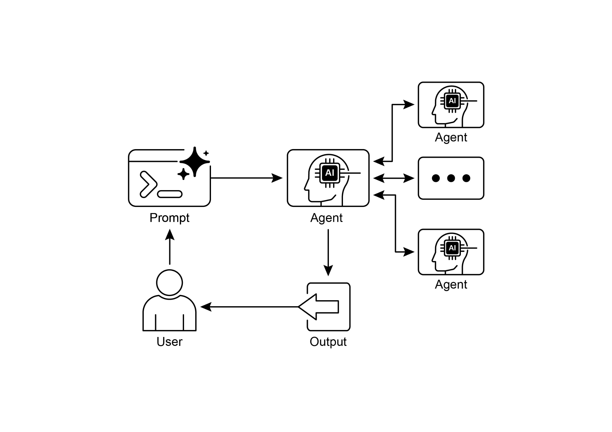
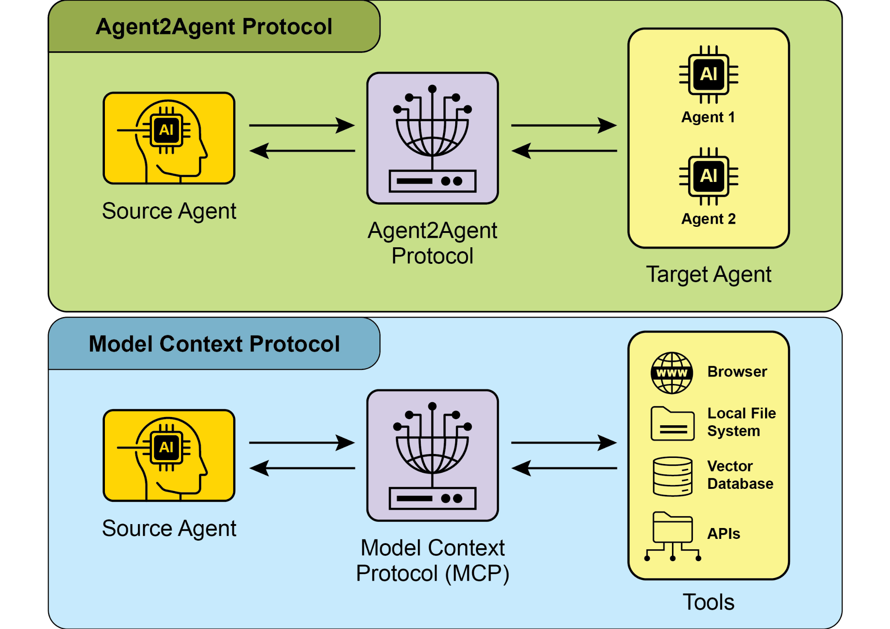

# Chapter 15: Inter-Agent Communication (A2A) 智能体间通信

本章讨论 Agent2Agent（A2A）协议，以及不同框架的智能体如何发现彼此的能力、委派任务、跟踪状态和交付成果。笔记按第 15 组课件的主题整理，并保留两张原图和两段日历示例伪代码。

## 为什么需要 A2A

- **能力孤岛**：日历、检索、写作等任务各有专长。把复杂任务分给不同智能体，可以让各模块独立开发和部署。
- **框架差异**：ADK、LangGraph 和 CrewAI 组织模型、工具和执行流程的方式各不相同。A2A 为它们约定统一的对外接口和任务语义。
- **集成成本**：逐对编写适配器会重复开发。统一能力声明、任务状态和结果格式，有助于降低跨系统协作成本。

A2A 是开放的协作协议，配有开源实现。课件以 Box、SAP、Salesforce 和 LangChain 为生态参与或支持的例子。协议约定协作接口，服务仍需自行实现任务规划、模型选择、工具调用与权限控制。

## 核心概念

### 用户、客户端与服务端

| 角色 | 职责 |
| --- | --- |
| User（用户） | 提出目标和约束，例如查找三人明天下午的共同空闲时段。 |
| A2A Client（客户端） | 代表用户发起委派、补充信息并接收结果，可以是应用或另一个智能体。 |
| A2A Server（服务端） | 通过 HTTP 端点接收请求，自行执行任务并返回结果。客户端通过约定的接口使用其能力。 |

请求从用户经客户端发往服务端，结果沿途返回。客户端和服务端是相对于一次调用而言的角色，同一个智能体可以同时为上游提供服务并向下游委派任务。

### Agent Card 与服务发现

Agent Card 是机器可读的智能体名片，描述名称、端点、版本、技能、交互能力、输入输出和认证要求。**Skill** 描述能完成的业务工作，**Capability** 描述支持的交互方式，例如流式更新或推送。服务端在执行请求时仍需验证身份与权限。

课件中的 WeatherBot 名片节选如下。

```json
{
  "name": "WeatherBot",
  "capabilities": {"streaming": true},
  "skills": [{
    "id": "get_forecast",
    "name": "Get Forecast",
    "description": "查询未来天气",
    "examples": ["伦敦周末会下雨吗？"]
  }]
}
```

| 发现方式 | 做法与适用场景 |
| --- | --- |
| Well-Known URI | 到已知服务域名的约定路径读取名片，适用于已知服务地址的公网或域内场景。 |
| 策展注册表 | 在集中目录发布名片并按能力检索，便于企业统一治理和管理访问。 |
| 直接配置 | 预置地址或直接共享名片，适用于合作关系固定的私有系统。 |

课件讲者备注指出，书中示例使用 `agent.json`，课件核对的规范使用 `agent-card.json`。接入时按部署的协议版本与服务文档确认路径，并核对服务身份、能力和访问权限。

### Task、Message、Artifact 与 Part

| 对象 | 用途 | 日历案例 |
| --- | --- | --- |
| Task（任务） | 有唯一 ID 和状态的可跟踪工作 | 查找三人的共同空闲时段 |
| Message（消息） | 承载请求、追问、补充信息和答复 | “请提供日期范围与时区。” |
| Artifact（工件） | 交付可供用户或下游使用的成果 | 可选时段列表、日程文件 |
| Part（内容片段） | 组成消息或工件，可以是文本、文件或结构化数据 | 时段数据或日程文件片段 |

课件以 HTTP(S) 和 JSON-RPC 说明传输方式。`taskId` 跟踪具体任务，`contextId` 关联多轮交互的上下文。



*图 2，来源为《Agentic Design Patterns》第 15 章。*

### 任务状态与多轮交互

1. **提交与执行**。任务从 `submitted` 进入 `working` 后，客户端可以跟踪执行进度。
2. **等待补充**。服务端缺少日期、时区或时长等信息时，可进入 `input-required`，由客户端向用户收集所需信息。
3. **继续执行**。用户补充“明天下午，上海时区”后，客户端用 `taskId` 关联原任务，用 `contextId` 维持上下文，再把补充信息发给服务端。
4. **结束任务**。`completed` 表示完成，可返回成果。对于 `failed` 或 `canceled`，客户端按失败原因或取消情况分别处理。

这些是课件展示的主要状态。完整状态与迁移规则取决于使用的协议版本。

## 交互机制与安全

| 机制 | 工作方式与适用场景 |
| --- | --- |
| 同步请求与响应 | 在同一次请求中等待答复，适合快速查询等短操作。 |
| 异步轮询 | 先取得任务 ID，再定期查询状态，适合较长任务。轮询频率需要兼顾时效与请求成本。 |
| 流式更新（SSE） | 服务端沿现有连接持续发送事件，适合实时展示进度或增量结果。 |
| 推送通知（Webhook） | 客户端预先登记回调地址，服务端在重要变化时发起回调，适合客户端难以长期维持连接的任务。 |

选择方式时先考虑任务时长和用户如何等待，再核对 Agent Card 声明的流式或推送能力。连接中断后，可通过任务 ID 检查实际执行状态。使用 Webhook 时，服务端需验证回调地址，接收端也需校验通知。

- **传输和身份**：使用 TLS 保护传输，按部署要求采用 mTLS 验证双方身份，并保护服务和 Agent Card 端点。
- **授权**：Agent Card 声明认证要求，服务端校验身份并判断资源访问范围。查询空闲时间和修改日历需要各自的权限。
- **凭据**：通过安全通道传递凭据，避免将令牌或密钥放入公开名片和普通任务消息。
- **审计**：关联调用方、`taskId`、操作与结果，便于排查问题，同时控制日志中的敏感信息。

## A2A 与 MCP 的分工

| 协议 | 作用 | 日历示例 |
| --- | --- | --- |
| A2A（Agent2Agent） | 在智能体之间委派任务、交换状态与成果，远端智能体自行组织执行。 | 主智能体请日历智能体分析约束并给出可选时段。 |
| MCP（Model Context Protocol） | 为模型或智能体连接外部工具与数据资源。 | 日历智能体使用查询工具读取日历。 |

两种协议可组合使用。课件中的 `CalendarToolset` 示例直接访问 Google Calendar API。



*图 1，来源为《Agentic Design Patterns》第 15 章。*

## 应用场景与日历案例

- **多框架协作**：不同团队独立开发和部署专精智能体，通过共同接口协作。
- **自动化工作流**：由不同智能体依次完成数据采集、分析和成稿，并传递任务状态与交付成果。
- **动态信息检索**：主智能体提出查询需求，专责智能体调用外部 API 并返回结构化结果。

日历案例中，用户希望找到三个人明天下午共同空闲的 30 分钟，并获得两个备选时段。

1. 主智能体整理日期、时区、人员和时长，发现具备日历查询技能的智能体并通过 A2A 委派任务。条件不全时，主智能体向用户追问。
2. 日历智能体验证读取权限，调用日历 API，计算共同空闲时段，再返回任务状态和时段 Artifact。
3. 主智能体把结果整理成备选时段。用户选定时段后，如需创建会议，先确认其选择并校验写权限。

### 代码一：定义日历智能体与对外技能

课件的教学伪代码省略了导入、认证流程、模型配置和部分必填参数。

```python
tools = CalendarToolset(credentials)
agent = LlmAgent(
    model=MODEL_NAME,
    instruction="明确日期、时区和时长",
    tools=await tools.get_tools()
)
skill = AgentSkill(
    id="check_availability", ...
)
card = AgentCard(skills=[skill], ...)
```

`CalendarToolset` 封装访问日历 API 的工具，凭据与权限在工具层配置。`LlmAgent` 按指令使用工具。`AgentSkill` 描述检查空闲时间的业务技能，`AgentCard` 汇总技能及端点、交互与安全信息。

### 代码二：封装执行器并暴露服务

```python
runner = Runner(agent=agent, ...)
executor = ADKAgentExecutor(runner, card)
handler = DefaultRequestHandler(
    agent_executor=executor,
    task_store=InMemoryTaskStore()
)
service = A2AStarletteApplication(
    agent_card=card,
    http_handler=handler
)
serve_with_uvicorn(service)
```

`Runner` 运行智能体，`ADKAgentExecutor` 将 A2A 协议要求衔接到 ADK 执行逻辑。`DefaultRequestHandler` 处理协议请求，`TaskStore` 保存任务状态。`A2AStarletteApplication` 组装 HTTP 服务，末行是启动服务的示意调用。内存存储适用于演示，生产部署需考虑持久化、权限、可观测性与版本兼容。

## 要点回顾

- “请补充日期”是推进交互的 Message，可选时段列表是交付成果 Artifact。
- 任务进入 `input-required` 时，客户端收集缺失信息，并关联原任务继续交互。
- 委派日历查询工作属于智能体间协作，调用日历 API 属于工具访问。

## 参考资料

- 《Agentic Design Patterns》中文版，第 15 章，PDF 第 185–196 页。[中文版](https://ningg.top/Agentic-Design-Patterns-CN/)
- [A2A 协议规范](https://a2a-protocol.org/latest/specification/)
- [A2A 示例仓库](https://github.com/a2aproject/a2a-samples)
