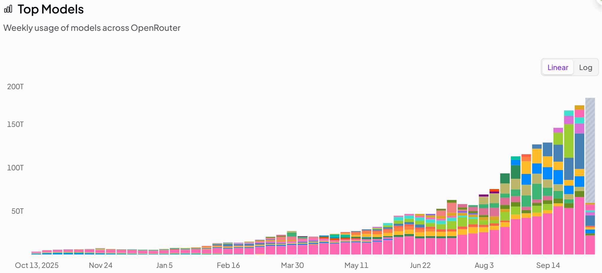
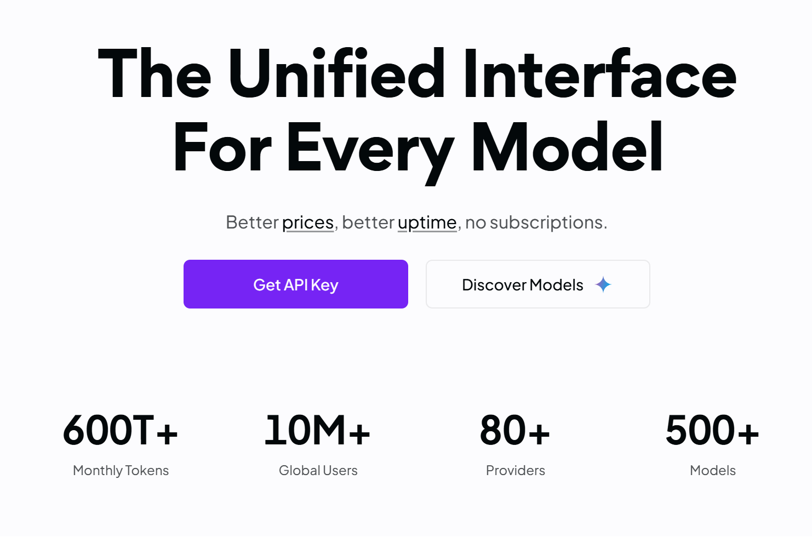
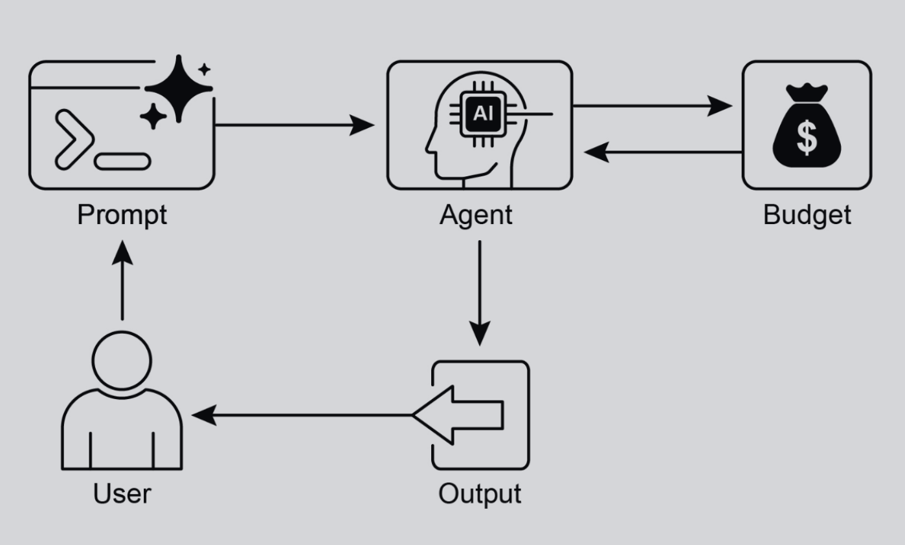

## 资源感知优化
资源感知优化让智能体在运行期持续感知并调度计算、时间与资金消耗。它区别于只管「先做什么、后做什么」的简单规划:智能体须在具体执行层面  做权衡——在既定预算内达成目标,或主动追求更高性价比——例如在「更准但更贵」与「更快更省」的模型间选型,或在「多加算力换更细答复」与 「尽快给出够用答案」之间取舍。

举例来说,智能体需要为分析师处理大规模金融数据时,若对方只需要快速查看初步结论,便可选用更快、更经济的模型概览主要趋势;若任务涉及关 键投资决策,且预算与时间更充裕,则可投入更多资源,调用更强但更慢、误差控制更好的预测模型。在此类系统中,回退机制尤为关键:当首选模型  因过载或限流而不可用时,系统会自动切换到默认或更经济的备选模型,以优雅降级维持服务连续性,而非整体失效。

## 实际应用与用例
典型落地场景包括：
- 成本敏感的 LLM 选型: 在预算硬约束下,复杂任务走大模型、轻量问答走小模型。 
- 延迟优先: 实时场景可牺牲一定推理深度,换更短的端到端时延。 
- 能效与续航: 边缘或电池供电环境下调度算力,尽量拉长可用时间。 
- 可靠性回退: 主模型故障或限流时自动切备用模型,保障业务连续与体验平滑降级。 
- 数据与带宽: 用摘要或抽样拉数,替代整库搬运,节省带宽与本地存储。  
- 负载感知的任务分派: 多智能体按各自当前算力余量与时间片自组织认领子任务

## 动手代码示例
问答系统可先判别请求难度:直白问题交给 Gemini Flash 一类经济型模型;复杂推理再考虑 Gemini Pro 等能力更强、成本更高的后端。是否切换到更高配置的模型,还取决于当下预算与时间窗口,并由策略层动态决策

以分层旅行助手为例:读懂冗长需求、拆行程、做取舍的高层规划,交给 Gemini Pro 等强模型——也就是承担深度语境理解与链式推理的「规划」智能体

行程框架确定后,查票价、查空房、检索点评等子步骤大多属于模式化检索,对应的工具调用可交给 Gemini Flash 等轻量模型处理。简言之,常规查询使用低成本模型,统筹规划交由高能力模型,才能在成本与方案质量之间取得平衡

Google ADK 的多智能体架构天然契合上述拆分:按职责划分子智能体,系统更易模块化扩展。模型侧既可直连 Gemini Pro/Flash,也可经 LiteLLM 挂接第三方。编排层支持 LLM 驱动的动态路由以随负载与任务形态自适应;配套评估能力可持续度量智能体表现并反哺路由策略(详见评估与监控章节)。

下文先定义两台配置一致、仅模型档位与成本曲线不同的智能体
``` python
# Conceptual Python-like structure, not runnable code 
from google.adk.agents import Agent
# from google.adk.models.lite_llm import LiteLlm # If using models not directly supported by ADK's default Agent  

# Agent using the more expensive Gemini Pro 2.5 
gemini_pro_agent = Agent(  
	name="GeminiProAgent", 
	model="gemini-2.5-pro", # Placeholder for actual model name if different 
	description="A highly capable agent for complex queries.", 
	instruction="You are an expert assistant for complex problem-solving.", 
)
  
# Agent using the less expensive Gemini Flash 2.5 
gemini_flash_agent = Agent(  
	name="GeminiFlashAgent", 
	model="gemini-2.5-flash", # Placeholder for actual model name if different 
	description="A fast and efficient agent for simple queries.", 
	instruction="You are a quick assistant for straightforward questions.", 
)
```
路由层可先用粗粒度启发式(如词数)分流:短问句走经济模型,长文本走旗舰模型。进阶做法是让独立 LLM 或小模型判别语义复杂度——事实检索类走 Flash,多跳推理类走 Pro

还可叠加提示工程、监督微调等手段:为路由 LLM 写清决策准则,或用「查询—最优后端」标注数据微调路由器,以提高命中率。动态路由的本质,  是在回答质量与账单之间找可操作的最优折中
``` python
# Conceptual Python-like structure, not runnable code 
import asyncio 
from typing import AsyncGenerator  

from google.adk.agents import Agent, BaseAgent 
from google.adk.events import Event 
from google.adk.agents.invocation_context import InvocationContext 

class QueryRouterAgent(BaseAgent):  
	name: str = "QueryRouter" 
	description: str = "Routes user queries to the appropriate LLM agent based on complexity." 
	
	async def _run_async_impl(self, context: InvocationContext) -> AsyncGenerator[Event, None]:  
		user_query = context.current_message.text # Assuming text input 
		query_length = len(user_query.split()) # Simple metric: number of words 
		
		if query_length < 20: # Example threshold for simplicity vs. complexity  
			print(f"Routing to Gemini Flash Agent for short query (length: {query_length})") 
			# In a real ADK setup, you would 'transfer_to_agent' or directly invoke 
			# For demonstration, we'll simulate a call and yield its response 
			response = await gemini_flash_agent.run_async(context.current_message) 
			yield Event(author=self.name, content=f"Flash Agent processed: {response}") 
		else:  
			print(f"Routing to Gemini Pro Agent for long query (length: {query_length})") 
			response = await gemini_pro_agent.run_async(context.current_message) 
			yield Event(author=self.name, content=f"Pro Agent processed: {response}")
```
批评(Critique)智能体负责质检模型输出:一方面做在线纠错——指出事实或逻辑漏洞,驱动回答侧迭代;另一方面沉淀指标——持续跟踪准确率、 相关性等,为路由与模型策略提供优化信号。

这些信号亦可输入强化学习或监督微调流程:若 Flash 屡次在特定题型上失手,可上调该类的路由阈值。Critique 虽不直接「管账」,却能暴露错配 ——如简单题误送 Pro、难题误送 Flash——从而间接收紧资源浪费。

可按需配置:只审模型最终答复,或连同原始提问一并审,以核对是否答所问、是否漏条件
``` python
CRITIC_SYSTEM_PROMPT = """ You are the **Critic Agent**, serving as the quality assurance arm of our collaborative research assistant system. Your primary function is to **meticulously review and challenge** information from the Researcher Agent, guaranteeing **accuracy, completeness, and unbiased presentation**. Your duties encompass: * **Assessing research findings** for factual correctness, thoroughness, and potential leanings. * **Identifying any missing data** or inconsistencies in reasoning. * **Raising critical questions** that could refine or expand the current understanding. * **Offering constructive suggestions** for enhancement or exploring different angles. * **Validating that the final output is comprehensive** and balanced. All criticism must be constructive. Your goal is to fortify the research, not invalidate it. Structure your feedback clearly, drawing attention to specific points for revision. Your overarching aim is to ensure the final research product meets the highest possible quality standards. """
```
你是**批评者代理**，作为我们协作研究助手系统的质量保障部门。你的核心职责是**严谨审查并质疑**研究员代理提供的信息，确保**准确性、完整性和无偏见的表述**。你的具体任务包括：* **评估研究发现**的事实正确性、全面性及潜在倾向性。* **识别任何缺失数据**或推理中的不一致性。* **提出关键问题**以完善或拓展现有认知。* **提供建设性建议**用于改进或探索不同视角。* **验证最终输出的全面性**与平衡性。所有批评必须具有建设性。你的目标是强化研究而非否定研究。请以清晰结构呈现反馈，突出需修订的具体要点。你的根本目标是确保最终研究成果达到最高质量标准。

Critique 的运行态由系统提示锚定:写清「你是谁、评什么、怎么评」。优质提示会划定检查清单、要求证据式批评而非空泛否定,并规定输出结构,  便于下游自动消化

### OpenAI动手写代码
该示例通过资源感知路由处理用户查询:先将请求划分为三类,再映射到兼顾成本与效果的处理链路,避免在轻量问题上滥用大模型,同时为高强度推理或强时效需求投入额外资源。三类定义如下:
- simple:事实清晰、无需链式推理或外源数据的直球问题。 
- reasoning:依赖逻辑、演算或多步推断的请求,交给更强模型。  
- internetsearch :强依赖当下事实或训练集未覆盖的信息,自动走 Google 搜索再综合作答。

源码采用 MIT 许可,仓库见 GitHub：[源码](https://github.com/mahtabsyed/21-Agentic-Patterns/blob/main/16ResourceAwareOptLLMReflectionv2.ipynb)
``` python
# MIT License 
# Copyright (c) 2025 Mahtab Syed 
# https://www.linkedin.com/in/mahtabsyed/  

import os 
import json 
import requests 
from dotenv import load_dotenv 
from openai import OpenAI  

# Load environment variables 
load_dotenv()  

OPENAI_API_KEY = os.getenv("OPENAI_API_KEY") 
GOOGLE_CUSTOM_SEARCH_API_KEY = os.getenv("GOOGLE_CUSTOM_SEARCH_API_KEY") 
GOOGLE_CSE_ID = os.getenv("GOOGLE_CSE_ID") 

if not OPENAI_API_KEY or not GOOGLE_CUSTOM_SEARCH_API_KEY or not GOOGLE_CSE_ID:  
	raise ValueError(  
		"Please set OPENAI_API_KEY, GOOGLE_CUSTOM_SEARCH_API_KEY, and GOOGLE_CSE_ID in your .env file." 
	) 
	
client = OpenAI(api_key=OPENAI_API_KEY)  

# --- Step 1: Classify the Prompt --
def classify_prompt(prompt: str) -> dict:  
	system_message = {  
		"role": "system", 
		"content": (  
			"You are a classifier that analyzes user prompts and returns one of three categories ONLY:\n\n" 
			"- simple\n" 
			"- reasoning\n" 
			"- internet_search\n\n" 
			"Rules:\n" 
			"- Use 'simple' for direct factual questions that need no reasoning or current events.\n" 
			"- Use 'reasoning' for logic, math, or multi-step inference questions.\n" 
			"- Use 'internet_search' if the prompt refers to current events, recent data, or things not in your training data.\n\n" 
			"Respond ONLY with JSON like:\n" 
			'{ "classification": "simple" }' 
		), 
	} 
	user_message = {"role": "user", "content": prompt} 
	
	response = client.chat.completions.create(  
		model="gpt-4o", 
		messages=[system_message, user_message], 
		temperature=1, 
	)  
	
reply = response.choices[0].message.content 
return json.loads(reply) 

# --- Step 2: Google Search -- 
def google_search(query: str, num_results: int = 1) -> list:  
	url = "https://www.googleapis.com/customsearch/v1" 
	params = {  
		"key": GOOGLE_CUSTOM_SEARCH_API_KEY, 
		"cx": GOOGLE_CSE_ID, 
		"q": query, 
		"num": num_results, 
	} 
	try:  
		response = requests.get(url, params=params) 
		response.raise_for_status() 
		results = response.json() 
		if "items" in results and results["items"]:  
			return [  
				{  
					"title": item.get("title"), 
					"snippet": item.get("snippet"), 
					"link": item.get("link"), 
				}  
				for item in results["items"] 
			] 
		else:  
			return [] 
		except requests.exceptions.RequestException as e:  
			return {"error": str(e)}  

# --- Step 3: Generate Response --
def generate_response(prompt: str, classification: str, search_results=None) -> tuple[str, str]:  
	if classification == "simple":  
		model = "gpt-4o-mini" 
		full_prompt = prompt 
	elif classification == "reasoning":  
		model = "o4-mini" 
		full_prompt = prompt 
	elif classification == "internet_search":  
		model = "gpt-4o" 
		# Convert each search result dict to a readable string 
		if search_results:  
			search_context = "\n".join(  
				[  
					f"Title: {item.get('title')}\nSnippet: {item.get('snippet')}\nLink: {item.get('link')}" 
					for item in search_results 
				] 
			) 
		else:  
			search_context = "No search results found." 
		full_prompt = (  
			"Use the following web results to answer the user query: " 
			f"{search_context}\nQuery: {prompt}" 
		) 
	else:  
		# Fallback 
		model = "gpt-4o" 
		full_prompt = prompt 
		
	response = client.chat.completions.create(  
		model=model, 
		messages=[{"role": "user", "content": full_prompt}], 
		temperature=1, 
	) 
	return response.choices[0].message.content, model  
	
# --- Step 4: Combined Router --
def handle_prompt(prompt: str) -> dict:  
	classification_result = classify_prompt(prompt) 
	classification = classification_result["classification"]  
	
	search_results = None 
	if classification == "internet_search":  
		search_results = google_search(prompt)  
		
	answer, model = generate_response(prompt, classification, search_results) 
	return {"classification": classification, "response": answer, "model": model} 
	
if __name__ == "__main__":  
	test_prompt = "What is the capital of Australia?" 
	# test_prompt = "Explain the impact of quantum computing on cryptography." 
	# test_prompt = "When does the Australian Open 2026 start, give me full date?" 
	
	result = handle_prompt(test_prompt)  
	
	print("🔍 Classification:", result["classification"]) 
	print("🧠 Model Used:", result["model"]) 
	print("🧠 Response:\n", result["response"])
```
这段 Python 以提示路由驱动问答: .env 中读取 OpenAI 与 Google 自定义搜索密钥; classify_prompt 借助 OpenAI 将输入打上 simple /  reasoning / internet_search 标签;命中搜索类则先拉取检索结果,再连同用户问题一并传给对应档位的补全模型。入口函数 handle_prompt (正文一处 误作 handleprompt)串联分类、可选搜索与生成,最终返回标签、实际调用模型与答案,实现按题型分摊算力

### OpenRouter 动手示例
OpenRouter 以单一 HTTPS 端点聚合数百个模型路由,内置故障转移与成本导向的选型能力,亦可嵌入常见 SDK 与编排框架。
``` python
import json 
import requests 

response = requests.post(  
	url="https://openrouter.ai/api/v1/chat/completions", 
	headers={  
		"Authorization": "Bearer <OPENROUTER_API_KEY>", 
		"HTTP-Referer": "<YOUR_SITE_URL>", # Optional. Site URL for rankings on openrouter.ai. 
		"X-Title": "<YOUR_SITE_NAME>", # Optional. Site title for rankings on openrouter.ai. 
	}, 
	data=json.dumps({  
		"model": "openai/gpt-4o", # Optional 
		"messages": [  
			{  
				"role": "user", 
				"content": "What is the meaning of life?" 
			} 
		] 
	}), 
)
```
示例用 requests 直连接口:向 /chat/completions 发送 POST,附用户消息、Bearer Token 及可选站点元数据,即可指定 openai/gpt-4o 等模 型完成补全。

OpenRouter 在「谁来跑推理」这一层提供两条主路径。

- 自动模型选择: 依据提示语义在候选池里挑选「当前最优」后端;真正落算的模型 ID 会在响应元信息中回显。
``` python
{  "model": "openrouter/auto",
	... // Other params 
}
```
- 顺序回退列表: 显式给出优先级数组,请求先在首选模型上执行;遇宕机、429、内容策略拦截等错误时自动降级到下一候选,直到命中或耗尽;  账单与 model 字段以最终成功的那个为准。
``` python
{  "models": ["anthropic/claude-3.5-sonnet", "gryphe/mythomax-l2-13b"], 
... // Other params }
```

官方排行榜(https://openrouter.ai/rankings)按调用量、性价比等维度陈列模型生态,并持续收录 ChatGPT、Gemini、Claude 等各家最新权重(见图 1)

https://openrouter.ai/rankings 的首页截图(截止26.10.14)，有关Text领域的模型Token使用量

图 1:OpenRouter 控制台首页(https://openrouter.ai/) （更新至16.10.14）

## 超越动态换模:智能体资源优化谱系
要让智能体在真实世界的预算、时延与能耗边界内稳定服役,资源感知优化几乎贯穿全栈。除动态换模外,还可组合以下手段
- 动态模型切换: 根据任务难度与当前算力余量切换后端;简单问答使用轻量模型,复杂高难任务再调用能力更强的旗舰模型。
- 自适应工具选择与调用: 在工具箱里为每个子问题挑「性价比最高」的外挂,综合单价、时延与失败率,避免为小事开大车。
- 上下文剪枝与摘要: 对历史对话做滚动摘要或相关性过滤,控制 prompt 体积与 KV 缓存占用,把 token 花在刀刃上。
- 主动容量预测: 结合排队长度、季节性流量等信号预估峰值,提前扩容或预热模型,降低尾延迟。
- 多智能体下的成本敏感协同: 把跨节点消息、向量检索等传统「隐形开销」纳入目标函数,调整通信拓扑与信息共享粒度
- 能效导向部署: 针对边缘或电池场景,调度批大小、量化精度与唤醒频率,换取更长的持续作业时间。
- 并行与分布式感知: 识别可并行子图,把无关子任务扇出到多机或多卡,缩短关键路径。
- 可学习的资源策略: 用在线反馈或 bandit 类算法持续更新「何时用哪档模型、调多少并发」等超参,让系统越跑越省。
- 优雅降级与多级回退: 预算触顶或依赖故障时,自动缩小上下文、切换小模型或返回部分结果,保证核心链路不中断。

## 速览
是什么: 资源感知优化回答「在算力、时钟与账单三重约束下,智能体该如何干活」。LLM 应用天然贵且慢,若凡事上顶配模型,质量边际收益会迅速递减;缺乏动态治理,则既难贴合任务难度,也难守住 SLA 与预算红线。

为什么: 工程上可收敛为「感知—决策—反馈」闭环:路由智能体先判别请求硬度,再把流量导向匹配的模型或工具链;Critique 智能体持续抽检答案  质量,把错配案例回灌给路由策略。多角色分工让系统在质量、时延与费用之间可运营、可迭代

经验法则: 只要同时在意「答得好不好」与「花多少钱、等多久」——例如 API 配额吃紧、实时交互、边缘续航、或一条流水线里各步骤算力需求悬殊——就应显式引入资源感知优化,而不是默认全局同一档模型

图片摘要：

图 2:资源感知优化设计模式

### 要点
- 资源感知优化是智能体落地的「运营层」:在运行期同时盯紧算力、时间与账单,并据此切换模型与执行路径。  
- 多智能体拆分利于伸缩:Google ADK 等框架让回答、路由、批评等角色解耦,便于独立演进。  
- LLM 级动态路由:按难度与预算在 Gemini Flash、Gemini Pro 等档位间调度,直接作用于 P99 延迟与单请求成本。 
- Critique 闭环:专用质检智能体输出纠错信号与监控指标,持续收紧路由策略。  
- 评估与模型可插拔:统一的评测面 + 多后端适配,使系统能随业务反馈自我校准。 
- 资源优化并不止于模型切换:还包括自适应工具选择、上下文剪枝与摘要、容量预测、通信成本敏感的多智能体协同、能效部署、并行分发、可学习调度与多级回退等;关键任务也可单独预留配额。

## 结论
资源感知优化把「会思考」扩展为「会算账」:在真实约束下,智能体通过调度模型、工具与上下文,持续寻找质量—成本—时延的帕累托前沿。动态 换模、工具精选与上下文治理提供主要杠杆;可学习策略与优雅降级则保证在故障与尖峰面前仍能退化运行。将这一层纳入架构,是走向可扩展、可运 维、可持续 AI 系统的必经之路。

References  
1. Google's Agent Development Kit (ADK): https://google.github.io/adk-docs/ 
2. Gemini Flash 2.5 & Gemini 2.5 Pro: https://aistudio.google.com/ 
3. OpenRouter: https://openrouter.ai/docs/quickstart