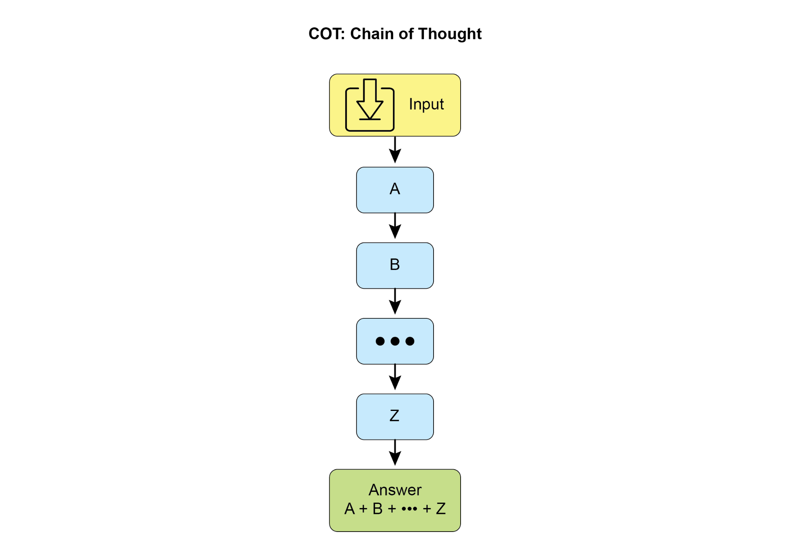
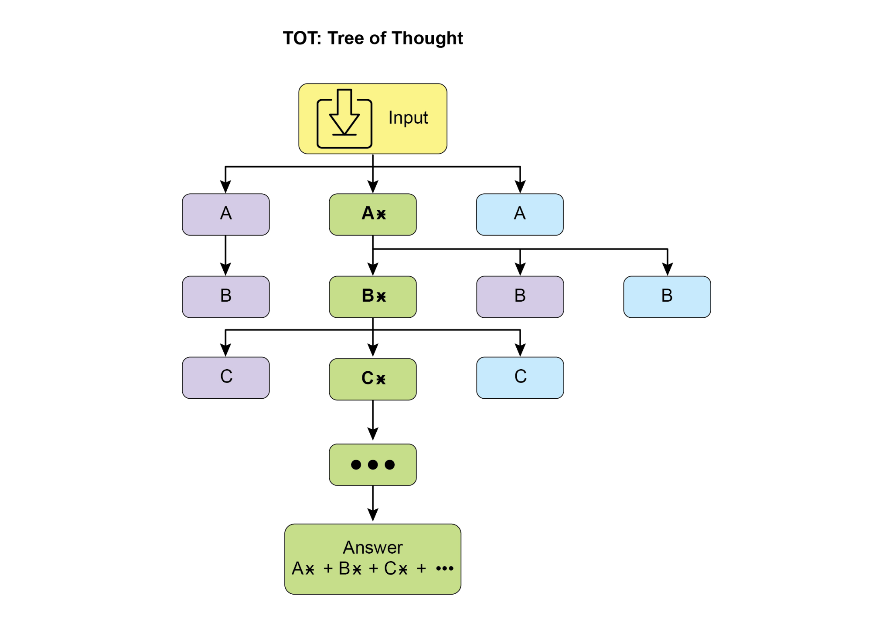
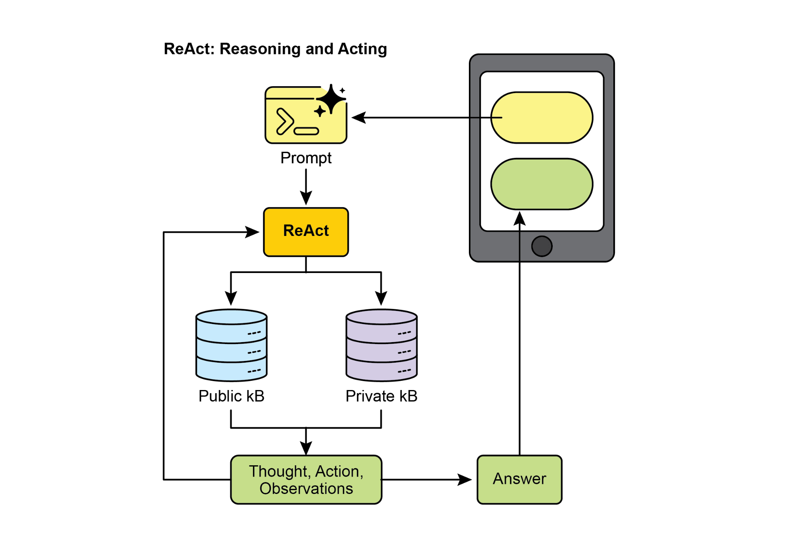
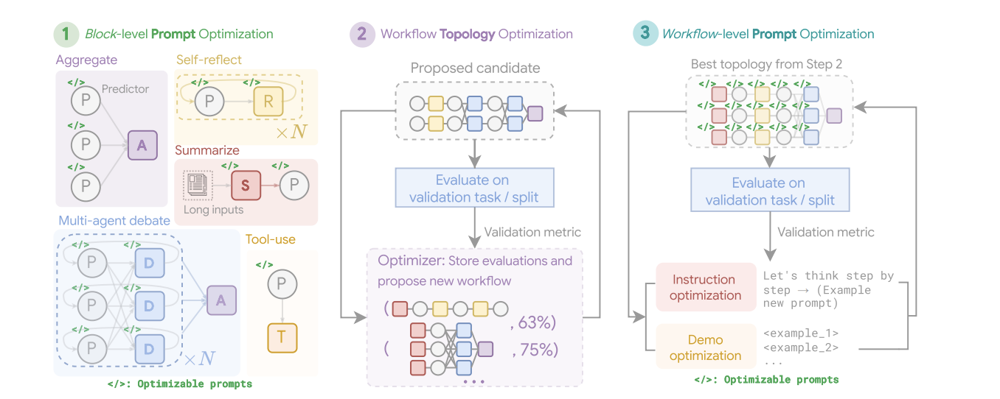
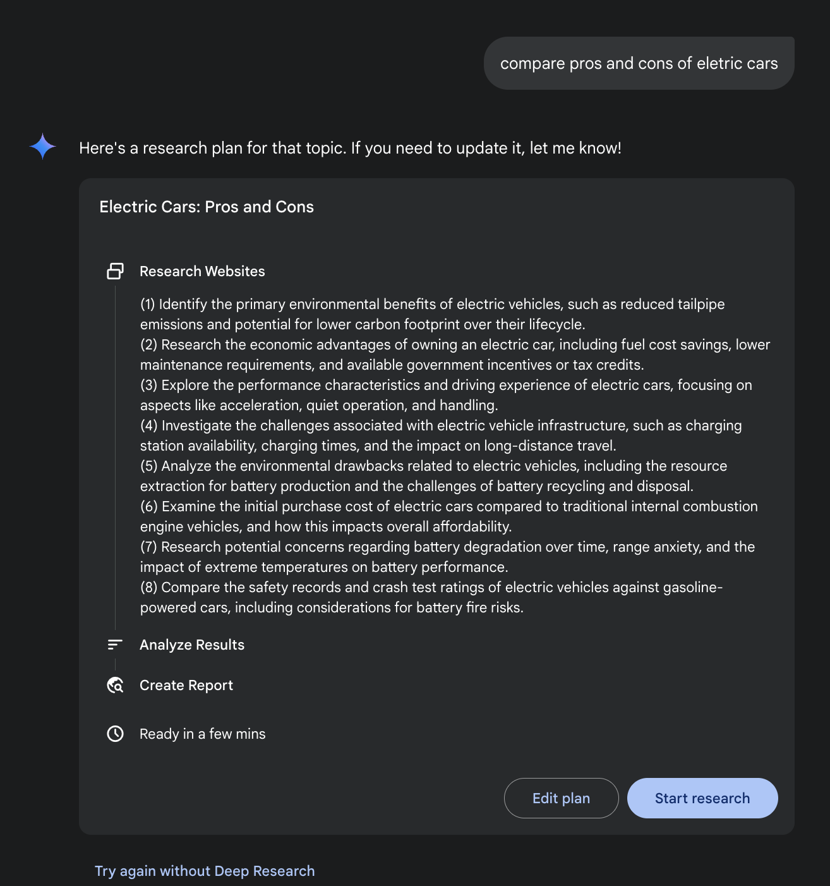
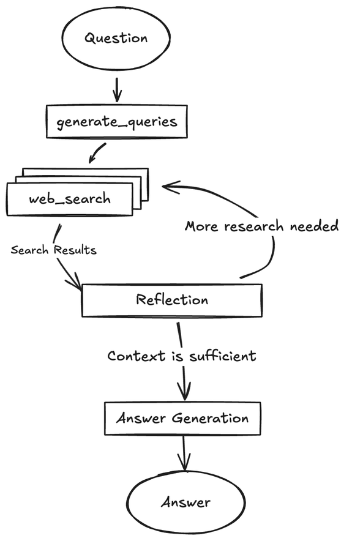
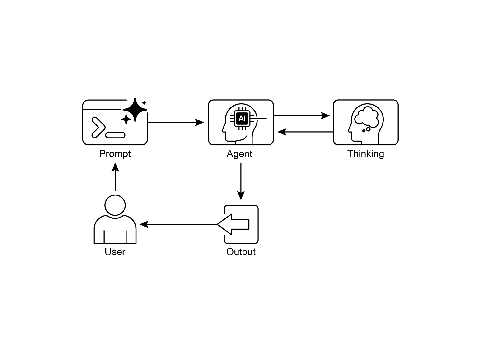

# Chapter 17: Reasoning Techniques 推理技术

> 来源：[《Agentic Design Patterns》中文双语版第 17 章节选](Agentic-Design-Patterns-CN_207.pdf)。下文页码沿用书内页码（207–224），图号沿用原文。

## 1. 为什么需要多步推理（第 207 页）

复杂任务常常要拆分问题、比较备选方案、核对证据，并在得到新信息后调整计划。本章的共同思路是在**推理阶段**给模型更多时间、步骤或样本，把这些工作安排在交付答案之前。多投入的预算可以用来检查中间结论、搜索其他路径或调用工具；质量能否提高，还取决于中间结果能否被有效评估。

| 原文用例 | 多步推理解决什么问题 |
| --- | --- |
| 复杂问答 | 将多跳问题拆开，从不同来源收集事实，再验证它们能否推出结论。 |
| 数学解题 | 分步推导，把数值计算交给程序，并核查最终结果。 |
| 代码生成与调试 | 分步排查，根据测试失败定位问题，再修改与重跑。 |
| 战略规划 | 比较选项、前提和后果，随外部反馈更新计划。 |
| 医学诊断辅助 | 系统梳理症状、检查和病史，比较候选解释。 |
| 法律分析辅助 | 对照法规和判例，检查论证是否一致、依据是否充分。 |

## 2. 从分步推理到工具交互（第 208–213 页）

### 思维链（CoT）与思维树（ToT）

**CoT（Chain-of-Thought）**将难题拆成一条可以逐步推进的推理路径。提示中可以给出少量分步示范（few-shot），也可以直接指定要做的中间步骤。原文的信息检索例子要求比较经典计算机与量子计算机，并举出一个应用：先理解问题、拟定检索词、整理关键概念，再综合信息和检查答案是否满足要求。示例中的检索是模拟步骤，不能当作已经核验的外部证据。



**ToT（Tree-of-Thought）**在中间步骤保留多个候选，评估哪些值得继续，必要时回溯并改走别的分支。它适合早期选择会显著影响结果的规划与决策任务，效果取决于候选生成和评估能否筛掉无效路径。



### 自我纠正（Self-Correction）

把质量检查放进生成流程：理解原始要求 → 分析当前草稿 → 找出缺陷 → 提出具体修改 → 生成修订稿。原文用不超过 150 字符的 GreenTech Gadgets 产品宣传帖演示：初稿虽短，但卖点笼统、行动号召较弱；修订时突出环保特征、加强动词和行动号召，再检查长度限制。复杂任务可以重复这套流程；涉及事实或执行结果时，可结合来源、规则或测试校验。相关模式见第 4 章。

### 程序辅助语言模型（PALMs）与可验证奖励（RLVR）

- **PALMs（Program-Aided Language Models）**让模型把数学、逻辑或数据处理转成代码，由确定性运行时执行，再把结果解释给用户。代码可稳定执行，但代码本身仍需核对。书中的 Google ADK 片段让根智能体通过 `AgentTool` 调用两个专门角色：一个用 `google_search` 查资料，另一个用 `BuiltInCodeExecutor` 执行代码。
- **RLVR（Reinforcement Learning with Verifiable Rewards）**是训练方法：数学题可用答案判分，代码题可运行测试，模型用这类可验证反馈学习更有效的求解策略。原文以专门的推理模型为例，说明它们在推理时可按题目难度分配不同的思考预算，支持较长的推理、回溯与自检。可验证奖励属于训练环节；思考预算属于运行时配置。

### ReAct：思考 → 行动 → 观察

模型根据当前信息决定下一步，调用知识库（图中 KB）、数据库、计算工具或 API，再把返回结果带入下一轮决策。若证据不足，继续检索或调整方案；若满足任务条件，则交付。CoT 帮助把问题拆步，ReAct 则把外部反馈纳入每一轮，适合必须边执行边调整的任务。



## 3. 多智能体辩论与系统搜索（第 213–215 页）

**CoD（Chain of Debates，辩论链）**组织多个模型依次提出观点、质询和反驳，再综合结论，类似同行评审。**GoD（Graph of Debates，辩论图）**把论点当作节点，以支持、反驳等关系连接；多条讨论线可以分叉或汇合，最终从图中选取支撑最充分的一组论点。应优先采用能被来源交叉核对的证据；模型共识本身不能证明事实正确。

**MASS（Multi-Agent System Search）**解决的是如何设计多智能体系统：提示怎样写，角色如何连接、按什么顺序执行。原文介绍三个阶段：

1. **优化块级提示。**先让每个角色独立完成职责。例如 HotpotQA 的辩论角色以事实核查员身份逐条对照原文，识别答案中的不一致和无依据说法。
2. **优化工作流拓扑。**在配置空间中选择连边和调用顺序，按相对基线的边际收益优先探索有潜力的组合。MBPP 编程任务的示例将多轮代码修订与运行测试结合起来。
3. **联合优化工作流提示。**固定拓扑后一起调整各角色提示，减少职责冲突和隐性依赖。DROP 示例结合数据集特点、少量高质量示例和角色设定，提升整条流程的表现。

原文报告，在所列基准上，MASS 搜出的系统优于若干手工与自动设计方案。可复用的设计顺序是：先让个体能完成自己的任务，再搜索有影响的连接，最后联调全流程。



## 4. 推理扩展定律与 Deep Research（第 216–218 页）

**推理扩展定律（Scaling Inference Law）**关注模型部署以后，增加求解步骤、采样次数或搜索与验证开销会怎样影响表现。训练扩展关注的是参数、数据与训练算力。合适的任务上，小模型使用多样化采样、自洽投票或外部验证，有时能超过只生成一次的大模型；这并非固定比例或普遍保证。部署时要一起比较模型规模、响应延迟、运营成本与实际质量提升，把额外计算用在最能改善结果的步骤上。

**Deep Research**把额外的时间预算用在研究流程上：拆解问题并初查 → 整理发现、标出证据缺口和矛盾 → 追加查询并交叉核对 → 综合为带来源的报告。相较于直接交付搜索链接，它还承担了筛选证据和综合写作。原文列举了 Perplexity、Gemini 和 ChatGPT 中的相关形态。



## 5. 代码走读：LangGraph DeepSearch（第 218–220 页）

原文用 `gemini-fullstack-langgraph-quickstart` 演示 React 前端与 LangGraph 后端如何组成研究应用。后端使用 Gemini 生成查询，经 Google Search 获取材料，在反思节点找出缺失证据，补搜或生成带引用的终稿。图结构位于 `backend/src/agent/graph.py`：

```text
START → generate_query → web_research → reflection
                              ↑              │
                              └── 需补搜 ────┤
                                             └── 可收束 → finalize_answer → END
```

`generate_query` 可将多条查询分派给并行检索分支；`reflection` 通过条件边决定回到 `web_research` 还是进入 `finalize_answer`。这段示例展示了 ReAct 式的行动反馈，以及自我纠正如何落实为工作流节点。



原书给出的本地启动思路是：分别为 `frontend/` 和 `backend/` 安装依赖，在后端 `.env` 配置 Gemini API Key，用 `make dev` 启动；容器示例还用到 Redis 和 Postgres。具体依赖和启动步骤以所用仓库版本为准，原书将其定位为参考实现。

## 6. 选用推理模式与复盘（第 220–224 页）

智能体在有限的动作集合中选择下一步，把搜索摘要、网页或结构化工具结果纳入观察，再继续推进，直至满足终止条件。事实核查可记录每一步所用证据、动作和判断依据；动作密集的任务可只在关键分叉记录决策，以节约预算。可复盘的依据包括查询、工具输入输出和检查结果。

- 任务可沿一条清晰路径分步求解：用 CoT。
- 需要比较路线或撤销早期选择：用 ToT；已有草稿但需打磨：加入自我纠正。
- 涉及精确计算或执行测试：交给程序；依赖不断更新的外部反馈：用 ReAct。
- 候选结论需要独立质询：考虑 CoD 或 GoD；角色、连边与提示组合难以手工枚举时，可评估 MASS。
- 需要多轮取证与综合：采用类似 Deep Research 的流程，为检索、验证和终止条件分配预算。



原章列出的延伸阅读包括 CoT（Wei 等，2022）、ToT（Yao 等，2023）、Program-Aided Language Models（Gao 等，2023）、ReAct（Yao 等，2023）、推理算力分配的实证研究，以及 *Multi-Agent Design: Optimizing Agents with Better Prompts and Topologies*。完整条目见原章第 224 页。

