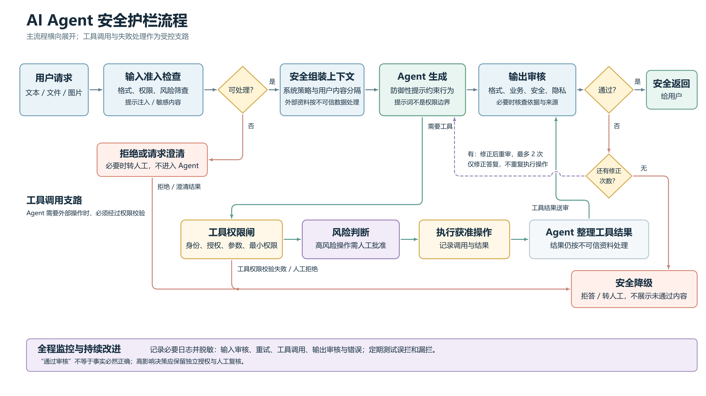

# Chapter 18: Guardrails and Safety Patterns 护栏与安全模式

> 来源：本目录《1111绝对最终版护栏与安全模式.pptx》。本文按主题整理课件中的概念、案例与实现；代码为示例节选，未连接外部服务运行。

## 1. 护栏的作用与实现位置

**护栏（Guardrails）**是在智能体接收信息、生成内容和执行操作时施加约束的防护层。它用于降低提示注入、偏见、有害输出、隐私泄露及工具越权的风险。规则适合检查确定的条件，小模型可以快速筛查内容，模型审查和人工复核可以补充语境判断。

| 防线 | 检查重点 | 典型做法 |
| --- | --- | --- |
| 输入校验 | 恶意载荷、越权指令、个人信息 | 长度和格式检查、规则扫描、敏感信息处理 |
| 输出过滤 | 有害内容、隐私、事实依据与输出格式 | 毒性检测、脱敏、结构校验、必要时改写 |
| 提示约束 | 角色、职责和业务范围 | 明确允许、禁止及需要转交的行为 |
| 工具限制 | 工具范围、参数和权限 | 白名单、访问控制、最小权限 |
| 外部审核 | 独立复核内容风险 | 接入外部审核服务 |
| 人工复核 | 高风险操作与难以判断的案例 | 暂停、审批、接管或急停 |

提示词可以约束模型行为，涉及退款、写入或发布时仍需由后端执行授权检查。内容合规、事实可靠、操作获准是三项独立判断。

## 2. 七类应用场景

| 场景 | 课件案例与处理方式 |
| --- | --- |
| 客服退款 | 用户要求跳过订单核验直接退款 299 元。先核身份、订单归属和退款规则，再由后端验证金额、权限与审批。获准后才执行并返回凭证；资料不足则补充或转人工。 |
| 内容生成 | 台灯宣传稿中的续航和认证需有材料支持，删去无法证实的承诺，核对版权与品牌规则，经编辑审核后发布。 |
| 教育辅导 | 以 `2x + 3 = 11` 为例，先提示等式两边同时减 3，让学生尝试求解，再代回原式检查；同时保护学生隐私。 |
| 法律研究 | 合同争议案例先确认管辖地、日期、签署和履行情况，再核对官方来源、版本与适用条件；输出可追溯摘要供律师复核。 |
| 招聘筛选 | 按 SQL、分析方法和沟通等岗位要求核对材料，排除无关个人属性。缺少证据标为待补充，录用或淘汰由人复核。 |
| 社区审核 | 引用争议言论并批评可结合语境放行；反讽等不确定内容转人工；明确威胁先限制传播并复核，提供申诉入口。 |
| 科学研究 | 核对题名、作者和 DOI，确认原文支持结论，追溯数据、代码及版本。仅部分支持时缩小表述范围，无法复现时注明局限。 |

通用流程是**输入准入 → 生成约束 → 工具授权 → 输出复核**。通过检查后才返回或执行；可修正的内容可以有限重写；高风险或不确定的请求应补充信息、暂停或转人工。持续记录脱敏后的误拦、漏拦、越权尝试及人工复核结果。



流程图中的重审最多两次，且只修正答复，不重复执行工具操作。组装上下文时应分隔系统策略和用户内容，外部资料及工具结果仍按不可信数据处理。

## 3. CrewAI：策略代理预审

课件用独立的 Policy Agent 在主模型之前审核输入。审核任务拼接安全政策提示及用户输入，用 `output_pydantic=PolicyEvaluation` 定义输出，再由 `guardrail=validate_policy_evaluation` 检查结果。Crew 由一个代理与一个顺序执行的任务组成；示例关闭委派并使用低温度，仍可能误判。

### 3.1 策略与输出

策略覆盖指令劫持、禁止内容、偏离任务、品牌与竞品四类。明确触发任一条时返回 `non-compliant`；示例对证据不足的情形默认 `compliant`。竞品讨论、政治话题和学术代写属于该示例的业务边界。

~~~json
{
  "compliance_status": "non-compliant",
  "evaluation_summary": "Attempted policy bypass and harmful request.",
  "triggered_policies": [
    "1. Instruction Subversion Attempts",
    "2. Prohibited Content: Hazardous Activities"
  ]
}
~~~

### 3.2 校验与路由

以下按课件整理关键逻辑，省略框架初始化和完整异常处理：

~~~python
class PolicyEvaluation(BaseModel):
    compliance_status: str
    evaluation_summary: str
    triggered_policies: list[str]


def validate_policy_evaluation(out):
    if isinstance(out, TaskOutput):
        out = out.pydantic
    if isinstance(out, str):
        raw = out.strip()
        if raw.startswith("```json") and raw.endswith("```"):
            raw = raw[7:-3].strip()
        out = PolicyEvaluation.model_validate(json.loads(raw))
    if not isinstance(out, PolicyEvaluation):
        return False, "Bad type"
    if out.compliance_status not in ("compliant", "non-compliant"):
        return False, "Invalid status"
    if not out.evaluation_summary.strip():
        return False, "Empty summary"
    return True, out
~~~

运行 `crew.kickoff(inputs={"user_input": user_input})` 后，从最后一个任务的结构化结果取出状态、摘要和条款。**校验通过仅表示结果可用**，仍需读取状态：合规转主模型，违规拦截并保留依据，解析或执行失败时保守中止或转人工。

课件的八个测试预期中，首都问答和相对论科普应放行；两条绕过规则并索取危险指导的请求应拦截；竞品比较、辱骂、整篇论文代写和选举讨论按示例政策拦截。它们是预期行为，未展示实跑结果。评估应同时检查误拦和漏拦。

## 4. Vertex AI / ADK：工具调用门禁

课件用 `before_tool_callback` 检查会话身份与工具参数是否一致。返回错误会短路工具执行，返回 `None` 则让框架继续处理：

~~~python
def validate_tool_params(tool, args, ctx):
    expected = ctx.state.get("session_user_id")
    actual = args.get("user_id_param")
    if actual and actual != expected:
        return {"status": "error", "error_message": "User ID mismatch"}
    return None
~~~

该片段仅展示身份不一致的检查，缺失参数时不会自动拒绝。真实退款工具还需验证身份、参数必填项、订单归属、金额和审批状态。注册时将函数交给 `Agent(before_tool_callback=validate_tool_params, ...)`。

| 回调 | 时机 | 用途 |
| --- | --- | --- |
| `before_tool_callback` | 调用工具前 | 核对身份、参数白名单与执行权限 |
| `after_tool_callback` | 调用工具后 | 校验、脱敏或替换结果，限制下游暴露 |

事后过滤不能撤销已经发生的操作。课件还建议结合身份认证、网关载荷过滤、工具白名单、Gemini 内容安全设置与模型回调。

## 5. 工程保障与局限

- **检查点与恢复**：保存可恢复状态，测试回滚或补偿路径；外部副作用要有相应的补偿机制。
- **模块化**：分离检索、推理、总结等职责，便于隔离故障、压测和分批发布。
- **结构化日志与追踪**：记录必要的工具参数、判定依据、失败类型和执行路径，控制敏感数据暴露。
- **最小权限**：只授予任务所需工具、数据与凭据，限制故障影响范围。

课件还提出威胁建模、沙箱、红队测试、持续监控、VPC 网络边界、轻量模型二次审核，以及防止模型生成的 HTML 或脚本引发 XSS 的前端处理。应将线上误判与攻击样本纳入回归评估。

本章介绍防御模式，没有提供量化效果数据；示例代码未在本次整理中运行。课件也未展开对抗训练和多智能体责任划分。参考资料包括教材第 18 章、CrewAI 文档、Google Cloud Vertex AI 文档、OWASP 大模型应用风险清单和 Google 负责任 AI / SAIF 材料。

## 小组成员与分工

- 温俊杰（组长）：讲解护栏的定义、六类实现位置及采用护栏的原因
- 王和清：讲解客服、内容生成、教育、法律、招聘、社区与科研七类应用场景
- 林嘉辉：讲解 CrewAI 策略预审，包括策略代理、安全提示、Pydantic 校验和拦截测试
- 罗黄芊钰：讲解 Vertex AI 回调校验、工具门禁和可靠智能体的工程原则
- 张乐园：整理并讲解要点、结论与局限

原始课件：[[1111绝对最终版护栏与安全模式.pptx]]
