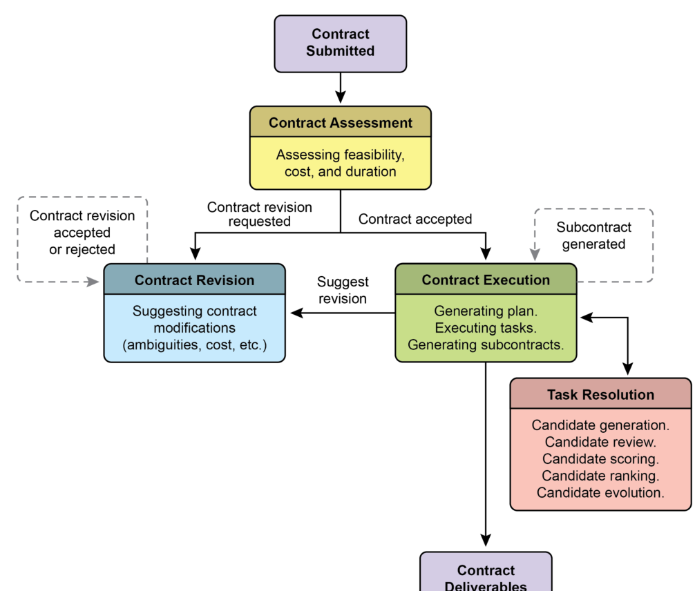
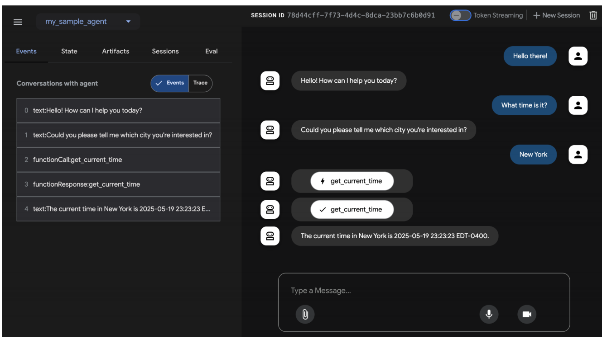
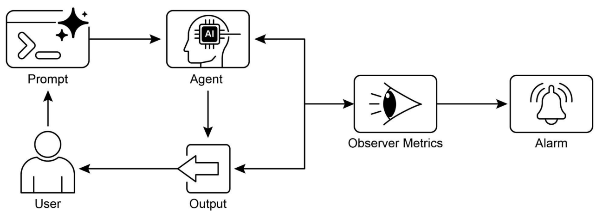

# Chapter 19: Evaluation and Monitoring 评估与监控

> 来源：本目录《智能体监控与评估最终版.pptx》。本文按主题整理课件中的概念、案例与实现；代码为示例节选，未连接外部服务运行。

## 1. 评估与监控的区别

智能体对同一任务可能给出不同答案、选择不同工具并消耗不同资源。最终答案恰好正确，也可能掩盖错误的数据来源、参数或执行路径。

| 维度 | 评估（Evaluation） | 监控（Monitoring） |
| --- | --- | --- |
| 核心问题 | 表现是否达到标准？ | 运行是否正常？ |
| 方式 | 按标准检查结果与过程 | 持续采集运行数据 |
| 对象 | 答案准确性、工具轨迹、协作质量 | 延迟、Token、异常与漂移 |
| 作用 | 判定是否达标并定位质量问题 | 及时发现运行异常并触发反馈 |

实践中先明确指标，再进行定量与定性测量，持续收集数据，将发现反馈给智能体及其开发者。典型用途包括生产性能追踪、A/B 测试、合规审计、任务合约、漂移与异常检测，以及对学习曲线和跨任务泛化能力的评估。

## 2. 输出质量怎样评估

| 方法 | 检查什么 |
| --- | --- |
| 精确匹配 | 输出经去空白和大小写归一后是否与参考答案一致 |
| 编辑距离 | 通过插入、删除和替换将一种表达变成另一种所需的最小代价 |
| Jaccard 相似度 | 分词集合的交集大小除以并集大小 |
| 关键词覆盖 | 命中关键词数占要求关键词总数的比例 |
| 嵌入与余弦相似度 | 文本向量的语义接近程度 |
| LLM 评审 | 按给定规则判断事实、相关性或其他质量维度 |
| RAG 评估 | 区分回答是否有检索材料支持，以及回答是否切合问题 |

课件以“法国首都是巴黎”和“巴黎是法国的首都”这类同义表达说明：精确匹配可能判错，分词集合、关键词和语义指标可以提供补充证据。幻觉、偏见与逻辑一致性也需要按任务单独检查。

~~~python
def evaluate_response_accuracy(agent_output: str, expected_output: str) -> float:
    matched = agent_output.strip().lower() == expected_output.strip().lower()
    return 1.0 if matched else 0.0
~~~

## 3. 延迟与 Token 监控

针对每次请求记录时间戳、阶段、接口与耗时，可定位检索、模型调用或工具执行中的瓶颈。结构化日志便于查单次请求，时序数据库便于聚合和告警，数据仓库适合长期分析和故障复盘。课件的示例告警是：某接口的 p95 延迟连续 10 秒超过 160 ms 时报警；该阈值用于演示。

课件的 `LLMInteractionMonitor` 分别记录并累计输入和输出用量。以下是截图中的核心思路：

~~~python
class LLMInteractionMonitor:
    def __init__(self):
        self.total_input_tokens = 0
        self.total_output_tokens = 0

    def record_interaction(self, prompt: str, response: str):
        self.total_input_tokens += len(prompt.split())
        self.total_output_tokens += len(response.split())

    def get_total_tokens(self):
        return self.total_input_tokens, self.total_output_tokens
~~~

`split()` 按空白切分，只是课堂占位写法。实际统计应使用模型服务返回的用量或该模型对应的分词器。质量、延迟和用量应一起观察，避免以单一指标判断方案。

## 4. LLM-as-a-Judge：法律问卷案例

输入待评问题和评分细则（Rubric），让评审模型按**清晰度与精确性、中立性与偏见、相关性与聚焦、完整性、受众适配度**五个维度评分，每项 1–5 分，附理由与改进建议。输出用 JSON 记录总分、理由、反馈、风险和建议；空响应或解析失败应记录并处理。

| 问卷示例 | 课件示意评分与理由 |
| --- | --- |
| 瑞士知识产权法能否充分保护符合原创性标准的 AI 生成内容？ | 4 分；问题较聚焦，但非专业受众需要理解“原创性标准”。 |
| 将隐私法描述为“过度严格”，并询问是否阻碍技术创新与经济增长 | 2 分；措辞诱导，并把两个效果合并到一个是非选项。 |
| “它适合直接用于法律调研吗？” | 2 分；虽易懂，但指代和调查范围不明确，答案难比较。 |

自动化指标适合定义明确的持续检查；模型评审适合规模化质性初筛，但可能漏看中间步骤；人工评估能识别细节，适合抽样校准和建立基准。模型评分不应当作绝对真值。

## 5. 工具轨迹与多智能体协作

课件用考勤查询说明轨迹检查：用户要求查询张三，智能体却把李四的记录传给考勤流程。即使最终都显示“迟到”，员工标识参数仍然错误。

| 轨迹检查 | 判定方式 |
| --- | --- |
| 精确匹配 | 工具、步骤和顺序完全一致 |
| 顺序匹配 | 必要步骤保持先后，允许插入其他动作 |
| 任意顺序匹配 | 检查必要动作是否出现，不要求顺序 |
| 精确率与召回率 | 分别衡量实际动作中有多少相关，以及必要动作有多少已完成 |
| 关键工具检查 | 单独检查高风险流程的必要调用及关键参数 |

单会话测试文件可保存请求、期望工具轨迹、中间回复和终答。课件示例要求关闭卧室的 `device_2`，预期调用 `set_device_info`，参数含 `location: Bedroom`、`device_id: device_2`、`status: OFF`。多会话 Evalset 将不同任务或对话场景放在同一套回归测试中。

旅行规划案例还要求检查团队协作：航班代理是否把正确日期和目的地交给酒店代理，预订顺序是否遵循依赖，天气请求是否路由到能访问实时数据的代理，以及增加餐厅代理后整体质量或延迟是否改善。

## 6. Contractor：用合约定义可验证交付

把“分析上季度销售”改写为可核验的任务规格。例如，交付 20 页 PDF，分析 2025 年第一季度欧洲市场并与上年同期对比，包含五类指定可视化和基于指定供应链数据的风险评估，同时约定数据来源、范围、成本和完成时间。

流程是**提交合约 → 评估可行性 → 协商修订或执行 → 候选成果自检与修正 → 验收交付**。数据无法访问时先协商，复杂任务可拆为子合约交给专门代理。

## 7. Google ADK 与外部监控

| 评估入口 | 用途 |
| --- | --- |
| ADK Web | 交互调试，观察事件、工具调用与回复轨迹，保存会话 |
| pytest | 通过 `AgentEvaluator.evaluate()` 指定 Agent 模块与测试文件 |
| `adk eval` | 指定 Agent、Evalset 与评估配置，批量运行测试 |

复现需要先准备 Agent、评估数据、判定标准和可用模型服务。课件中的 ADK 界面用于说明观察方式，本次未连接服务运行。

外部观察器持续采集运行证据，如延迟、Token、工具调用、目标偏离和漂移。告警触发后，由责任人复核并将发现回填到测试集与任务合约。这样才能把输出质量、过程追溯、运行稳定性与交付验收连成反馈闭环。

## 小组成员与分工

- 连世舟：负责第一、四小节内容讲解
- 汪安萍：负责第二、三小节内容讲解
- 胡丽文：负责 PPT 素材收集、整理与内容优化
- 刘旭：负责 PPT 制作

原始课件：[[智能体监控与评估最终版.pptx]]
