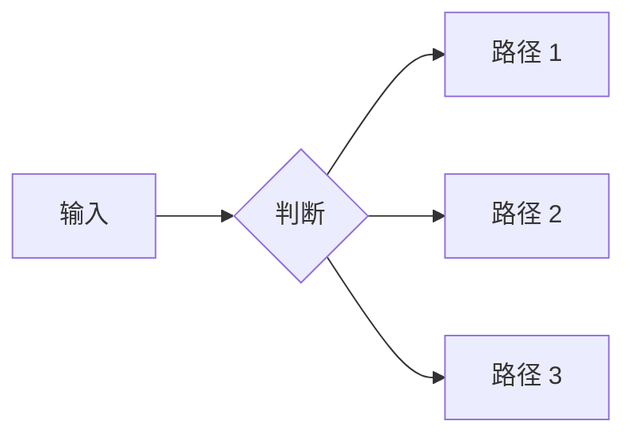
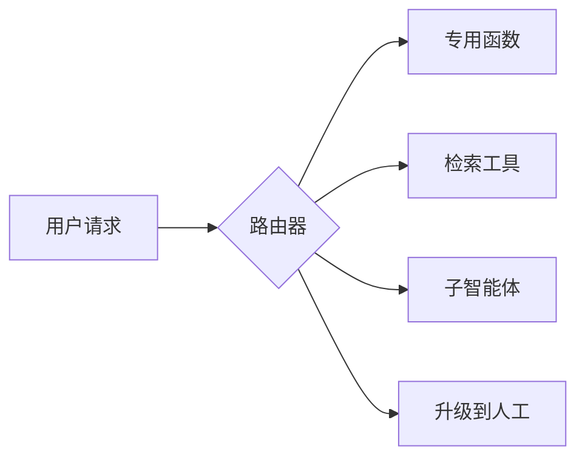
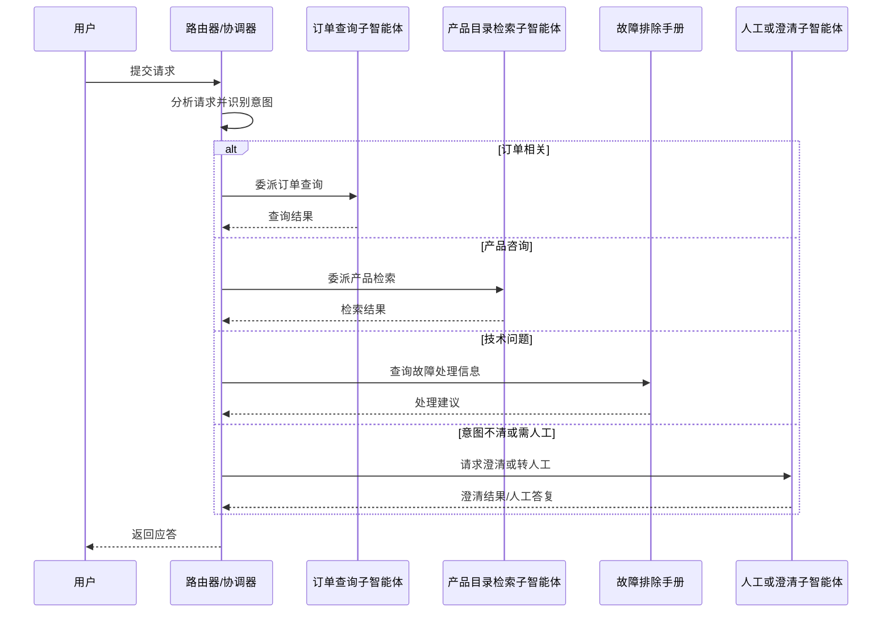
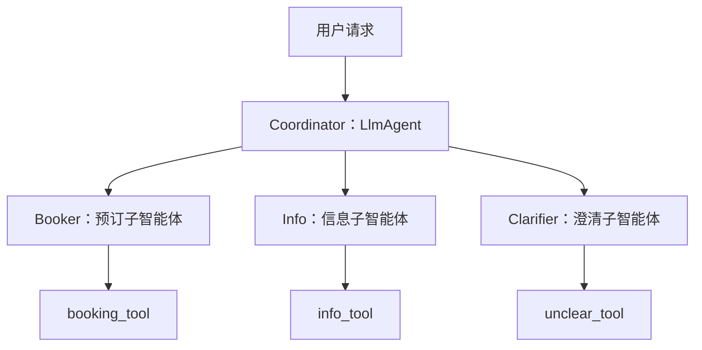

# 路由：智能体动态决策器
> 路由（Routing）让智能体先理解当前请求，再选择后续要执行的工具、工作流或子智能体。它把条件逻辑引入运行框架，使系统从固定的线性流程转向按情境动态决策。

## 从顺序链到动态决策

**提示链（Prompt Chaining）**是一条预先写好的直线：每一步的输入和输出都由前一步固定决定。流程稳定、无需判断时，它足够简单可靠；但输入发生变化时，链本身没有调整空间。

```text
步骤 A → 步骤 B → 步骤 C
```

**路由**则在岔路口增加判断。系统可以依据环境状态、用户输入或前序步骤的结果，选择接下来最合适的路径。



## 路由机制与决策点

路由器可放在运行周期的三个位置：

1. **入口处**：对主任务分类，例如把客服请求分给订单、退款或技术支持流程。
2. **链的中间**：根据前一步结果决定下一步，例如检索结果不足时改走澄清或人工复核。
3. **子程序内部**：从一组候选工具中选择最适合当前任务的工具。



# 四种路由机制

| 机制 | 核心做法 | 优点 | 局限 | 适用场景 |
| --- | --- | --- | --- | --- |
| 基于 LLM 的路由 | 用提示词要求模型输出类别标识符，再进入相应流程 | 语义理解强，能适配开放、新颖的输入 | 依赖提示工程和推理成本；输出可能不一致 | 客服意图分类、开放域多分支任务 |
| 基于嵌入的路由 | 将查询和路径说明向量化，按相似度分流 | 按语义而非关键词匹配；无需生成式模型在线推理 | 依赖嵌入模型质量；相近类别可能难区分 | FAQ、多知识库检索路由 |
| 基于 ML 模型的路由 | 用标注语料训练判别式分类器，类别逻辑编码进模型权重 | 低延迟、确定性强、可控 | 需要训练数据和持续迭代；泛化受语料限制 | 高并发、要求确定性的生产分流 |
| 基于规则的路由 | 依据关键词、正则、字段或 `if-else` / `switch` 规则分流 | 快速、可解释、零推理成本，便于审计 | 对新颖表达适应性弱；规则多时维护成本上升 | 表单、结构化数据、高频确定性任务 |

## 基于 LLM 的路由

LLM 在运行时分析输入，输出目标类别标识符；系统读取该标识符并把请求交给对应流程。

```text
构造分类提示词 → 模型分析并输出类别 → 读取标识符 → 进入对应流程
```

它适合需要理解隐含意图、表达方式多变的请求。为了减少不稳定输出，应限制可输出的标签，并为未识别情形设计兜底分支。

## 基于嵌入的路由

先为每条路径准备简短且有区分度的说明，并将其编码为向量；收到查询后，计算查询向量与各路径向量的相似度，选择得分最高的路径。

```text
预构建路径嵌入 → 编码输入查询 → 计算相似度 → 选择最高分路径
```

它擅长处理同义表达。例如“快递到哪了”和“查一下配送进度”不含相同关键词，但语义接近。对容易混淆的相邻类别，可设置相似度阈值；低于阈值时转入澄清或 LLM 二次判断。

## 基于 ML 模型的路由

将历史请求标注为固定类别，训练分类器，并在推理时直接输出类别。

```text
收集并标注语料 → 训练分类器 → 部署模型 → 类别匹配到处理分支
```

与 LLM 路由相比，它更适合类别稳定、样本足够且请求量大的场景。模型效果会随语料覆盖范围变化，应将无法归类或低置信度样本收集起来，作为下一轮训练数据。

## 基于规则的路由

规则路由根据输入中的关键词、模式或结构化字段直接选择路径。

```text
定义关键词或正则 → 提取输入特征/字段 → 逐条匹配 → 未命中时走兜底分支
```

它非常适合订单号、地区码、表单类型等强结构化信号。规则应保持短小、可测试，并始终保留“未命中”的默认路径，避免请求无处可去。

# 实例演示：智能客服分流系统

一个客服路由器可以将用户请求分到五类处理路径：

| 用户表达示例 | 去向 |
| --- | --- |
| “查订单状态”“快递到哪了” | 订单与物流 |
| “退款”“退货”“换货”“取消” | 退换与退款 |
| “闪退”“登录失败”“报错”“卡顿” | 技术支持 |
| “价格”“参数”“库存”“型号区别” | 产品咨询 |
| “投诉”“转人工”“需要真人” | 人工客服 |



协调器不承担具体业务处理：它只负责判断、委派和汇总。订单、产品、技术支持等分支可以独立维护；新增业务时，只需要增加处理模块与路由标签。

# 代码实现

## LangChain：分类链与 `RunnableBranch`

示例中定义了三个处理器：

- `booking_handler`：处理机票、酒店等预订请求；
- `info_handler`：处理普通信息问答；
- `unclear_handler`：处理无法可靠分类的请求，并请用户补充说明。

协调器由“提示词模板 + LLM + 字符串解析器”组成。系统提示词将输出严格限制为单个标签：`booker`、`info` 或 `unclear`。随后用 `RunnableBranch` 把标签绑定到对应处理器，并保留默认兜底分支。

```python
# 伪代码：展示分工，而非可直接运行的完整程序
decision = coordinator.invoke({"request": request})

branches = {
    "booker": booking_handler,
    "info": info_handler,
}

handler = branches.get(decision, unclear_handler)
answer = handler.invoke(request)
```

关键点在于：路由判断和业务执行是两个独立步骤。`RunnableBranch` 根据 `decision` 标签分发原始请求，处理器则只关心自己负责的业务。

## Google ADK：协调器委派给专用智能体

Google ADK 示例延续同一分工：

- `Booker`：负责预订，并调用 `booking_tool`；
- `Info`：负责信息查询，并调用 `info_tool`；
- `Clarifier`：当意图不清时请求补充信息，并调用 `unclear_tool`；
- `Coordinator (LlmAgent)`：只判断并委派，不处理具体业务。



主函数通过内存运行器把请求交给协调器。演示结果如下：

- “帮我在巴黎订一间酒店” → `Booker` / 预订处理器；
- “世界最高的山是哪座” → `Info` / 信息处理器；
- 无法判断归属时 → `Clarifier` 请求用户澄清。

# 总结与提问

## 设计与落地要点

1. **标签要少且边界清楚**：标签越多、描述越重叠，路由误判越多。先使用少量稳定的业务类别。
2. **为兜底路径定义行为**：低置信度和未识别请求不应被强行分类；可以澄清、转人工，或记录为待扩充类别。
3. **选择与场景匹配的机制**：结构化、明确的信号优先用规则；需要快速语义匹配时使用嵌入；类别稳定且访问量大时训练分类模型；面对开放或隐含意图时再使用 LLM。
4. **分支保持解耦**：修改一个子智能体不应影响其他分支；新增业务通常只需要添加处理器、标签和路由说明。这符合开闭原则。
5. **观察路由质量**：记录输入、路由标签、置信度（如有）和最终结果，重点复盘兜底和人工转接样本。

## 关键要点

- **动态决策能力**：智能体能根据用户输入选择下一步，不再局限于固定流程。
- **多路径分发**：不同请求进入专属工具链或子智能体，避免单一流程过于臃肿。
- **灵活实现**：规则、嵌入、ML 分类器与 LLM 各有适用边界，可以组合使用。
- **解耦收益**：分支独立演进，新增或修改业务的影响范围更小。

## 互动题

**场景 A**：用户输入“我的订单号是 12345，请帮我查一下物流”，系统必须精准且极速地分流到物流查询工具。

适合使用**基于规则的路由**，也可结合简单关键词或正则。订单号和固定句式是明确特征；规则的确定性最高、延迟最低，也不需要调用 LLM。

**场景 B**：用户输入“我最近压力好大，想听点轻松的”，系统需要把隐含的情感闲聊需求分给情感陪伴智能体。

适合使用**基于嵌入的路由**或**基于 LLM 的路由**。这类表达没有稳定关键词，需要理解“压力大”与“轻松”背后的情感语义。嵌入适合快速寻找相近路径；LLM 更适合处理复杂、隐含或跨类别的意图。
