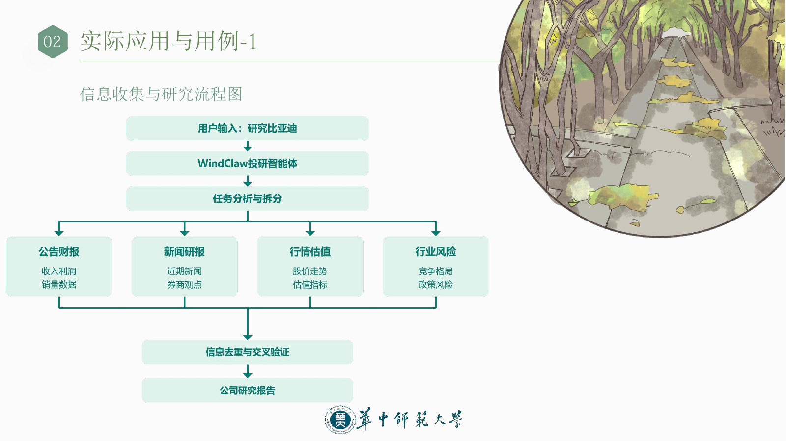
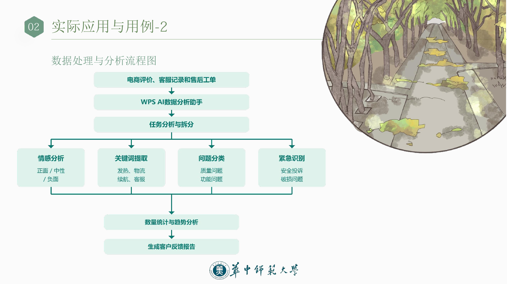
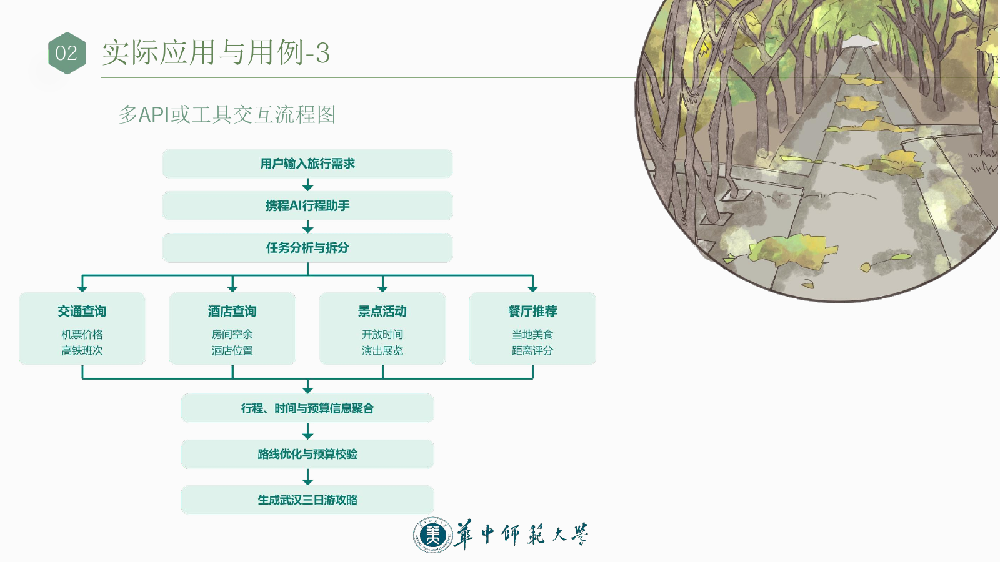
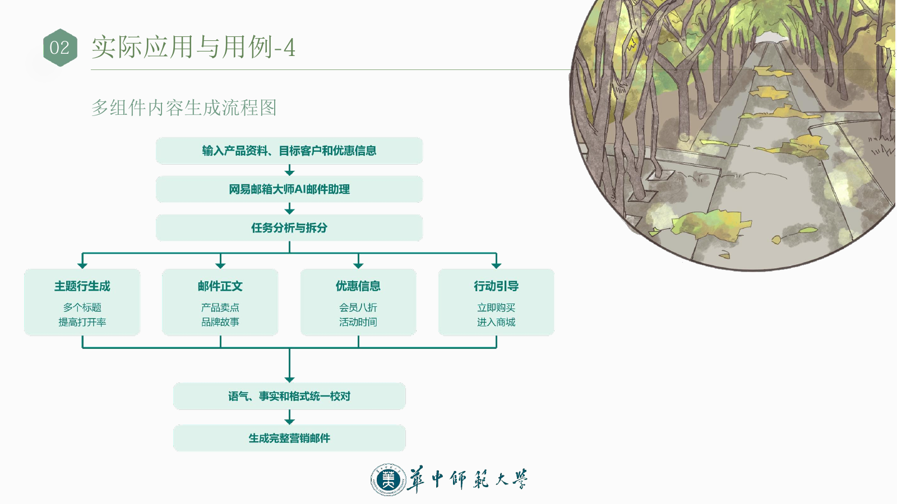
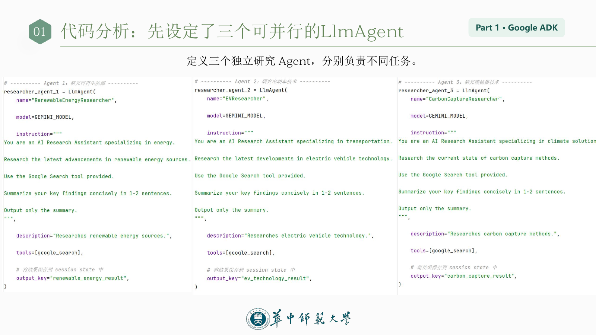
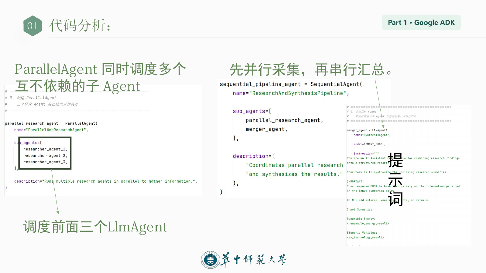
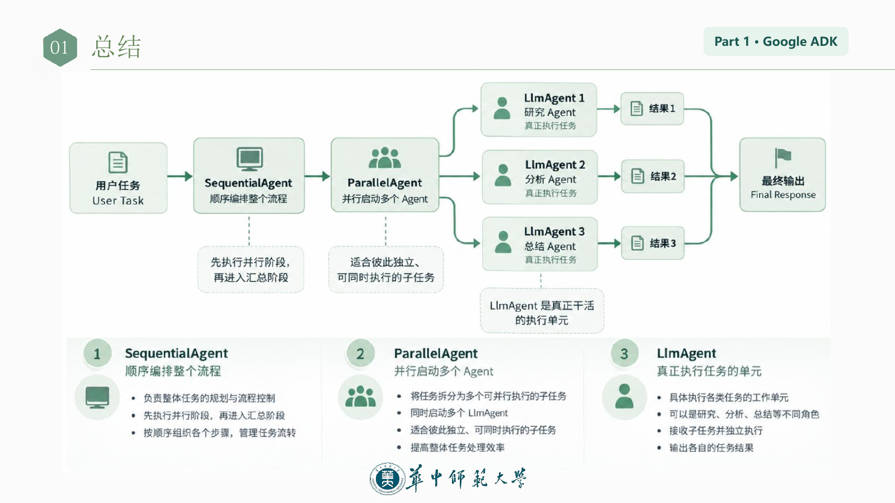
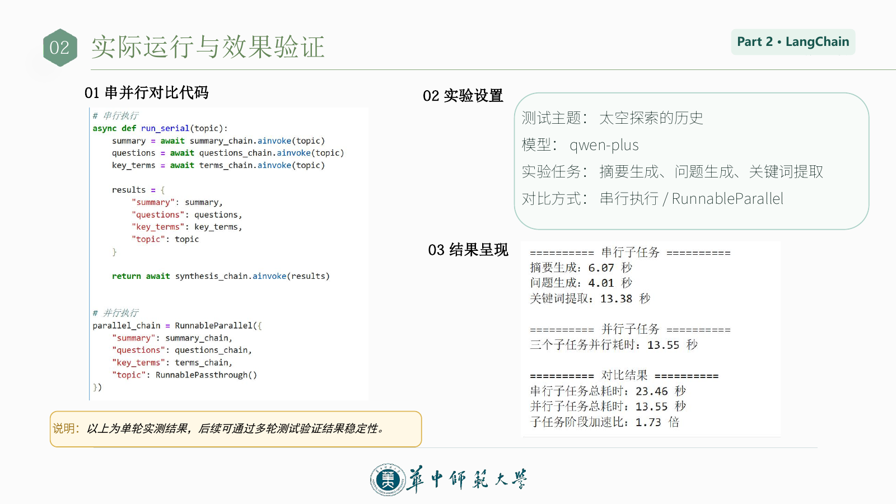

# 第三章：并行化（Parallelization）

> 从串行到并行：AI Agent 工作流的高效协同设计。
>
> 本文依据第三小组的[汇报材料](并行化第三组汇报.pdf)整理。当前目录提供的是 42 页 PDF，未提供 PPTX；以下内容以这份汇报为准。页码均对应原汇报。

## 一、并行化原理与核心机制

### 1. 为什么需要并行化

复杂 Agent 任务经常包含多个处理环节。如果相互独立的操作仍逐项串行执行，等待时间就会不断累积，降低系统响应效率。并行化让独立任务同时推进，以减少整体延迟。

| 模式 | 组织方式 | 示意 |
| --- | --- | --- |
| 提示链（Prompt Chaining） | 顺序连接处理步骤 | A → B → C |
| 路由（Routing） | 根据条件选择不同路径 | 条件 → 分支选择 |
| 并行化（Parallelization） | 让独立子任务同时推进 | A ∥ B ∥ C |

### 2. 定义与可并发的组件

并行化的核心是：识别工作流中不依赖其他步骤即时输出的环节，使其并发执行，并在需要时汇总结果。

可以并发执行的组件包括：

- **LLM 调用**：独立提示与模型推理。
- **工具或 API 调用**：多源信息检索、外部服务或数据库查询。
- **整个子 Agent 任务**：多个专业智能体分工处理独立任务。

这些是可选的组件类型，并不意味着每个场景都需要同时使用三类组件。

### 3. 串行执行与并行执行

教材示例是检索来源 A、来源 B，分别总结，再综合生成最终回答。

**串行流程：**

```text
检索 A → 总结 A → 检索 B → 总结 B → 综合最终回答
```

**汇报中的并行流程：**

```text
阶段 1：检索 A ∥ 检索 B
阶段 2：总结 A ∥ 总结 B
阶段 3：综合最终回答
```

串行时间约为所有步骤耗时之和；一个并行阶段的时间约为最慢分支耗时加上额外开销。综合回答仍需等待所需结果就绪。

### 4. 核心运行机制

1. **识别独立任务（Task Independence）**：分析子任务的输入输出关系，找出没有直接数据依赖、可以同时启动的任务集合。
2. **并发执行子任务（Concurrent Execution）**：通过异步机制或并行编排框架，同时推进多个 LLM、API 调用，必要时由多个专业 Agent 协作。
3. **汇总执行结果（Result Aggregation）**：收集各分支输出，等待后续步骤所需结果就绪，再整合信息并进入下一阶段。

并行化需要根据依赖关系组合并行阶段与串行阶段，不能无条件同时执行所有任务。

### 5. 适用条件与技术支撑

判断依据是：**任务 B 是否必须使用任务 A 尚未产生的输出？**

- 已知共同检索条件后，查询来源 A 与来源 B 可以同时发起。
- 如果必须先查询机票到达时间，才能确定入住日期，这两个步骤应按顺序执行。

汇报提及的框架包括：

| 框架 | 并行编排方式 |
| --- | --- |
| LangChain / LCEL | 使用 `RunnableParallel` 组织多个 Runnable |
| LangGraph | 使用图中的并行分支与汇合节点 |
| Google ADK | 通过 `ParallelAgent` 并发执行子 Agent |

典型价值是减少 LLM 推理、工具调用和外部服务等 I/O 等待造成的延迟。

### 6. 并行智能体的设计步骤

以旅行规划为例：

| 步骤 | 关键问题 | 旅行规划示例 |
| --- | --- | --- |
| 明确输入 | 哪些共同条件必须先确定？ | 目的地、日期、人数与预算 |
| 分析依赖 | 哪些任务可以独立执行？ | 条件确定后，并行查询机票、酒店与活动 |
| 定义输出 | 各分支返回什么，怎样对应？ | 统一返回价格、时间、来源与查询状态 |
| 设置执行规则 | 并发数量、超时和失败如何处理？ | 限制并发数，设置超时、重试与备选来源 |
| 设计汇总 | 如何处理冲突和缺失？ | 核对预算与时间衔接，标明缺失信息 |
| 验证效果 | 是否更快，质量是否保持？ | 比较耗时、成功率、费用与方案完整度 |

设计要点：先判断依赖，再组织并发，最后用实测检验收益。

## 二、应用场景与案例分析

> 以下结合产品功能展示可采用的并行化设计。流程图属于汇报小组的分析示意，不代表产品公开的内部实现。

### 1. 信息收集与研究：WindClaw 研究比亚迪

并行分析公告财报、检索近期新闻与券商研报、获取股价及估值数据，并评估行业竞争和政策风险。汇总时进行信息去重与交叉验证，形成公司研究报告。

多个研究任务同步推进，可以更快汇集多源研究材料。



### 2. 数据处理与分析：WPS AI 分析客户反馈

输入包括电商评价、客服记录和售后工单。可并发执行：

- 情感分析：识别正面、中性和负面反馈。
- 关键词提取：提取发热、物流、续航、客服等主题。
- 问题分类：区分质量问题和功能问题。
- 紧急识别：发现安全投诉、破损问题等需要优先处理的内容。

汇总后开展数量统计与趋势分析，生成客户反馈报告，帮助及时发现集中投诉和重点产品问题。



### 3. 多 API 或工具交互：携程智能体旅行规划

在旅行条件明确后，同时查询机票或高铁、酒店空房、当地景点活动及餐厅推荐。随后聚合行程、时间与预算信息，进行路线优化和预算校验，形成完整行程。汇报流程图以“武汉三日游攻略”为输出示例。



### 4. 多组件内容生成：网易邮箱大师撰写营销邮件

输入产品资料、目标客户和优惠信息后，同时生成邮件主题行、营销正文、优惠信息和行动引导。各部分生成后，统一校对语气、事实与格式，形成完整营销邮件。

也可以生成多个主题和正文版本供选择。



### 5. 并行校验：注册信息检查

汇报以 GitHub 注册信息校验为例，列出邮箱非空及格式检查、密码复杂度与长度检查、用户名字符规范检查，最后汇总结果并反馈。

第 20 页给出另一组通用表单校验分支：

```text
用户提交表单
    ├─ 邮箱格式检查
    ├─ 手机号格式检查
    ├─ 地址核验
    └─ 不当用语检查
            ↓
      汇总所有校验结果
            ↓
全部通过：接收输入；任一失败：返回对应错误提示
```

两页使用的字段不同，但展示的共同机制都是独立校验并发执行、统一反馈结果。

### 6. 多模态处理：豆包图文理解

操作示例为上传冬日街景图片，并输入“请描述图片内容”，由豆包结合图片与问题输出场景描述。

汇报中的分析示意将输入拆为文本分析与图像分析两条分支：

| 分支 | 处理任务 |
| --- | --- |
| 文本分析 | 情感倾向识别、关键词提取 |
| 图像分析 | 物体识别、场景描述 |

最后融合文本与图像结果。

### 7. 多方案生成与评估：ChatGPT 文案生成

对同一写作任务，并行生成不同风格的文案，再比较吸引力、清晰度和传播效果，选择最佳方案。

汇报第 23 页展示三种风格文案，并推荐方案 B“青春活泼型”；第 24 页用“严谨、生动、简洁”展示三条生成分支。

```text
同一写作任务
    ├─ 方案 A：严谨
    ├─ 方案 B：生动
    └─ 方案 C：简洁
            ↓
      质量评估与对比
            ↓
        选择最佳方案
```

## 三、框架实现代码分析与复现

### 1. Google ADK

#### 框架与核心 Agent

Google ADK（Agent Development Kit）用于构建 AI Agent，支持多智能体协作、流程编排，以及搜索、数据库、API 等工具调用。

| 核心组件 | 职责 |
| --- | --- |
| `LlmAgent` | 具体执行研究、分析等任务 |
| `ParallelAgent` | 同时启动多个彼此独立的子 Agent |
| `SequentialAgent` | 按顺序组织 Agent 的执行阶段 |

#### 三个独立研究 Agent

汇报第 28 页定义三个独立研究 Agent，均使用 `GEMINI_MODEL` 和 `google_search` 工具，要求将研究发现简要概括为 1–2 句话，仅输出摘要。

| Agent 名称 | 研究任务 | 保存到 session state 的 `output_key` |
| --- | --- | --- |
| `RenewableEnergyResearcher` | 可再生能源的最新进展 | `renewable_energy_result` |
| `EVResearcher` | 电动汽车技术的最新发展 | `ev_technology_result` |
| `CarbonCaptureResearcher` | 碳捕集方法的当前状况 | `carbon_capture_result` |



#### 并行采集，再串行汇总

`ParallelAgent` 调度上述三个研究 Agent；`merger_agent` 读取研究结果，生成结构化报告。汇总提示词要求仅依据输入摘要，不添加外部知识、事实或细节。

最后由 `SequentialAgent` 组织“并行研究 → 汇总”的执行顺序。以下摘录汇报中的编排代码，研究 Agent 与汇总 Agent 的定义见原图，片段本身不是独立运行脚本。

```python
parallel_research_agent = ParallelAgent(
    name="ParallelWebResearchAgent",
    sub_agents=[
        researcher_agent_1,
        researcher_agent_2,
        researcher_agent_3,
    ],
    description="Runs multiple research agents in parallel to gather information.",
)

sequential_pipeline_agent = SequentialAgent(
    name="ResearchAndSynthesisPipeline",
    sub_agents=[
        parallel_research_agent,
        merger_agent,
    ],
    description=(
        "Coordinates parallel research "
        "and synthesizes the results."
    ),
)
```





第 30 页为角色与流程的概览示意；具体代码中三个并行分支均为独立研究任务，最终综合由并行阶段之后的 `merger_agent` 完成。

### 2. LangChain / LCEL

#### 案例任务与整体结构

以 `The history of space exploration`（太空探索的历史）为主题，从三个角度处理同一输入，再整合成一份综合回答。

| 任务链 | System Prompt | 输出 |
| --- | --- | --- |
| `summarize_chain` | Summarize the following topic concisely | 简短摘要 |
| `questions_chain` | Generate three interesting questions about the following topic | 三个问题 |
| `terms_chain` | Identify 5-10 key terms from the following topic, separated by commas | 5–10 个关键词 |

五个代码模块组成完整工作流：

1. 使用 `ChatOpenAI` 初始化模型。
2. 构建三条任务链：`Prompt | LLM | Parser`。
3. 使用 `RunnableParallel` 并发调度。
4. 使用 `synthesis_prompt | llm` 综合生成。
5. 使用 `ainvoke(topic)` 执行并取得输出。

运行分为准备、并发、综合三个阶段：准备阶段仅建立工作流；并发阶段将同一主题传给三条独立任务链；综合阶段将结果字典填入提示词，再生成最终回答。

#### 定义任务链

三条任务链结构相同，仅提示词不同。以下按汇报中的结构整理，`llm`、导入及其他任务链的初始化省略。

```python
summarize_chain = (
    ChatPromptTemplate.from_messages([
        ("system", "Summarize the following topic concisely:"),
        ("user", "{topic}"),
    ])
    | llm
    | StrOutputParser()
)
```

`ChatPromptTemplate` 组织输入，LLM 生成内容，`StrOutputParser` 提取字符串。

#### RunnableParallel 并发执行

```python
map_chain = RunnableParallel({
    "summary": summarize_chain,
    "questions": questions_chain,
    "key_terms": terms_chain,
    "topic": RunnablePassthrough(),
})
```

三条链互不等待对方结果，`RunnablePassthrough()` 将原始主题透传给下游。输出结构如下：

```json
{
  "summary": "...",
  "questions": "...",
  "key_terms": "...",
  "topic": "The history of space exploration"
}
```

#### 结果整合与异步调用

综合提示词接收 `summary`、`questions`、`key_terms` 和 `topic` 四项。汇报以 `ChatPromptTemplate.from_messages([...])` 省略具体模板，核心拼装方式如下：

```python
full_parallel_chain = (
    map_chain
    | synthesis_prompt
    | llm
    | StrOutputParser()
)

# 放在 async 函数中执行
response = await full_parallel_chain.ainvoke(topic)
```

执行顺序为：

1. 三条任务链并发执行，共产生 3 次 LLM 调用。
2. 汇总得到包含三项结果与原始主题的字典。
3. `synthesis_prompt` 接收字典并填充四个占位符。
4. 第 4 次 LLM 调用生成综合回答。
5. `StrOutputParser()` 输出最终字符串。

`ainvoke()` 异步启动整条链并等待结果，需放在异步函数中；脚本入口通常使用 `asyncio.run(...)`。子任务并发执行，综合步骤仍需等待它们完成。

### 3. 实际运行与效果验证

原汇报第 37 页的实验设置：

| 项目 | 设置 |
| --- | --- |
| 测试主题 | 太空探索的历史 |
| 模型 | `qwen-plus` |
| 实验任务 | 摘要生成、问题生成、关键词提取 |
| 对比方式 | 串行执行与 `RunnableParallel` 并发执行 |

原图中的单轮实测结果：

| 测量项 | 耗时或结果 |
| --- | --- |
| 串行：摘要生成 | 6.07 秒 |
| 串行：问题生成 | 4.01 秒 |
| 串行：关键词提取 | 13.38 秒 |
| 串行子任务总耗时 | 23.46 秒 |
| 三个子任务并行总耗时 | 13.55 秒 |
| 子任务阶段加速比 | 1.73 倍 |

这些数值比较的是**子任务阶段**，不能直接当作包含最终综合回答的整条工作流耗时。原汇报明确说明这是单轮实测，后续需要多轮测试验证稳定性；本文未重新运行实验。



## 四、综合对比与总结展望

### 1. LangChain 与 Google ADK 对比

| 比较维度 | LangChain / LCEL | Google ADK |
| --- | --- | --- |
| 并行对象 | 多个 Runnable / Chain | 多个专职 `LlmAgent` |
| 核心组件 | `RunnableParallel` | `ParallelAgent` |
| 后续汇总 | Synthesis Prompt + LLM | Merger Agent |
| 控制方式 | Runnable 链式组合（`|`） | `SequentialAgent` 组织阶段 |
| 教材示例 | 主题摘要、问题、关键词 | 三领域并行研究与综述 |

两者使用不同的软件抽象与编排组件，但共同原则一致：识别独立任务 → 并发执行 → 必要时统一汇总。

### 2. 价值、边界与设计挑战

**主要价值：**降低多路 I/O 等待，提高复杂任务响应速度，汇总多源与多角度结果。

**适用场景：**独立的 LLM / API 调用、多数据源并发检索、多版本内容独立生成。

**设计挑战：**分支增加可能提高调用次数和费用；调试、日志与监控更复杂；需要处理慢分支、超时和结果冲突。

关键判断是：子任务之间不存在必须等待的依赖，并且并发收益大于额外开销。分支更多并不保证整体更快。

### 3. 关键结论与未来方向

Parallelization 是任务依赖驱动的工作流优化模式。

- **独立性优先**：识别任务依赖，决定哪些步骤能够并发。
- **并发与串行结合**：分支同时执行，所需结果就绪后再汇总。
- **框架各有侧重**：LangChain 管理 Runnable，ADK 调度专业子 Agent。
- **评估真实收益**：结合延迟、费用、可靠性与可观测性进行权衡。

未来优化方向包括依赖分析、动态任务调度、错误恢复与成本感知编排。
