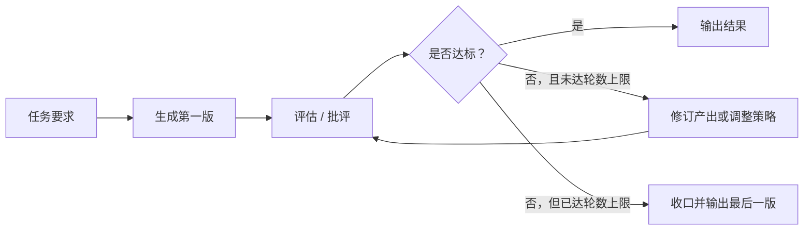

# 反思：通过反馈改进智能体结果

> 反思（Reflection）让智能体对自己的产出或执行过程进行评估，并把评估结果用于修订内容、调整策略。它在工作流中加入反馈闭环，使结果能在多轮迭代中改善。

## 反思的基本概念

智能体的第一版答案、代码、文章或行动计划，可能包含错误、遗漏，或没有满足任务约束。反思模式将“先生成、再检查、再修订”组织为一个明确的过程。

评估可以由智能体自评，也可以交给专职审阅者。审阅时应围绕任务要求，检查：

- 准确性：结论、事实或计算是否正确；
- 完整性：是否遗漏必要信息、边界条件或异常处理；
- 连贯性：推理、结构和表达是否自洽；
- 指令遵循：是否满足原始任务的格式、范围和硬约束。

## 反思机制：生成、评估、修订、停止



1. **执行**：根据任务要求生成第一版答案、代码或计划。
2. **评估/批评**：对照任务要求，检查准确性、逻辑、完整性与指令遵循，并指出具体问题。
3. **反思/精炼**：根据反馈修订产出；必要时可以调整原有方案，甚至推翻重来。
4. **迭代与停止**：再次评估修订版，直到达标或达到最大轮数。

达到最大轮数只表示流程必须收口，**不表示结果已经通过评估**。最终结果仍应根据任务风险进行实际测试、事实核验或人工复核。

## 与提示链的区别：是否存在反馈回边

提示链一般是单向流转：前一节点的输出传给后一节点，流程继续向前。反思模式则把评估结果回送给生成步骤，形成循环。


这个“反馈回边”是反思的关键：评估意见和当前版本一起进入下一轮。修订可以在原方案上小幅改动，也可以在发现根本问题后采用新的策略。停止条件则要求系统在达标时结束，或者在轮数上限到达时安全收口。

## 角色分工：生产者与批评者

| 角色 | 关注点 | 输入 | 输出 |
| --- | --- | --- | --- |
| 生产者（Producer） | 把任务做完、做对；按照意见修改产出 | 任务要求、上一轮意见 | 新一版答案、代码或计划 |
| 批评者（Critic/Reviewer） | 找出缺陷与不合规之处 | 任务要求、当前版本 | 具体、可操作的修改意见 |

两种角色可以由同一模型承担，但需使用不同的系统提示词；也可以由两个智能体分别承担。独立视角能减轻自我确认偏差，但批评者同样可能出错，因此最终质量仍应依赖测试、原始材料对照或人工验证。

## 什么是有效反馈

笼统地说“代码不够好，请优化”几乎无法指导下一轮修订。高质量反馈至少包含三个部分：

1. **定位问题**：指出具体位置、输入或可观察到的现象；
2. **说明预期**：明确正确结果应该是什么；
3. **给出依据**：解释为什么当前结果不符合要求。

例如：

> 输入 `5!` 返回 `24`，预期应为 `120`。循环边界少计算了一次，应检查终止条件或迭代范围。

这种反馈既提供了失败案例，也明确了正确标准和可能的检查方向。

## 应用场景

### 写作与摘要

审阅表达、结构与语气；对照原始材料补充遗漏，并纠正事实偏差。适用于长文摘要、报告草稿和博客文章。

### 代码与规划

检查边界情况、测试结果、计划可行性与硬约束。对于代码，反思不应止于“模型说通过了”，还应运行测试或人工检查关键逻辑。

## 收益与局限

| 方面 | 具体表现 |
| --- | --- |
| 准确度提升 | 多轮审查有机会纠正事实错误与逻辑漏洞 |
| 完整度改善 | 更容易补充边界情况、异常处理和遗漏内容 |
| 指令遵守增强 | 可逐项对照原始要求，减少偏离 |
| 调用成本 | 每轮生成和审查都会增加费用与等待时间 |
| 上下文压力 | 旧稿、批评与修订稿持续累积，Token 和内存开销增长 |
| 管理负担 | 需要限制历史长度和最大轮数，避免上下文溢出或无效循环 |

对于逻辑题，反思可以帮助模型在较大的搜索空间中少走死胡同；对于长文摘要，能减少漏点和事实漂移。它不适合所有实时场景，应在质量、成本与响应速度之间取舍。

## LangChain 示例：阶乘代码的多轮反思

任务要求是实现 `calculate_factorial(n)`：计算 `n!`，提供清晰文档说明，且满足 `0! = 1`、负数输入抛出 `ValueError`。

工作方式如下：

1. 用 `llm.invoke(message_history)` 生成初稿，并把模型回复写入历史；
2. 将模型切换为“资深工程师”角色，审查当前代码的逻辑、文档、边界情况与任务要求；
3. 将批评意见作为 `HumanMessage` 写回历史；
4. 下一轮据此生成或修订代码；
5. 若审查意见出现 `CODE_IS_PERFECT` 则提前停止，否则最多运行 `max_iterations = 3` 轮。

```python
max_iterations = 3

for _ in range(max_iterations):
    # 生成或修订当前代码，并写入 message_history
    critique = llm.invoke(reflector_prompt).content
    if "CODE_IS_PERFECT" in critique:
        break
    message_history.append(HumanMessage(content=critique))

print(current_code)
```

`message_history` 保存任务、每版代码与批评，为下一轮提供上下文。即使达到轮数上限，系统也只应输出最后一版，而不应把它误称为“已验证正确”。这个示例仍需要实际测试：`5! = 120`、`0! = 1`，负数应抛出 `ValueError`。

## Google ADK 示例：生成器与审核者

### 生成器 `generator`

`generator` 是由大模型驱动的 `LlmAgent`。常用参数包括：

- `name`：智能体名称；
- `description`：智能体用途；
- `instruction`：具体要完成的任务；
- `output_key`：将模型输出写入哪个会话状态变量。

例如 `output_key="draft_text"` 会把初稿保存到会话状态，供后续审核者读取。

### 审核者 `reviewer`

`reviewer` 同样是 `LlmAgent`，但承担不同角色。它读取 `draft_text`，按预设标准检查事实，并输出包含状态与理由的字典，例如：

```json
{
  "status": "INACCURATE",
  "reasoning": "部分事实缺少可靠依据"
}
```

该结果可保存为 `review_output`，供控制器决定是否进入下一轮修订。

### `SequentialAgent` 的边界

`SequentialAgent` 可以按顺序编排 `[generator, reviewer]`：先生成，再审核。它本身不负责生成文本，也不负责审核事实。

因此，只有“生成 → 审核”还不是完整的反思闭环。若希望审核不通过后自动退回重写，还需要增加基于 `review_output` 的条件分支与回边，并配合最大迭代次数或预算等停止条件。

## 实施检查清单

- 是否把评估标准写成可检查的要求，而不是“写得更好”这类模糊指令？
- 批评意见是否包含问题位置、预期结果和判断依据？
- 是否保存必要的任务要求、当前版本和反馈，而非无限累积全部历史？
- 是否有最大轮数、预算或时间等停止条件？
- 是否用单元测试、事实来源或人工复核验证最终结果？
- 是否只在质量收益足以抵消延迟和成本时启用多轮反思？

## 总结

反思模式通过“生成—评估—修订”的反馈闭环，把一次性产出变为可逐步改进的过程。它能提高准确度、完整度和指令遵守度，但不会自动保证正确：有效的评估标准、具体反馈、明确停止条件与外部验证同样不可缺少。
