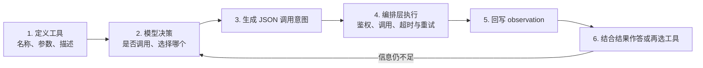
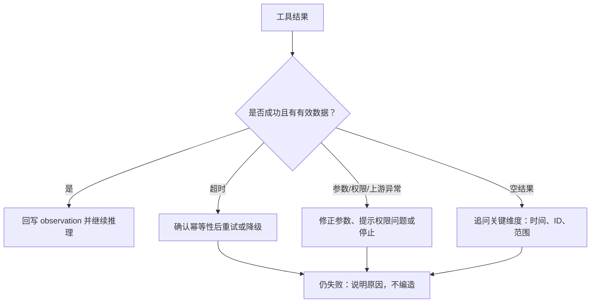

# Tool Use（Function Calling）：让模型从会说话到能动手

> 工具调用不是模型本身“获得的一项能力”，而是模型与外部系统之间的一份接口协议。模型负责表达调用意图；编排层负责校验、鉴权、执行与回写结果。

## 从内部信息调度走向外部行动

前四种模式主要在系统内部调度信息：提示链决定步骤如何衔接，路由决定走哪条路径，并行化决定哪些任务可同时进行，反思决定如何自查和修正。工具使用则第一次把智能体连接到模型外部。

| 范围 | 要解决的问题 | 处理对象 |
| --- | --- | --- |
| 前四章模式 | 怎么排队、怎么分工、怎么自查 | 文本与信息流 |
| Tool Use | 查不到、算不准、做不了的事 | 外部系统与真实动作 |

框架只是实现载体；LangChain、Google ADK、CrewAI 等都可以实现同一协作结构。

## 为什么需要工具：模型缺少四类外部能力

模型可以推理和生成，但不能直接解决以下问题：

| 缺口 | 原因 | 示例 |
| --- | --- | --- |
| 知识时点 | 参数冻结在训练时刻 | “昨天的股价是多少？” |
| 私有数据 | 数据不在公开语料中，也不应进入训练数据 | “查询数据库中的学生表” |
| 计算确定性 | 下一个 Token 预测不等于精确计算 | `178.52 × 1.06`、费用分摊 |
| 真实副作用 | 文本本身无法改变外部世界 | 订机票、发邮件、控制设备 |

当任务涉及**实时数据、私有数据、精确计算、代码执行或外部动作**时，应考虑调用工具。

## 六步闭环：意图与执行分离



模型只负责第 2、3、6 步；真正“动手”的是第 4 步的编排层。第 3 步产生的是数据，而非一次执行：

```json
{
  "tool": "get_stock_price",
  "arguments": {
    "ticker": "AAPL"
  }
}
```

因为调用意图是数据，它可以被记录、拦截、拒绝和重放。这是工具调用可治理的基础。

## 谁在执行：模型与编排层的职责边界

| 层级 | 负责什么 | 不负责什么 |
| --- | --- | --- |
| 模型 | 在候选工具中选择工具；从自然语言提取参数 | 超时、权限、拒绝、重试与真实副作用 |
| 编排层 | 解析调用、按 Schema 校验、鉴权、超时、重试、审计、执行，并将 observation 回写 | 替模型理解用户的真实意图 |

这种分工带来可测试、可审计和可回滚的收益，也增加了一次往返和一个潜在失败点。

## Tool 比 Function 更宽

工具可以是函数、API 端点、数据库查询、设备控制，甚至委托给另一个智能体。判断标准不在于“是不是代码”，而在于它是否引入：

- 外部事实；
- 外部副作用。

当工具本身是另一个智能体时，其返回值仍是模型输出，可能不稳定或不可复现，应把它作为不可信输入继续校验。

## 工具定义：可验证的 Schema 与不可验证的描述

| 层次 | 内容 | 作用 | 是否可由程序验证 |
| --- | --- | --- | --- |
| Schema 层 | `name`、参数、类型、必填项、枚举值 | 保证调用结构合法 | 可以 |
| 描述层 | `description`、docstring、示例、适用范围 | 告诉模型何时用、怎么用 | 不可以 |

Schema 写错时，调用通常会立刻报错；描述写错时，模型可能安静地选错工具。因此，docstring 实际上是在为模型写“路由规则”。

```python
@tool
def search_information(query: str) -> str:
    """提供主题的事实信息。
    当问题类似“法国首都”或“伦敦天气”时使用。"""
    return simulated_lookup(query)

@tool
def search_docs(query: str) -> str:
    """搜索文档。"""
    return rag_lookup(query)
```

两个函数签名可以相同，但模型看不到函数体；第一个描述给出了触发条件和示例，第二个只重复了函数名，容易造成工具选择错误。

## 何时使用，以及如何回退

| 应使用工具 | 不应使用工具 | 失败时的处理 |
| --- | --- | --- |
| 天气、股价等实时变化数据 | 已知且稳定的常识 | 超时可重试一次；降级时标注信息时间戳 |
| 公司数据库等私有数据 | 无法鉴权或越权访问 | 空结果不等于无数据，应追问时间、ID 或范围 |
| 金额、统计等精确计算 | 一步可心算的比较 | 先修正参数再重试；两次失败即放弃 |
| 沙箱中的代码执行 | 没有沙箱或资源限额 | 不能把 stderr 原样当作“成功” |
| 下单、发信等外部副作用 | 高敏感操作且没有二次确认 | 使用幂等键和人工确认；失败时不自动重试 |
| 委托给另一个智能体 | 同一上下文中一句话可完成 | 视返回值为不可信输入并校验 |

## 失败恢复

常见失败包括超时、报错和空结果。处理顺序应根据具体问题选择：



章节中的 CrewAI 示例会让工具抛出 `ValueError`，同时在任务描述中明确“查不到就说查不到”。异常处理与交付要求应成对设计，不能用生成内容掩盖调用失败。

## 模式卡片

- **意图**：在推理断点处向外部系统获取事实，或触发一次动作。
- **适用条件**：实时、私有、需精确计算、需要真实副作用。
- **结构**：定义 → 决策 → JSON → 执行 → 回写 → 再决策。
- **参与者**：模型负责“选与填”；编排层负责“执行与把关”；工具是外部系统。
- **变体**：平台执行或客户端执行；函数、API、数据库、设备或智能体委托。

工具使用的本质，是把一次跨边界调用切分为可拦截的**调用意图**与受控的**执行边界**：推理在哪里停止，工具就从哪里开始接手。
