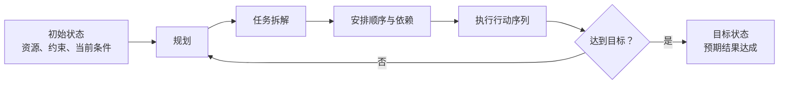
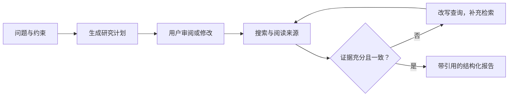

# Planning：让智能体从反应式工具走向目标导向执行者

> 规划（Planning）让智能体从初始状态出发，形成一系列有依赖关系的行动，逐步到达目标状态。它把高层目标转化为可执行步骤、顺序与调整机制。

## Planning 的基本原理

复杂任务通常包含多个步骤、前后依赖与不确定信息。规划模式要求智能体先思考“要达成什么、需要做哪些事、先做什么、遇到变化怎么办”，再开始执行。



当一次行动无法完成任务、步骤之间存在依赖，或“如何做”仍需探索时，Planning 很有价值。若路径早已明确且需要重复执行，固定工作流通常更稳定、更可预测。

### 教学案例：准备研究生组会

目标“准备下周组会汇报”可被拆为：确定主题 → 阅读相关论文 → 整理核心内容 → 制作 PPT → 检查结果并按需调整。规划能力体现在：知道最终目标、拆解子任务、安排先后关系，并能在出现新情况时重新制定计划。

## 核心特点与适用边界

| 特点 | 含义 |
| --- | --- |
| 目标导向 | 围绕目标状态组织行动，而非只响应当前输入 |
| 任务拆解 | 将高层目标转为更小、可执行且相互衔接的步骤 |
| 适应性 | 遇到新约束时重新评估选项，必要时调整计划 |

| 类型 | 特点 | 适合场景 |
| --- | --- | --- |
| 固定工作流 | 步骤预先确定，稳定可预测 | 路径明确、重复性高的任务 |
| 动态 Planning | 按任务和环境生成或调整计划 | 路径不确定的复杂任务 |

典型应用包括：新员工入职等业务流程自动化、机器人与自主导航、研究报告生成，以及多步骤客户服务诊断与升级。

## CrewAI：把“先规划、后写作”写入任务

CrewAI 的四个核心概念可用团队协作理解：

| 概念 | 作用 |
| --- | --- |
| `Agent` | 有角色、目标、背景设定并绑定 LLM 的智能体 |
| `Task` | 明确说明做什么，以及预期输出是什么 |
| `Crew` | 将 Agent 与 Task 组合为项目组 |
| `Process` | 指定顺序执行或层级委派的流程 |

一个简化的规划型写作任务如下：

```python
from crewai import Agent, Task, Crew, Process

planner_writer_agent = Agent(
    role="Article Planner and Writer",
    goal="Plan then write a concise summary",
    backstory="You are an expert technical writer.",
    allow_delegation=False,
    llm=llm,
)

task = Task(
    description="1. 列出计划；2. 按计划写 200 词摘要",
    expected_output="### Plan + ### Summary",
    agent=planner_writer_agent,
)

crew = Crew(
    agents=[planner_writer_agent],
    tasks=[task],
    process=Process.sequential,
)
result = crew.kickoff()
```

`kickoff()` 之后，系统加载 LLM，要求 Agent 先以要点形式列出计划，再按计划撰写约 200 词摘要，最后返回结果。关键不在于模型“自觉先想一想”，而在于任务描述把“先规划、后写作”设为硬性要求。

## Google Deep Research：计划可审阅、执行可迭代

Deep Research 以研究目标为输入，先形成可审阅的研究计划；用户批准后，系统进行多轮搜索、阅读、评估缺口与综合，最后生成带引用、可追溯的报告。



例如，“欧洲风投总量是多少，哪些国家在加速增长？”可以拆成六个检索子任务：比较 2024 与 2025 总量、识别领先国家、比较同比增速、找出增幅最大国家、分析增长较快国家、查找增长的行业与赛道。

### 五层教学框架

1. **交互层**：接收问题与约束，支持用户编辑或批准计划。
2. **规划层**：把目标拆为子问题，明确每项所需证据。
3. **工具层**：调用搜索并打开、阅读网页来源。
4. **验证层**：识别知识缺口和数据冲突，回查来源、年份与统计口径。
5. **产出层**：生成分节论述、结论与可点击引用的报告。

异步任务与实时状态反馈贯穿这些层。计划是可修订的，不是一次写死的固定工作流。

### 研究结论必须回到证据

同一指标可能因统计范围、门槛或时点不同而出现不同数字。以欧洲风投总量为例，Crunchbase、Invest Europe、GoingVC 与 PitchBook 的口径可给出不同结果。因此报告中应保留**来源、年份、定义与统计口径**，让读者能回查“结论—数据—来源”链条。

### 研究任务的验收标准

- 明确主题、时间范围、地域、比较对象与交付格式；
- 优先使用行业机构和权威媒体；
- 关键数字至少交叉核验两个来源；
- 并列冲突口径并解释差异；
- 对无法查到的信息明确标注未知，而不编造。

## Google Deep Research API：plan → refine → run

PPT 中的代码结构将研究流程拆为三步：

```python
from google import genai

client = genai.Client()

# 1. 请求可审阅的研究计划
plan = client.interactions.create(
    agent="deep-research-preview-04-2026",
    prompt="欧洲风投规模及增长国家",
)

# 2. 根据反馈修改计划（refine，示例省略）

# 3. 批准后在后台执行并导出报告
job = client.interactions.run(
    previous_interaction_id=plan.id,
    background=True,
)
job.poll().export().save("report.md")
```

其中 `plan` 用于生成计划，`refine` 用于按照反馈调整，`run` 在批准后异步执行并轮询结果。示例还强调 `previous_interaction_id` 用于延续前序交互上下文。

## OpenAI Deep Research API：从问答到可编程研究系统

| 普通问答 | Deep Research API |
| --- | --- |
| 用户问题 → 一次回答 | 高层目标 → 自主规划 → 多工具检索 → 结构化报告 |
| 适合事实查询和概念解释 | 适合复杂、多步骤研究任务 |
| 不主动拆分复杂任务 | 能规划、搜索、推理和综合 |
| 来源与搜索过程不透明 | 可查看搜索查询、推理摘要与代码步骤 |

研究型智能体可通过系统消息、用户问题和模型配置定义角色；按需接入 Web Search、Code Interpreter 和 MCP 工具，最终生成带行内引用的报告。响应解析可提取最终文本、被引用的原文片段、来源标题、URL 与字符位置，也可解析推理步骤、搜索调用和代码执行记录。

这种 API 的价值在于：开发者只需描述研究角色、交付标准和高层问题，具体路径由智能体动态生成；同时，行内引用和来源元数据让结论可核验，MCP 也能将公开网页研究扩展到私有知识库与内部数据源。

## 总结

规划是智能体从“反应式工具”转变为“目标导向执行者”的分水岭。它将模糊意图拆成有序行动序列，并在执行中根据证据和环境变化调整方案。CrewAI 展示了显式的线性“先计划、后执行”；Deep Research 展示了使用检索工具、边收集证据边重新规划的动态过程。规划让智能体不仅知道下一步做什么，也知道为什么这样做。
