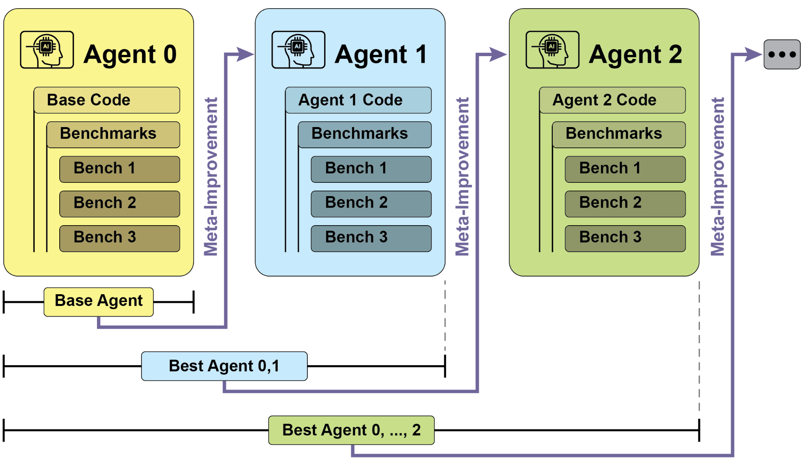
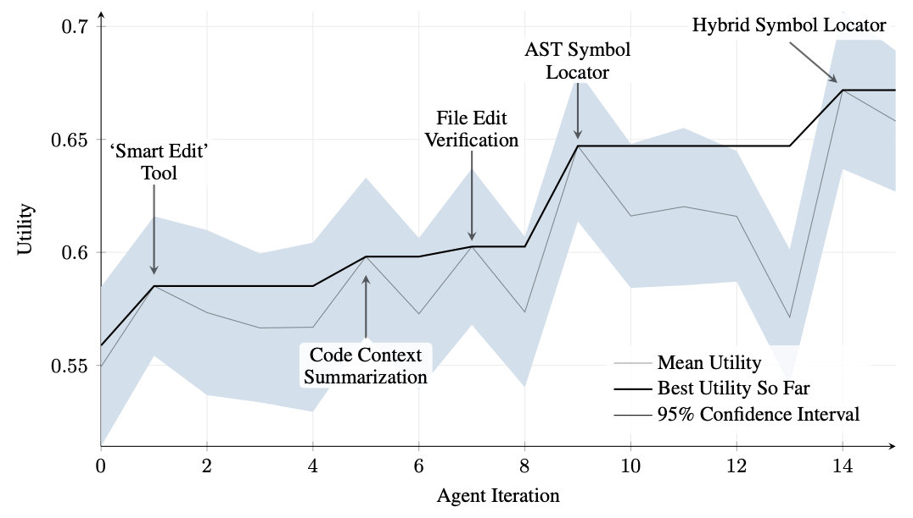
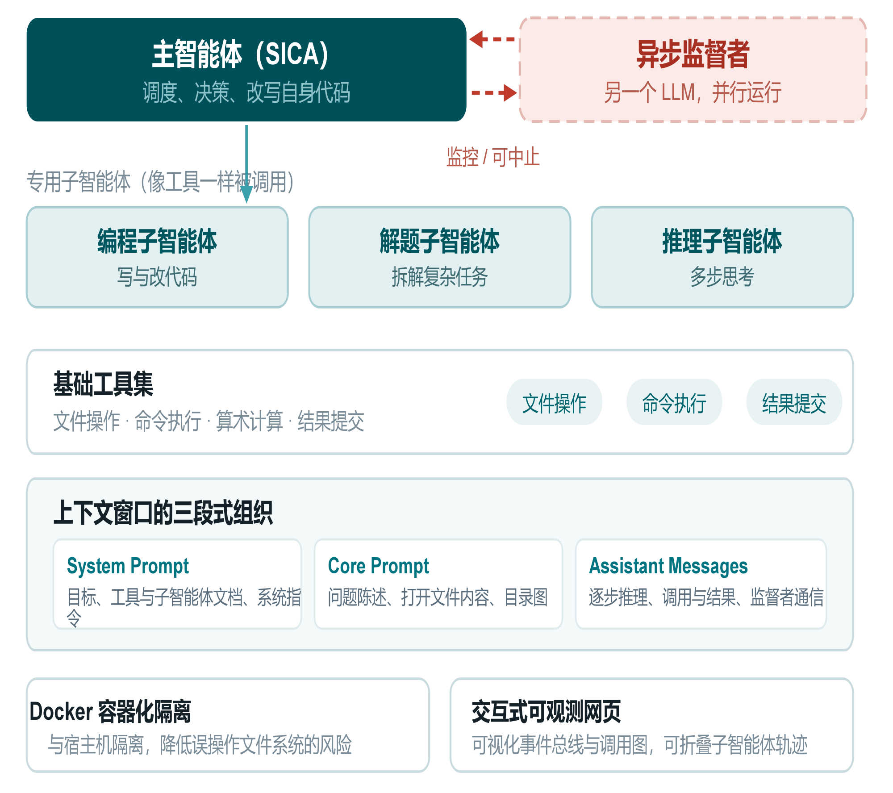
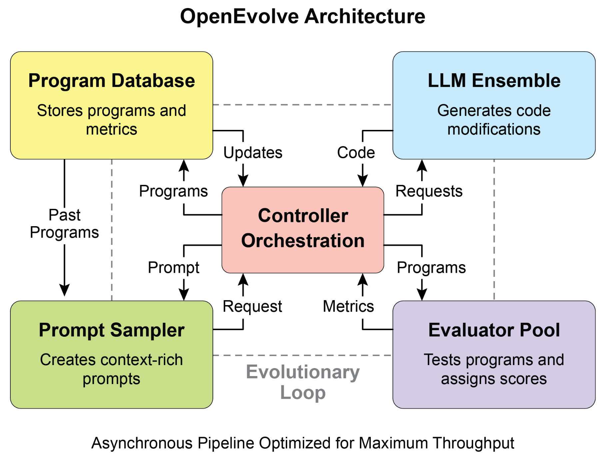
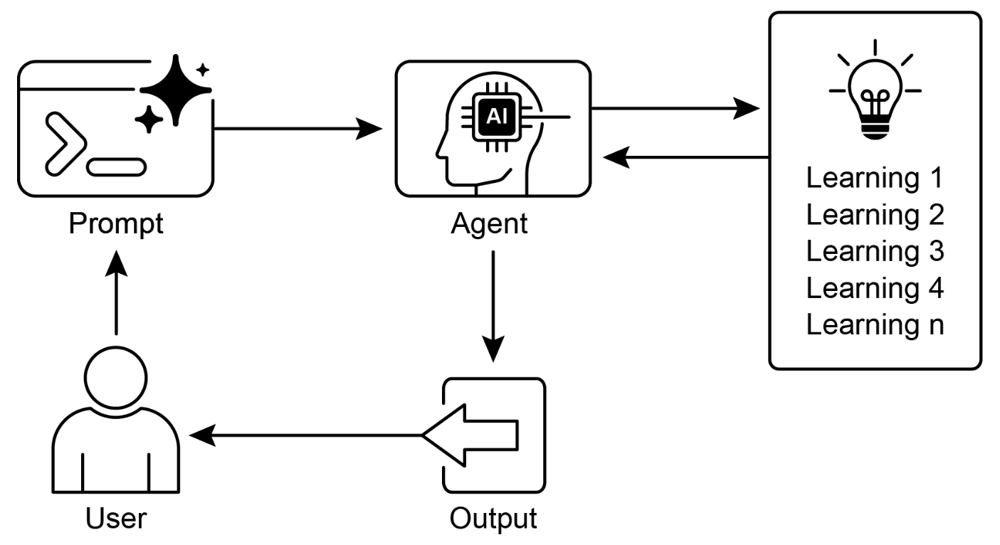

# Learning and Adaptation 学习与适应

> 来源：本目录《第9章-学习与适应.pptx》，共 33 页，华中师范大学《高级数据库技术》第九组汇报，2026 年 10 月。
> 本文按主题整理课件文字、图表与代码，并保留主要原图。案例指标均为课件转述的研究结果，本次未重新复现实验；示例代码按课件整理，未执行。

## 1. 为什么智能体需要学习与适应

预编程逻辑只能覆盖设计阶段预想过的情况。当环境持续变化时，固定规则可能失效，系统也无法仅靠原有逻辑自行恢复。

课件归纳了三种典型变化：

| 变化类型 | 含义 | 对智能体的影响 |
| --- | --- | --- |
| 需求漂移 | 业务规则随时间改变 | 原有决策逻辑不再符合需求 |
| 分布变化 | 输入数据的统计特征与训练期不同 | 原有预测与决策质量可能下降 |
| 全新场景 | 出现未预见的任务类型 | 既有策略缺乏应对方法 |

解决思路是在系统中加入学习机制，利用新数据、交互反馈和历史经验调整知识与行为，使系统能够持续改进。

> 课件第 4 页的“任务表现随环境变化”曲线是概念示意图，不是实测数据。

## 2. 学习与适应的区别

| 概念 | 定义 | 关注点 |
| --- | --- | --- |
| 学习（Learning） | 调整思考方式、行为策略或知识结构的内部过程 | 系统如何改变自身 |
| 适应（Adaptation） | 学习带来的、外部可观察的行为或知识变化 | 改变如何体现在实际任务中 |

学习可以调整模型参数，也可以更新记忆、提示、工具或代码。适应则表现为应对新情境、调整行动方式或改善任务表现。

**本章的“学习”覆盖多个系统层次，不应一概理解为训练大模型权重。**

## 3. 六种学习范式

课件把经典机器学习方法与 LLM 智能体的适应机制放在同一张全景图中。这些类别可以组合，并非彼此排斥。

| 范式 | 学习来源或机制 | 典型用途 |
| --- | --- | --- |
| 强化学习（Reinforcement Learning） | 与环境交互，依据奖励与惩罚调整策略 | 机器人控制、博弈、连续决策 |
| 监督学习（Supervised Learning） | 从标注的输入—输出样本学习映射，减少预测误差 | 邮件分拣、趋势预测、模式识别 |
| 无监督学习（Unsupervised Learning） | 从无标签数据中发现结构、关联与聚类 | 数据探索、环境结构建模 |
| 少样本／零样本（Few-Shot / Zero-Shot） | 借助模型已有能力，通过少量示例或清晰指令适应任务 | 新指令、新任务的即时响应 |
| 在线学习（Online Learning） | 持续接收新数据并进行增量更新 | 数据流处理、实时反应、滚动决策 |
| 基于记忆的学习（Memory-Based Learning） | 召回相似情境的历史经验，调整当前判断和行动 | 个性化交互、经验复用、情境感知 |

### 3.1 经典三范式：学习信号不同

- **强化学习**：将奖励信号转化为策略改进，依赖试错与探索。
- **监督学习**：将标注信号转化为输入到输出的映射。
- **无监督学习**：利用数据自身的结构发现模式。

### 3.2 LLM 场景中的三条路径

- **少样本／零样本适应**：可将部分任务定制从训练层转移到提示层。一次提示带来的行为变化通常不意味着模型参数被持久更新。
- **在线学习**：强调随新数据增量更新。课件以“不需要停机重训”描述其目标，但实际能否在线部署仍取决于系统实现。
- **基于记忆的学习**：把历史经验变成当前决策依据，与第 8 章记忆管理直接关联。保存经验后，还需要在适当时机召回并使用。

### 3.3 范式、算法与系统三个层次

| 层次 | 回答的问题 | 设计重点 |
| --- | --- | --- |
| 范式 | 从什么信号学？ | 奖励、标注、数据结构、指令或历史经验 |
| 算法 | 如何完成稳定有效的更新？ | 目标函数、更新约束及优化方法 |
| 系统 | 在什么载体上改进？ | 模型权重、提示、记忆、工具或程序代码 |

## 4. PPO：近端策略优化

PPO（Proximal Policy Optimization）通过控制策略更新幅度，降低一次大幅更新破坏既有表现的风险。

### 4.1 基本流程

1. **收集交互轨迹**：用当前策略与环境交互，获取状态、动作和奖励。
2. **评估更新方向**：估计动作带来的收益，构造策略优化目标。
3. **使用裁剪目标更新**：限制部分过大概率比变化继续带来的优化激励，鼓励相对谨慎的更新。

课件以控制机器人关节和游戏角色为例介绍 PPO。PPO 并不限于连续动作空间，在后文的大模型偏好对齐中也会使用。

### 4.2 裁剪机制的直观理解

课件通过新旧策略对同一动作的概率比解释裁剪，围绕 1 设置区间：

```text
[1 − ε, 1 + ε]
```

第 12 页以 `ε = 0.2` 为例，并提到 `0.1–0.2` 的取值范围。较小的 ε 通常意味着更保守的裁剪设置。

课件用“安全阀”和“信任域”帮助理解：当某些更新超出范围时，不再因继续扩大该方向的概率比获得额外目标收益。

> **表述边界**：PPO 的裁剪目标不是把整个新策略硬性限制在区间内，也不保证每次更新都不退化。“信任域”和“安全阀”在这里是直观类比，不能理解为严格的安全保证。

## 5. DPO：直接偏好优化

DPO（Direct Preference Optimization）直接利用偏好比较数据更新策略，省去单独训练并在优化环中调用奖励模型的步骤。

### 5.1 传统基于 PPO 的偏好对齐流程

课件介绍的流程为：

1. 收集人类偏好数据，例如同一问题下“回答 A 优于回答 B”。
2. 训练奖励模型，学习给回复打分。
3. 用 PPO 更新语言模型，使其倾向于生成奖励模型评分较高的回复。

奖励模型充当代理评判者。一个风险是模型找到评分器的漏洞，让实际质量不佳的回复也得到高分。

### 5.2 DPO 的流程

DPO 根据偏好数据与策略之间的关系直接优化，使模型更倾向于被偏好的回复，减少独立奖励模型带来的训练和调用复杂度。

偏好数据的质量、偏差与覆盖范围，会直接影响对齐结果。流程简化不意味着数据问题自动消失，也不意味着在所有任务上优于 PPO。

### 5.3 PPO 与 DPO 对比

| 维度 | 基于 PPO 的偏好对齐 | DPO |
| --- | --- | --- |
| 偏好数据的用法 | 先训练奖励模型，再据其评分优化策略 | 直接用于偏好优化目标 |
| 独立奖励模型 | 课件所述 RLHF 路径需要 | 不需要单独训练的奖励模型 |
| 更新机制 | 强化学习策略更新，使用裁剪等机制 | 直接优化偏好关系 |
| 工程复杂度 | 包含奖励建模与策略优化等环节 | 省去独立奖励模型及其在环调用 |
| 主要风险 | 奖励模型误差、奖励投机、训练不稳定 | 偏好数据质量不足、偏差及覆盖不足 |
| 选择依据 | 是否需要环境交互与奖励优化，以及工程资源 | 是否有合适的偏好数据及简化训练的需求 |

> 课件中的“PPO 需要奖励模型”特指该大模型偏好对齐流程。一般强化学习中的 PPO 可以直接使用环境奖励，并非算法本身必须额外训练奖励模型。

## 6. 三个自改进系统概览

| 系统 | 改进对象 | 关键机制 | 课件中的代表内容 |
| --- | --- | --- | --- |
| SICA | 智能体自身源代码 | 回顾历史版本，按表现选择起点，改写代码并重新评估 | Smart Editor、AST Symbol Locator |
| AlphaEvolve | 算法与程序 | LLM 生成候选，自动评估，结合进化搜索迭代 | 数据中心调度、计算内核、数学问题 |
| OpenEvolve | 程序代码，可覆盖完整文件 | 控制器协调提示采样、程序数据库、模型与评估器 | 开源框架、多目标优化、分布式评估 |

共同机制是：生成候选，依据可测量反馈评估，保留有价值的结果，再以历史结果指导下一轮搜索。

## 7. SICA：自改进编程智能体

SICA（Self-Improving Coding Agent）既执行修改，也将自身代码作为修改对象。它依靠历史版本和基准评估驱动改进，不要求每轮重新训练基础模型。

### 7.1 四步自改进循环

1. **回顾档案并打分**：综合历史版本的成功率、耗时和计算成本评估效用。
2. **选择最优历史版本**：从已有成果出发，避免每次重新开始。
3. **分析并修改源码**：根据档案发现可改进环节，直接调整自身代码。
4. **重新评估并记录**：运行基准测试，把程序版本与结果写回档案。



图中每轮从历史候选中选择最佳版本作为后续改进起点。新生成的版本不必然更好，历史最优版本因此具有保留价值。

### 7.2 在迭代中形成的工具

#### 代码编辑能力

| 阶段或工具 | 作用 |
| --- | --- |
| 整文件覆盖 | 基础编辑方式，每次重写文件，处理量较大 |
| Smart Editor | 结合上下文完成编辑 |
| Diff-Enhanced Smart Editor | 通过差异进行定向修改 |
| Quick Overwrite Tool | 支持简单改动的快速覆盖 |
| Minimal Diff Output Optimization | 减少输出改动量 |
| Context-Sensitive Diff Minimization | 按上下文缩小差异范围 |
| AST 解析与 SmartEditor Input Normalizer | 辅助结构化编辑并规整输入 |

#### 代码导航能力

| 工具 | 作用 |
| --- | --- |
| AST Symbol Locator | 依据抽象语法树定位符号定义 |
| Hybrid Symbol Locator | 结合快速文本搜索与 AST 校验 |
| Optimized AST Parsing | 缩小解析范围，减少不必要的代码分析 |

AST（Abstract Syntax Tree，抽象语法树）利用程序结构辅助定位和编辑，弥补纯文本搜索的局限。

### 7.3 性能曲线与关键迭代

课件第 21 页给出的历史最佳效用（Utility）约从 `0.56` 提高到 `0.67`：

- 绝对增加约 `0.11`。
- 相对起点提升约 `19.6%`，课件取整为约 `20%`。



| 迭代 | 标注的改进 |
| --- | --- |
| 1 | Smart Edit Tool |
| 5 | Code Context Summarization，代码上下文摘要 |
| 7 | File Edit Verification，文件编辑验证 |
| 9 | AST Symbol Locator |
| 14 | Hybrid Symbol Locator |

读图时需区分：黑色粗线表示截至当前的历史最佳效用，细线表示平均效用，阴影表示 95% 置信区间。历史最佳值持续保留，不代表每个新版本的平均表现都提高。

该指标是图中的 **Utility**，不宜直接写成“准确率从 56% 增至 67%”。

### 7.4 架构与运行支持



- **主智能体**：负责调度、决策和自身代码修改。
- **专用子智能体**：承担编程、问题求解与推理任务，帮助拆分长任务并管理上下文。
- **异步监督者**：另一个并行运行的 LLM，周期性发现循环、停滞或异常路径，必要时通知或终止执行。
- **基础工具**：文件操作、命令执行、算术计算和结果提交。
- **Docker 隔离**：减少误操作宿主环境的风险。
- **可观测界面**：通过事件总线和调用图查看执行过程，并支持折叠子智能体轨迹。

课件将上下文分成三部分：

| 部分 | 内容 |
| --- | --- |
| System Prompt | 目标、工具与子智能体文档、系统指令 |
| Core Prompt | 问题陈述、已打开文件内容、目录图 |
| Assistant Messages | 推理过程、调用及结果、监督者通信 |

这些机制支持迭代的效率、可观察性与纠偏能力，但不能由“存在监督者”推导出系统必然安全。

## 8. AlphaEvolve：算法发现与优化

AlphaEvolve 是课件介绍的 Google 算法发现系统，将大模型组合、自动评估与进化算法结合，用于理论数学和实际计算任务。

### 8.1 迭代过程

1. 使用 Gemini Flash 生成候选，扩大搜索广度和多样性。
2. 使用 Gemini Pro 进行更深入的分析与精炼。
3. 自动评估候选是否满足要求，并计算性能指标。
4. 将评估结果反馈到后续生成与选择过程。

LLM 提供候选程序，自动评估提供选择依据，进化框架管理多轮搜索。

### 8.2 课件列举的成果

第 24 页图表中的三项指标：

| 应用 | 课件报告的收益 |
| --- | --- |
| 数据中心调度 | 全球算力使用下降约 0.7% |
| Gemini 架构的某核心内核 | 提速约 23% |
| FlashAttention 低级 GPU 指令 | 优化约 32.5% |

三项指标对应不同任务和基线，不能直接相加。课件图表未进一步解释第三项“优化”的具体测量口径，这里保留其原意。

基础研究方面，课件还列出：

- 发现一个用于 `4 × 4` 复矩阵乘法的算法，需要 48 次标量乘法。
- 在 50 余个数学问题上，约 75% 复现已知最优解，约 20% 改进既有解。

这些比例描述课件所述问题集合中的结果，不代表解决了对应比例的所有数学开放问题。上述数字为课件转述，未在本次整理中独立核验原始研究。

## 9. OpenEvolve：开源进化编程框架

OpenEvolve 把生成、评估和选择组织为可复用框架。课件介绍其支持完整代码文件的优化、多种编程语言、兼容 OpenAI 接口的模型、多目标优化、灵活提示和分布式评估。

### 9.1 核心组件



| 组件 | 职责 |
| --- | --- |
| Controller Orchestration | 编排各组件及请求流转 |
| Program Database | 保存候选程序及其评估指标 |
| Prompt Sampler | 结合过去程序与上下文构造提示 |
| LLM Ensemble | 生成代码修改或候选程序 |
| Evaluator Pool | 测试程序并返回分数与指标 |

架构图中的原文是 **Prompt Sampler（提示采样器）**。课件部分文字称其为“程序采样器”，此处按图示说明其构造上下文提示的职责。

工作流可以归纳为：从历史程序获取信息，构造提示，请求 LLM 生成修改，评估新程序，保存程序与指标，再继续下一轮。图中还强调异步流水线，以提高吞吐量。

### 9.2 课件代码示例

```python
from openevolve import OpenEvolve

# 初始化：初始程序、评估脚本和配置文件
# 下列路径为课件占位路径，需要替换为实际文件。
evolve = OpenEvolve(
    initial_program_path="path/to/initial_program.py",
    evaluation_file="path/to/evaluator.py",
    config_path="path/to/config.yaml",
)

# 在支持 await 的异步环境中执行
best_program = await evolve.run(iterations=1000)

print("Best program metrics:")
for name, value in best_program.metrics.items():
    print(f"  {name}: {value:.4f}")
```

| 参数或结果 | 含义 |
| --- | --- |
| `initial_program_path` | 搜索的起点程序 |
| `evaluation_file` | 候选程序的评估脚本 |
| `config_path` | 搜索策略及相关运行配置 |
| `iterations=1000` | 本次运行设置的迭代次数 |
| `best_program.metrics` | 返回的最佳程序指标 |

代码按课件修复了换行和缩进，未验证当前版本接口。更多迭代提供更多搜索机会，也增加成本，不保证一定产生更优结果。

## 10. 学习与适应模式



模式包含用户、提示、智能体、学习模块和输出：

1. 用户通过 Prompt 提出任务。
2. Agent 读取已有学习成果并执行任务。
3. Agent 将新经验或反馈交给学习模块，形成后续可利用的成果。
4. 输出返回用户，用户继续提供新任务或反馈。
5. 系统在后续交互中使用累积的信息或改进后的能力。

`Learning 1..n` 表示学习可以经过多轮累积，不要求只采用一种学习方法。改进可以保存在参数、知识、经验、提示、工具或程序版本中。

## 11. 适用条件与实践启示

### 11.1 何时适合使用

- 环境动态、不确定，业务或数据分布持续变化。
- 应用需要个性化，并持续吸收用户反馈。
- 任务存在可测量目标，希望根据运行结果改进策略。
- 需要自主处理设计阶段未覆盖的新情境。

环境稳定、规则明确时，应评估学习机制的数据、计算和工程成本是否值得。无需为了使用该模式而强行增加训练或自修改环节。

### 11.2 本章九条要点

1. 利用历史经验改善任务表现，并应对新情境，是学习与适应的核心目标。
2. 学习描述内部更新过程，适应描述可观察的变化。
3. SICA 根据历史评估修改自身代码，展示了系统层面的改进路径。
4. 编辑和导航工具可以在自改进迭代中逐步形成。
5. 子智能体帮助拆分任务，监督者帮助发现偏离与停滞。
6. 上下文组织影响每轮执行的效率、时延和成本。
7. 动态环境、持续改进和个性化需求，是采用此模式的主要动机。
8. 工程实现需要管理数据流、评估流程及相关工具链。
9. 自主代码修改可以产生可测量的改进，但具体研究结果不保证所有系统都能稳定进步。

### 11.3 与前一章的联系

第 8 章关注如何保存、检索和使用历史信息，本章进一步关注如何利用这些信息调整行为与能力。

记忆是学习的一个基础：历史经验只有被取回并影响决策、策略、规则或代码，才能在后续任务中体现为适应。记忆增加、模型参数更新和代码自改进，应分别说明，避免混用。

## 12. 开放讨论

课件提出三个尚待讨论的问题：

1. **谁来监督监督者？** 当异步监督者也是可能出错的 LLM，自改进系统的边界与终止权如何设计？
2. **能否借鉴数据库自治运维？** 两者都具有观测、决策、调整的反馈循环，也面临连续决策和状态漂移问题。
3. **能否用于查询优化？** 让智能体依据真实代价反馈优化执行计划或索引选择时，主要瓶颈会是代价模型准确性，还是候选搜索空间过大？

这些内容是课件的研究问题，不是已经得到验证的实现结论。

## 13. 课件页码索引

| PPT 实际页码 | 内容 |
| --- | --- |
| 1–3 | 封面、目录与问题导入 |
| 4–5 | 预编程逻辑边界，学习与适应定义 |
| 6–10 | 六种学习范式，范式／算法／系统三个层次 |
| 11–15 | PPO、裁剪机制、DPO 与对齐路径比较 |
| 16–17 | 三个自改进系统概览 |
| 18–22 | SICA 循环、工具、性能和架构 |
| 23–24 | AlphaEvolve 机制与成果 |
| 25–26 | OpenEvolve 架构与代码 |
| 27–30 | 模式提炼、适用条件与要点 |
| 31 | 开放讨论 |
| 32–33 | 小组分工、参考文献与结束页 |

## 14. 课件列出的参考文献

以下按 PPT 整理，未额外补充外部资料：

1. Sutton & Barto (2018). *Reinforcement Learning: An Introduction*. MIT Press.
2. Goodfellow, Bengio & Courville (2016). *Deep Learning*. MIT Press.
3. Mitchell (1997). *Machine Learning*. McGraw-Hill.
4. Schulman et al. *Proximal Policy Optimization Algorithms*. arXiv:1707.06347.
5. Robeyns, Aitchison & Szummer (2025). *A Self-Improving Coding Agent*. arXiv:2504.15228v2.
6. *AlphaEvolve: a Gemini-powered coding agent for designing advanced algorithms*. Google DeepMind Blog.
7. OpenEvolve，项目地址：`github.com/codelion/openevolve`。

原始课件：[[第9章-学习与适应.pptx]]
